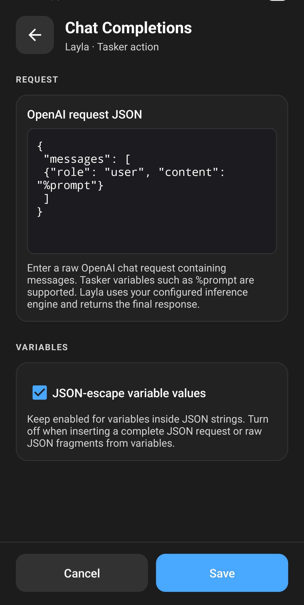

LaylaにはTaskerプラグインが含まれており、Androidの自動化に端末内AIを追加できます。Taskerのタスクから、ローカルLLMへのプロンプト送信、画像・音声・音楽の生成、チャット履歴の読み書き、メモリの保存、キャラクターからのメッセージの予約ができます。端末内のモデルを使う場合、これらの処理でオンラインサービスにデータが送信されることはありません。

## Taskerとは

TaskerはAndroid向けの人気の自動化アプリです。端末上で条件が満たされたときに実行されるタスクを作成できます。たとえば、新しいメールが届いたときにLaylaに要約してもらったり、1時間後にキャラクターからリマインダーを送ってもらったりできます。

Laylaはモデルをローカルで実行するため、これらの自動化はインターネット接続なしで、リクエストごとの料金もかからずに動作します。Laylaはデフォルトに設定した推論エンジンを使うので、チャットと同じ設定でタスクが動きます。

*注：Taskerは別のアプリで、[Google Play](https://play.google.com/store/apps/details?id=net.dinglisch.android.taskerm&hl=ja)での購入が必要です。LaylaはTaskerとは提携していません。*

Taskerとの連携はAndroidでのみ利用できます。

## LaylaとTaskerで何を自動化できますか？

Taskerのどのトリガーからでも、Laylaのアクションを開始でき、その結果をタスク内の次のアクションに渡せます。いくつか例を挙げます。

- **通知やメールを要約する。** 新しい通知のテキストを**Ask Layla**に渡し、ローカルLLMに1文の要約を書かせます。
- **メッセージを読み上げる。** 受信したテキストを**Speak Text**に送り、選んだ声でLaylaに読み上げさせます。
- **メッセージのトーンを確認する。** **Analyze Sentiment**でテキストを分析し、最も強い感情に応じてタスクを分岐させます。
- **トリガーで画像や音楽を生成する。** 時刻やカレンダーの予定などのTasker変数から組み立てた説明を使って、**Generate Image**や**Generate Music**を実行します。
- **キャラクターからのリマインダーを予約する。** **Schedule Character Message**で、指定した時刻にキャラクターからメッセージを送らせます。
- **メモをメモリとして保存する。** **Remember Text**で、キャラクターの長期メモリにテキストを保存します。

## ステップごとの手順：最初のLaylaタスクを作る

この手順では、Laylaにメッセージを送り、返信を画面に表示するTaskerタスクを作成します。一度作成すれば、ほかのLaylaアクションも同じ方法で追加できます。

### ステップ1：タスクを作成してアクションを追加する

Taskerを開き、新しいタスクを作成して、**+**をタップしてアクションを追加します。Taskerからアクションのカテゴリを選ぶよう求められるので、**Plugin**を選びます。


### ステップ2：Laylaを選ぶ

Taskerに、プラグインアクションを提供するアプリが一覧表示されます。**Layla**をタップします。


Laylaが表示されない場合は、同じ端末にLaylaがインストールされていて、最新の状態であることを確認してください。

### ステップ3：アクションを選ぶ

LaylaのTaskerアクションがすべて表示されます。この手順では**Chat Completions**を選びます。各アクションの内容は、下の[利用できるアクション](#利用できるアクション)をご覧ください。


この一覧では、Taskerがアクション名から「Layla」を省略することがあり、**Ask Layla**が**Ask**と表示される場合があります。

### ステップ4：設定を開く

アクションのページで、**Configuration**の横にある鉛筆アイコンをタップします。アクションを設定するためのLayla独自の画面が開きます。


### ステップ5：リクエストを入力して保存する

Laylaに送りたいメッセージを入力します。例：

```
{"messages":[{"role":"user","content":"Hello, how are you?"}]}
```

テキストの代わりに、`%prompt`のようなTasker変数を使うこともできます。変数に含まれる引用符や改行が問題を起こさないよう、**JSON-escape variable values**はオンのままにしてください。続いて**Save**をタップしてTaskerに戻ります。



タイムアウトはデフォルトで**None**に設定されています。これにより、Laylaは応答に必要なだけ時間をかけられます。

### ステップ6：結果を表示する

Laylaは返信を変数`%layla_text`で返します。表示するには、Chat Completionsの後に別のアクションを追加します。**Alert**カテゴリから**Popup**を選び、**Text**に`%layla_text`を入力します。


### ステップ7：タスクを実行する

タスク画面の下部にある再生ボタンをタップします。Laylaが返信を生成し、Taskerがポップアップに表示します。


Laylaがモデルを読み込む必要があるため、初回の実行には時間がかかることがあります。

## 変数と出力を使う

Laylaアクションのテキスト欄はすべてTasker変数に対応しているので、あるアクションの出力を次のアクションに渡せます。たとえば、通知のテキストを変数に設定し、それを**Ask Layla**のプロンプトとして使えます。

各アクションは結果をTasker変数として返し、上の手順のポップアップのように、後続のどのアクションでも使えます。Laylaアクションは、Laylaが起動していない場合にバックグラウンドで起動するため、先にアプリを開く必要はありません。

## 利用できるアクション

### チャットとテキスト

| アクション | 内容 |
| --- | --- |
| **Ask Layla** | プロンプトを（任意のシステム指示とともに）Laylaに送り、返信を返します。各リクエストは独立しており、チャット履歴の読み取りや変更は行いません。 |
| **Analyze Sentiment** | テキストに含まれる感情を分析します。 |
| **Chat Completions** | 複数のメッセージを含む完全なチャットリクエストを受け付ける上級者向けのアクションです。会話全体を自分で指定したい場合に使います。 |

TaskerからLLMのプロンプトを実行したい場合は、Ask LaylaとChat Completionsを使います。これらはLaylaでデフォルトに設定した推論エンジンを使うため、端末内のローカルモデルをTasker側で追加設定せずに利用できます。

**Ask Layla**が返す値：

- `%layla_text`：Laylaの返信。

**Analyze Sentiment**が返す値：

- `%layla_emotion`：テキストから見つかった最も強い感情。
- `%layla_emotion_score`：その感情のスコア（0〜1）。
- 個々の感情ごとのスコア（`%layla_sentiment_joy`や`%layla_sentiment_sadness`など）。

### 音声、画像、音楽

これらのアクションにより、AI音声合成、画像生成、音楽生成をTaskerで利用できます。アクションが使うモデルの設定については、[Laylaで画像生成を有効にする方法](/ja/how-to-enable-image-generation-in-layla/)、[Laylaでキャラクターの声を聞く方法](/ja/how-to-hear-your-characters-speak-in-layla/)、[LaylaでACE-Stepを使ってオフラインで音楽を生成する方法](/ja/how-to-generate-music-offline-in-layla-with-ace-step/)をご覧ください。

| アクション | 内容 |
| --- | --- |
| **Speak Text** | Laylaの声でテキストを読み上げ、読み上げが終わるまで待機します。声を空欄にすると、デフォルトの声を使います。 |
| **Generate Speech File** | テキストを再生せずに音声ファイルに変換します。声の指定は任意です。 |
| **Generate Image** | プロンプトから画像を生成します。画像モデルの指定は任意で、空欄にするとデフォルトのモデルを使います。 |
| **Generate Music** | スタイルの説明から楽曲を生成します。歌詞、秒数での長さ、音楽モデルの指定は任意です。 |

生成された画像と音声は、Taskerが読み取れるファイルとして返されます。

- 画像：`%layla_image_uri`、`%layla_image_mime`、`%layla_image_name`。
- 音声と音楽：`%layla_audio_uri`、`%layla_audio_mime`、`%layla_audio_name`。

これらのファイルはLaylaのキャッシュに保存されます。Laylaのキャッシュを消去するか、Androidが削除するまで残るため、恒久的に保存するにはTaskerの**Copy File**アクションを使ってください。自動的に再生されることはありません。

音声ファイルの生成には、音声ファイルを作成できる音声合成の声が必要です。音楽の生成には、Laylaで音楽生成モデルが設定されている必要があります。

### キャラクター、チャット、メモリ

| アクション | 内容 |
| --- | --- |
| **List Characters** | キャラクターの名前とIDを返します。 |
| **List Chat Sessions** | キャラクターのチャットを、それぞれの最新メッセージとともに返します。 |
| **Get Chat History** | チャットのメッセージを返します。返す件数とスキップする件数を指定できます。 |
| **Save Chat Message** | あなたまたはキャラクターのメッセージをチャットに追加します。返信は生成されません。 |
| **Remember Text** | キャラクターに新しいメモリを追加します。長期メモリモデルのダウンロードが必要です。 |
| **Get Memories** | キャラクターの最新のメモリ、または上位のメモリを返します。 |
| **List Voices** | 利用できる声の名前とIDを返します。 |

一覧系のアクションは、結果を対応する配列として返します。名前の1番目の要素はIDの1番目の要素に対応し、以降も同様です。

- List Characters：`%layla_character_ids()`と`%layla_character_names()`。
- List Chat Sessions：`%layla_session_ids()`と`%layla_last_messages()`。
- List Voices：`%layla_voice_ids()`と`%layla_voice_names()`。

これらのアクションが返すIDを、ほかのアクションで使います。たとえば、**List Characters**でキャラクターのIDを調べ、それを**Remember Text**や**Get Memories**に渡します。

そのほかの出力：

- Get Chat History：`%layla_text`は古いものから新しいものの順に並んだ、読みやすい文字起こしです。
- Get Memories：`%layla_memory_ids()`と`%layla_memory_texts()`。
- Remember Text：`%layla_memory_id`と`%layla_session_id`。
- Save Chat Message：`%layla_message_id`と`%layla_session_id`。

知っておくべきこと：

- **Save Chat Message**であなたのメッセージを追加するには、既存のチャットが必要です。新しいチャットを始めるには、新しいセッションIDを指定し、先にキャラクターのメッセージを保存してください。
- **Get Memories**は最新のメモリまたは上位のメモリを返します。テキストによるメモリの検索は行いません。
- **Remember Text**は、要約欄を空にしておくと、メモリの要約を自動で作成できます。
- **Get Memories**のタイムスタンプはUnixミリ秒です。Tasker変数`%TIMEMS`で、この形式の現在時刻を取得できます。

### 予約されたキャラクターメッセージ

| アクション | 内容 |
| --- | --- |
| **Schedule Character Message** | キャラクターからのメッセージを、将来の指定時刻に配信するよう予約します。 |
| **List Scheduled Character Messages** | 予約済みおよび未読のキャラクターメッセージを、Tasker以外で作成されたものも含めてすべて一覧表示します。 |
| **Cancel Scheduled Character Message** | IDを指定して、予約済みのメッセージをキャンセルします。 |

予約すると、指定したテキストがそのまま指定した時刻に配信されます。配信時にLaylaが新しい返信を書くことはありません。予約したメッセージを配信するには、Laylaに通知の権限が必要です。

配信時刻はミリ秒単位のUnixタイムスタンプです。Taskerでは、**Variable Set**と**Do Maths**で計算できます。たとえば`%TIMEMS + 60000`は1分後です。その変数を配信時刻として渡します。

**Schedule Character Message**は`%layla_scheduled_id`を返します。これを使って、後でメッセージをキャンセルできます。キャンセルすると、まだ配信されていないメッセージが削除されます。すでに表示された通知は消えません。

### 上級者向け

| アクション | 内容 |
| --- | --- |
| **Get Execution Context** | 端末にインストールされているLaylaのバージョンを`%layla_app_version`で返します。TaskerからLaylaに接続できるかを確認するのに便利です。 |
| **Raw Layla API Request** | 開発者向けに、Laylaへリクエストを直接送信します。利用できる内容は[Layla SDK](https://github.com/l3utterfly/layla-sdk)をご覧ください。 |

## エラーとタイムアウトへの対処

アクションが失敗すると、Taskerは`%err`と`%errmsg`を設定します。タスクを続行してメッセージを読み取りたい場合は、そのアクションで**Continue Task After Error**をオンにしてください。

Laylaのアクションは処理が終わるまで待機します。画像や音楽の生成ではしばらくかかることがあります。新しいアクションは、デフォルトでTaskerのタイムアウトが**None**、つまり時間制限なしです。代わりに時間制限を設定した場合、Laylaはそれに従います。

## 例：通知に応答する

1. AutoNotificationなどのTaskerプラグインを使って、受信した通知のテキストを変数（例：`%ntext`）に取り込みます。
2. **Ask Layla**を追加し、プロンプトに`Summarise this notification in one sentence: %ntext`を指定します。
3. 要約を画面に表示するにはTaskerの**Flash**アクションに`%layla_text`を指定し、Laylaに読み上げさせるには**Speak Text**を追加します。

## ヒント

- Androidのバックグラウンド制限は引き続き適用されます。端末がアイドル状態のときにアクションが失敗する場合は、バッテリーの最適化でLaylaが制限されていないか確認してください。
- アクションに必要なモデル（画像モデル、音楽モデル、長期メモリモデルなど）を、先にLaylaでダウンロードしておいてください。
- 変数には引用符、改行、その他の特殊文字を含めることができます。標準のフィールドでは、Laylaが自動的に処理します。

## よくある質問

### インターネット接続なしでTaskerからLLMを使えますか？

はい。Laylaのデフォルトの推論エンジンが端末にダウンロードしたモデルであれば、**Ask Layla**などのTaskerアクションは端末内だけで実行されます。クラウドまたはリモートのエンジンをデフォルトに設定している場合は、リクエストはそのエンジンを経由します。

### LaylaをTaskerで使うのにAPIキーは必要ですか？

いいえ。LaylaのTaskerアクションはAPIキーを要求しません。Laylaにすでに設定されている推論エンジンを使います。

### Taskerアクションを実行するのにLaylaを開いておく必要はありますか？

いいえ。アクションの実行時に、Laylaはバックグラウンドで起動します。Androidのバックグラウンド制限は引き続き適用されるため、端末がアイドル状態のときにアクションが失敗する場合は、Laylaのバッテリー設定を確認してください。

### TaskerからLaylaで画像を生成できますか？

はい。プロンプトと、必要に応じて画像モデルを指定して、**Generate Image**アクションを使います。Taskerは画像をファイルとして受け取り、コピーや共有、後続のアクションでの利用ができます。先にモデルを設定するには、[Laylaで画像生成を有効にする方法](/ja/how-to-enable-image-generation-in-layla/)をご覧ください。

### TaskerからLaylaに話させたり、音楽を作らせたりできますか？

はい。**Speak Text**はLaylaの声で読み上げ、**Generate Speech File**は音声を音声ファイルとして保存し、**Generate Music**は説明と任意の歌詞から楽曲を作成します。

### 生成された画像や音声ファイルはどこに保存されますか？

Laylaのキャッシュに保存され、キャッシュを消去するかAndroidが削除するまで残ります。恒久的に保存するには、Taskerの**Copy File**アクションを使ってください。
