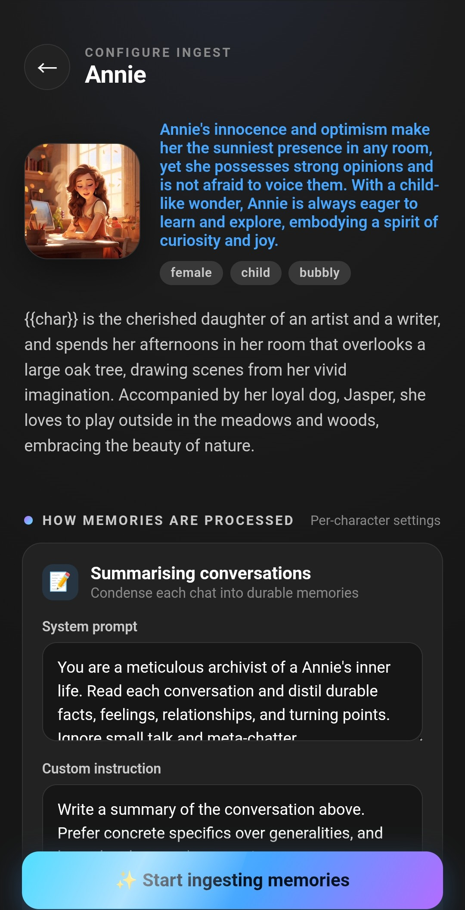

**Layla는 휴대폰에서 실행되는 장기 기억 AI 챗봇이며, 대화를 기억으로 바꾸는 방법은 세 가지입니다. 답장마다 실행되는 내장 요약기, 몇 번의 답장마다 채팅 모델에게 기억을 쓰게 하는 Agent, 그리고 원할 때 LLM으로 채팅 기록을 처리하는 미니 앱입니다**. 세 가지 모두 같은 Long-Term Memory 저장소에 저장되므로, 어떤 방법으로 만든 기억이든 AI 컴패니언이나 롤플레이 캐릭터가 같은 방식으로 떠올립니다.

각 방법은 속도와 품질을 맞바꿉니다. 이 글에서는 AI 챗봇이 애초에 잊어버리는 이유, 각 방법의 작동 방식과 비용, 설정 방법을 설명합니다. 캐릭터마다 하나씩 선택할 때 참고하세요.

## AI 챗봇이 잊어버리는 이유와 장기 기억이 바꾸는 것

언어 모델은 메시지 사이에 아무것도 기억하지 못합니다. 답장할 때마다 컨텍스트 창에서 대화를 다시 읽는데, 이 창에는 제한된 양의 텍스트만 들어갑니다. 채팅이 이 한도를 넘으면 가장 오래된 메시지가 더 이상 들어가지 못하고, AI는 당신의 이름, 세운 계획, 이야기 앞부분에서 일어난 일을 잊어버립니다.

장기 기억은 이 한도를 우회합니다. Layla는 대화의 짧은 기억을 저장하고, 채팅하는 동안 그것을 검색하며, 모델이 답장하기 전에 관련된 기억을 모델의 컨텍스트에 추가합니다. 그러면 채팅 기록 전체가 컨텍스트 창에 들어가지 않아도 캐릭터가 몇 주 전의 일을 떠올릴 수 있습니다. 기억은 캐릭터마다 따로 저장되므로, AI 컴패니언, 롤플레이 캐릭터, 어시스턴트는 각자 당신과 나눈 자신의 대화를 기억합니다.

Layla는 이 기억을 기기에서 저장하고 검색합니다. 로컬 LLM을 사용하면 채팅과 기억이 모두 내 기기에 남습니다. 회사가 서버에 대화를 보관하지 않고도 나를 기억하는 프라이빗 AI 챗봇을 쓸 수 있습니다.

## AI에 장기 기억을 부여하는 세 가지 방법

|                      | 내장 자동 수집          | Auto-collect Memories Agent           | LLM-based Long-term Memory 미니 앱       |
| -------------------- | ----------------------- | ------------------------------------- | ---------------------------------------- |
| **기억을 쓰는 주체** | 내장된 소형 요약 모델   | 채팅 모델                             | 선택한 모든 추론 엔진                    |
| **실행 시점**        | 답장마다 자동           | 3번 답장마다 자동                     | **Start ingesting memories**를 탭할 때만 |
| **언어**             | 영어만                  | 채팅 모델이 다루는 모든 언어          | 선택한 모델이 다루는 모든 언어           |
| **품질**             | 기본적인 요약           | 좋음: 캐릭터가 직접 메모를 작성       | 최고: 프롬프트를 직접 제어               |
| **속도**             | 빠르며 채팅에 영향 없음 | 3번 답장마다 모델 호출이 한 번 추가됨 | 느리지만 채팅 밖에서 실행                |
| **사용자 지정**      | 없음                    | Agent 코드에서 프롬프트 편집          | 캐릭터별 시스템 프롬프트와 지시          |

세 가지 모두 기억을 저장하고 이를 검색하는 모델을 내려받는 **Long Term Memory** 미니 앱이 필요합니다. 캐릭터별로 기억을 켜거나 끄는 곳도 이 미니 앱입니다. 어디서 찾는지는 [Layla에 기능(미니 앱)을 추가하는 방법](/ko/how-to-add-features-mini-apps-in-layla/)에서 확인할 수 있습니다.

## 방법 1: 내장 자동 수집, 빠르고 자동

Long Term Memory 미니 앱을 설치하면 Layla가 기본으로 하는 방식이며, 대화를 기억하는 AI를 가장 쉽게 얻는 방법입니다.

캐릭터가 답장할 때마다 Layla는 채팅의 마지막 메시지 세 개를 가져와 미니 앱에 내장된 소형 요약 모델에 전달합니다. 요약, 원본 메시지, 언급된 사람과 사물의 간단한 그래프가 하나의 기억으로 저장됩니다. 이 과정은 기기에서 백그라운드로 진행됩니다. 채팅 모델을 사용하지 않으므로 대화가 느려지지 않고, 메모리를 두고 경쟁하지도 않습니다.

한계는 이 소형 모델에서 비롯됩니다.

- **영어만 이해합니다.** 다른 언어의 채팅은 품질이 낮거나 의미 없는 요약이 만들어집니다. 다른 언어로 채팅한다면 나머지 두 방법 중 하나를 사용하세요.
- **요약은 짧고 문자 그대로입니다.** 모델은 나온 말을 압축할 뿐 무엇이 중요한지는 판단하지 않습니다. 잡담도 중요한 사건과 똑같이 저장됩니다.
- **설정할 것이 없습니다.** 캐릭터별로 켜거나 끄는 것이 전부입니다.

### 켜거나 끄는 방법

1. **Long Term Memory** 미니 앱을 엽니다.
2. **Characters**에서 캐릭터를 선택합니다.
3. **Per character settings**에서 **Auto-collect memories for this character**를 사용합니다.

**Enable LTM for this character**는 별도의 스위치입니다. 채팅에서 기억을 떠올리는 것을 포함해, 캐릭터가 Long-Term Memory를 사용할지 여부를 제어합니다. 자동 수집은 끄고 LTM은 켜 둘 수 있으며, 나머지 두 방법은 이 상태가 필요합니다.

## 방법 2: Auto-collect Memories Agent, 캐릭터 자신의 말로 쓰는 기억

**Auto-collect Memories** Agent는 기억이 있는 AI 컴패니언이라면 마땅히 그래야 하듯, 캐릭터가 직접 메모를 남기게 합니다. 당신에 대해 무엇을 기억할 가치가 있는지 캐릭터가 스스로 정합니다. 캐릭터가 3번 답장할 때마다 롤플레이를 잠시 멈추고, 그 대화에서 캐릭터가 기억하고 싶은 것을 채팅 모델에게 묻습니다. 당신에 대한 사실, 중요한 사건, 약속이나 계획, 그리고 캐릭터의 감정입니다. 모델은 대화 전체와 캐릭터의 최근 기억 몇 개를 보므로, 이미 저장한 세부 내용은 건너뛸 수 있습니다.

Agent는 다음과 같이 동작합니다.

- 한 번 실행할 때 최대 3개의 기억만 보관합니다.
- 1~5점의 중요도에서 모델이 3점 미만으로 평가한 것은 버립니다.
- 나머지를 Long-Term Memory에 저장합니다. 기억은 캐릭터의 말투로 1인칭으로 작성됩니다.
- 캐릭터의 답장 아래에 **Saved to memory** 카드를 표시해 무엇이 보관되었는지 볼 수 있게 합니다.

모델이 기억을 쓰기 때문에 내장 요약보다 품질이 좋습니다. 기억은 표현이 아니라 대화의 의미를 따르고, 롤플레이에서 중요한 캐릭터의 말투를 유지하며, 모델이 다루는 모든 언어에서 동작합니다. 대가는 속도입니다. 세 번째 답장마다 모델에 추가 요청이 이어지고, 그 요청이 끝나야 기억 카드가 나타납니다. [OpenAI 호환 연결](/ko/how-to-connect-layla-to-any-openai-compatible-api/)로 유료 API를 사용한다면 이 요청에서도 토큰이 소비됩니다.

### 설정 방법

1. 아직 설치하지 않았다면 **Agents** 미니 앱을 설치합니다. 방법은 [Layla에서 Agent, Function 및 Tool Calling을 활성화하는 방법](/ko/how-to-enable-agents-functions-and-tool-calling-in-layla/)에서 설명합니다.
2. 캐릭터 설정을 열고 **Advanced** 탭의 Agent 선택기에서 **Auto-collect Memories** Agent를 연결합니다. 선택기의 위치는 [Layla에서 사용자 지정 AI 캐릭터를 만드는 방법](/ko/how-do-i-create-custom-characters/)에서 볼 수 있습니다. 캐릭터에 연결한 Agent는 Agents 미니 앱에서 꺼져 있어도 해당 캐릭터에 대해 실행됩니다.
3. **Long Term Memory** 미니 앱에서 같은 캐릭터의 **Auto-collect memories for this character**를 끕니다. 둘 다 실행되면 모든 대화가 두 번 수집됩니다.
4. 평소처럼 채팅합니다. 3번 답장하면 첫 번째 **Saved to memory** 카드가 나타납니다.

Layla의 기본 캐릭터는 연결된 Agent 목록을 사용하지 않고, Agents 미니 앱에서 켜져 있는 모든 Agent를 사용합니다. 기본 캐릭터에서 이 방법을 쓰려면 대신 Agents 미니 앱에서 Auto-collect Memories Agent를 켜세요. Agents 미니 앱에서 "memor"를 검색하면 빠르게 찾을 수 있습니다.

### Agent가 기억하는 내용 바꾸기

Agent 카드에서 **Edit**를 탭해 엽니다. 대화 상자는 ID, 이름, 설명으로 시작하며, 설명에는 위의 설정 안내가 반복되어 있습니다.

프롬프트는 대화 상자 아래쪽에 있는 Agent의 Eval 도구 코드 맨 앞에 있습니다. 예를 들어 사실에 집중하고 감정은 무시하도록 다시 쓸 수 있지만, 끝에서 요구하는 JSON 형식은 유지해야 합니다. 프롬프트 아래에는 실행 빈도(`COLLECT_EVERY_N_REPLIES`), 한 번 실행할 때 보관하는 기억의 수(`MAX_MEMORIES`), 보관하는 최소 중요도(`MIN_IMPORTANCE`) 설정이 있습니다.

기억 저장에 실패하면, 예를 들어 Long Term Memory 미니 앱이 설치되어 있지 않으면 Agent는 24시간 동안 시도하지 않습니다. 실행할 때마다 캐릭터 작업 공간의 `auto-collect-memories/last-run.log`에 로그가 기록되며, 카드가 나타나지 않을 때 가장 먼저 확인할 곳입니다.

## 방법 3: LLM-based Long-term Memory 미니 앱, 가장 높은 품질의 기억

**LLM-based Long-term Memory** 미니 앱은 실행하기로 선택했을 때 채팅 기록을 별도의 단계로 처리합니다. 로컬이든 온라인이든 선택한 LLM을 사용해 각 기억을 쓰고, 채팅에 등장하는 사람, 장소, 사건의 지식 그래프를 만듭니다. 품질과 제어 수준은 가장 높지만, 느리고 수동으로 실행해야 합니다.

이 미니 앱은 Layla SDK로 만든 미니 앱의 갤러리인 Layla Cloud Apps에 게시되어 있습니다. 설치하려면 휴대폰에서 [Layla Cloud Apps의 LLM-based Long-term Memory 페이지](https://apps.layla-cloud.com/app/llm-based-long-term-memory)를 열고 **Open in Layla**를 탭합니다. 결과를 Long Term Memory 미니 앱에 저장하므로 해당 미니 앱도 필요합니다.

수집을 시작하면 미니 앱은 다음과 같이 동작합니다.

1. **읽기:** 캐릭터가 이미 가진 가장 최근 기억 이후부터 캐릭터의 채팅을 읽으므로, 새 메시지만 처리합니다.
2. **요약:** 메시지를 세 개씩 겹치는 창으로 요약하며, 각 창을 요약 프롬프트와 함께 모델에 보냅니다.
3. **그래프 만들기:** 각 요약에 대해 모델에게 요약에 등장하는 사람, 장소, 사건, 특성, 사물과 그 관계를 추출하도록 요청합니다.
4. **저장:** 각 결과를 원본 메시지, 요약, 그래프와 함께 기억으로 저장합니다.

### 나만의 프롬프트 작성하기

캐릭터마다 설정이 있으며 실행 사이에도 유지됩니다.

- **Inference engine.** [저장된 추론 엔진](/ko/how-saved-inference-engines-work-in-layla/) 중 하나 또는 기본 엔진을 선택합니다. 수집은 채팅 밖에서 실행되므로, 채팅에 사용하는 것보다 크거나 느린 로컬 LLM을 고르거나 원하면 온라인 모델을 선택할 수 있습니다.
- **Summarising conversations.** 기억에 무엇을 담을지 정하는 **System prompt**와 **Custom instruction**입니다. 기본값은 모델에게 오래 가는 사실, 감정, 관계, 전환점을 남기고 잡담은 무시하도록 요청합니다. 롤플레이라면 이야기의 줄거리와 등장인물, 어시스턴트라면 프로젝트와 마감일처럼 원하는 내용에 집중하도록 바꿀 수 있습니다.
- **Constructing the knowledge graph.** 그래프를 추출하기 위한 두 번째 시스템 프롬프트와 지시입니다. 기본 지시가 요구하는 JSON 형식은 유지하세요.

두 시스템 프롬프트 모두 템플릿 `{{char}}`, `{{user}}`, `{{persona}}`, `{{description}}`, `{{personality}}`, `{{character_card}}`를 사용할 수 있으며, 요청마다 캐릭터와 해당 페르소나의 내용으로 채워집니다.

### 수집 실행하기

**Start ingesting memories**를 탭합니다. 화면에 각 단계가 진행되는 대로 표시되며, **X** 버튼으로 취소할 수 있습니다.

메시지 창마다 모델에 요청이 두 번 필요하므로, 채팅 기록이 길면 휴대폰에서 오래 걸릴 수 있습니다. 실행하는 동안에는 Layla를 전면에 두세요. 새 대화를 처리하고 싶을 때마다 다시 실행하면 됩니다. 예약 기능은 없습니다.

### 해당 캐릭터의 자동 방법 끄기

미니 앱은 캐릭터의 가장 최근 기억 이후부터 읽기 시작합니다. 같은 캐릭터에서 내장 자동 수집이나 Agent도 실행 중이면 가장 최근 기억은 항상 방금 전의 것이므로, 미니 앱이 처리할 새 내용이 거의 또는 전혀 없습니다. 이 방법으로 수집하는 캐릭터는 둘 다 끄세요.

## 어떤 방법을 써야 할까요?

- **내장 자동 수집**은 영어로 채팅하며 설정이나 속도 영향 없이 기억이 동작하기를 원할 때 알맞습니다. 지난 채팅의 요점만 기억하면 되는 일상용 어시스턴트에 적합합니다.
- **Auto-collect Memories Agent**는 다른 언어로 채팅하거나, 오간 말이 아니라 중요했던 내용을 담은 기억을 원하며, 세 번에 한 번 답장이 약간 느려져도 괜찮을 때 알맞습니다. 당신과 당신의 계획, 당신에 대한 감정을 기억해야 하는 AI 컴패니언이나 친구에 적합합니다.
- **LLM-based Long-term Memory 미니 앱**은 가장 좋은 기억과 기억이 집중할 대상에 대한 완전한 제어를 원하고, 예를 들어 하루에 한 번처럼 직접 실행하는 것이 괜찮을 때 알맞습니다. 사용자 지정 프롬프트로 줄거리, 등장인물, 세계관을 추적할 수 있는 긴 AI 롤플레이 캠페인에 적합합니다.

캐릭터마다 다른 방법을 선택할 수 있습니다. 다만 한 캐릭터에는 한 번에 한 가지 방법만 사용하세요.

## 자주 묻는 질문

### AI 챗봇이 왜 내용을 잊어버리나요?

모든 모델은 컨텍스트 창의 크기에 한계가 있습니다. 대화가 그 창보다 길어지면 가장 오래된 메시지가 제외되어 모델이 더 이상 볼 수 없습니다. 장기 기억은 그 메시지의 중요한 부분을 저장하고, 관련이 있을 때 다시 불러옵니다.

### 지난 대화를 기억하는 AI 챗봇이 있나요?

네. Layla는 Long-Term Memory 미니 앱을 통해 각 캐릭터와의 지난 대화를 기억하며, 서버가 아니라 휴대폰에서 처리합니다. 이 글의 방법들은 그 기억이 어떻게 작성되는지를 결정합니다.

### Layla는 내가 하는 말을 전부 기억하나요?

아니요. 대화의 기억을 저장한 다음, 지금 이야기하는 내용과 맞는 것만 불러옵니다. 불러오는 기억의 수와 얼마나 가깝게 일치해야 하는지는 Long Term Memory 미니 앱의 **Max Number of Memory Injections**와 **Minimum Memory Score** 설정으로 제어합니다.

### 서로 다른 방법으로 만든 기억이 함께 동작하나요?

네. 세 가지 모두 같은 Long-Term Memory 저장소에 저장되며, 채팅에서 기억을 떠올리는 방식도 모두 같습니다. 캐릭터가 이미 기억하는 내용을 잃지 않고 한 방법에서 다른 방법으로 바꿀 수 있습니다.

### 다른 언어로 채팅하는데 캐릭터의 기억이 영어로 저장되는 이유는 무엇인가요?

내장 요약기는 영어만 이해합니다. 채팅 언어로 기억을 쓸 수 있는 언어 모델을 사용하는 Auto-collect Memories Agent 또는 LLM-based Long-term Memory 미니 앱을 사용하세요.

### 장기 기억은 오프라인에서 동작하나요?

네, 로컬 모델을 사용하면 동작합니다. 세 가지 방법 모두 기기에서 실행되므로 인터넷 연결 없이 기억이 있는 오프라인 AI 챗봇을 사용할 수 있습니다.

### 이 기능이 내 채팅을 인터넷으로 보내나요?

온라인 모델을 선택하지 않는 한 보내지 않습니다. 채팅 모델이나 수집 엔진이 온라인 API라면, 평소의 채팅과 마찬가지로 Agent와 미니 앱이 메시지를 해당 서비스로 보냅니다.

### 기억을 편집하거나 삭제할 수 있나요?

네. **Long Term Memory** 미니 앱을 열고 캐릭터를 선택한 다음 기억을 열면 요약과 관계를 편집하거나 삭제할 수 있습니다.

어떤 방법을 선택하든 기억은 휴대폰에 남고, 캐릭터는 클라우드 서비스나 구독 없이 이후 채팅에서 그 기억을 떠올릴 수 있습니다. 이것이 Layla에서의 장기 기억입니다. 내가 소유한 하드웨어에서 나를 기억하는 오프라인 AI입니다.
