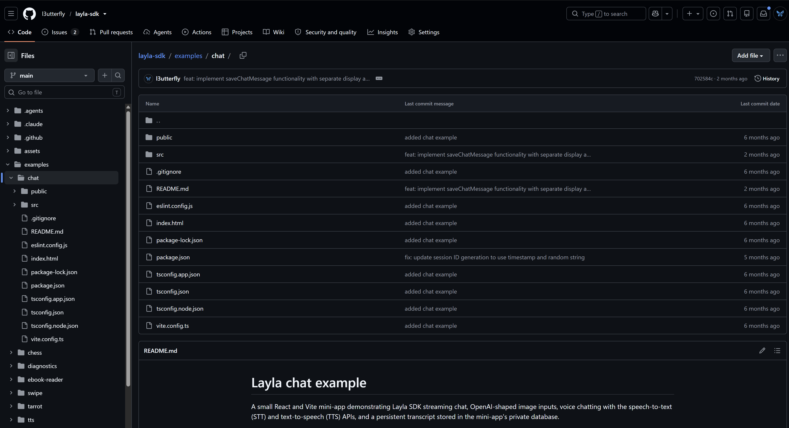

**Layla 미니 앱은 Layla 안에서 실행되는 웹 앱으로, Layla SDK를 통해 채팅, 음성, 이미지, 메모리, 비공개 저장소 등 기기의 AI 기능을 사용합니다.** API 키도, 직접 운영해야 하는 서버도 필요 없습니다. JavaScript나 TypeScript로 평범한 웹 앱을 작성하고 `@layla-network/sdk`를 호출하면, 사용자가 선택한 모델과 추론 엔진으로 Layla가 작업을 처리합니다.

이 튜토리얼은 Layla SDK 저장소의 공식 [채팅 예제](https://github.com/l3utterfly/layla-sdk/tree/main/examples/chat)를 참고하여 완전한 채팅 미니 앱을 단계별로 만듭니다. 끝까지 따라 하면 기기 내 모델의 응답을 스트리밍하는 방법, 생성을 중지하는 방법, 이미지를 보내는 방법, 말하고 듣는 방법, 미니 앱의 비공개 데이터베이스에 대화 기록을 보관하는 방법, SDK 목(mock)으로 브라우저에서 개발하는 방법, 그리고 결과물을 Layla용으로 패키징하는 방법을 알게 됩니다.

> **코딩 에이전트를 사용하시나요?** Layla SDK는 Codex, Claude Code, OpenCode 같은 코딩 에이전트에게 SDK로 미니 앱을 작성하는 방법을 알려 주는 에이전트 스킬을 공개합니다. 스킬을 에이전트에 제공하고 원하는 앱을 설명하면, 이 문서의 작업 대부분을 에이전트가 대신 처리하도록 할 수 있습니다. 다운로드와 설정 방법은 [Layla SDK 에이전트 스킬 사용하기](/getting-started-with-the-layla-sdk/#use-the-layla-sdk-agent-skill)를 참고하세요. 이 문서는 에이전트가 스킬과 함께 읽을 수 있는 참조 자료로도 쓰였으므로, 끝부분의 [개발자와 코딩 에이전트를 위한 빠른 참조](#개발자와-코딩-에이전트를-위한-빠른-참조)에 예제가 사용하는 모든 호출을 정리해 두었습니다.

## 만들 앱

채팅 예제는 한 화면짜리 React와 Vite 앱이며 다음 기능을 갖추고 있습니다.

| 기능                                  | 사용하는 SDK 호출                                                                          |
| ------------------------------------- | ------------------------------------------------------------------------------------------ |
| 깜박이는 커서가 있는 스트리밍 응답    | `layla.chat.completions.stream(...)`, `stream.on("content", ...)`, `stream.finalContent()` |
| 실행 중인 생성을 멈추는 중지 버튼     | `stream.abort()`, `LaylaAbortError`                                                        |
| 메시지에 이미지 첨부                  | OpenAI 메시지 형식의 `image_url` 콘텐츠 파트                                               |
| 재시작해도 유지되는 대화 기록         | `layla.db.executeSql(...)`                                                                 |
| 메시지를 Layla 자체 채팅 기록에 복사  | `layla.chat.saveChatMessage(...)`                                                          |
| 선택한 음성으로 응답을 소리 내어 재생 | `layla.tts.getVoices()`, `layla.tts.generateVoice(...)`, `layla.tts.stopSpeaking()`        |
| 메시지 받아쓰기 또는 핸즈프리 대화    | `layla.stt.startListening()`, `layla.stt.on("speechRecognized", ...)`                      |
| 일반 브라우저에서 실행 및 디버그      | `installLaylaMock(...)`                                                                    |

로직의 대부분은 두 파일에 있습니다. 앱 본체인 [`src/App.tsx`](https://github.com/l3utterfly/layla-sdk/blob/main/examples/chat/src/App.tsx)와 개발용 목을 담은 [`src/main.tsx`](https://github.com/l3utterfly/layla-sdk/blob/main/examples/chat/src/main.tsx)입니다.

## 시작하기 전에

다음이 필요합니다.

- 컴퓨터에 설치된 Node.js와 npm.
- JavaScript 또는 TypeScript에 대한 기본 지식. 예제는 React를 사용하지만 SDK 자체는 React를 요구하지 않습니다. 어떤 웹 스택이든 사용할 수 있습니다.
- 기기에서 테스트할 Android 휴대폰의 최신 Layla. 일부 기능은 최소 버전이 필요하며, [버전 요구 사항](#버전-요구-사항)에 나와 있습니다.

시작하는 데 휴대폰은 필요하지 않습니다. 개발 중에는 SDK의 목 호스트가 Layla를 대신하므로 데스크톱 브라우저에서 인터페이스를 만들고 테스트할 수 있습니다.

## Layla 미니 앱이 작동하는 방식

미니 앱은 Layla가 자체 WebView에서 불러오는 웹 페이지입니다. SDK는 그 페이지와 Layla 앱 사이의 메시지 계층을 감싸 주므로 일반적인 메서드를 호출하듯 사용할 수 있습니다.

```text
미니 앱 -> Layla SDK -> WebView 브리지 -> Layla 앱 -> 기기 내 모델
```

이 튜토리얼의 나머지 부분은 다음 사실들을 바탕으로 합니다.

- **설정할 것이 없습니다.** API 키, 기본 URL, 엔드포인트가 필요 없습니다. SDK는 Layla 브리지가 있는 곳, 즉 Layla 안에서만 작동합니다. 그 밖의 곳에서는 SDK 호출이 `LaylaBridgeUnavailableError`로 거부됩니다.
- **모델은 사용자가 고릅니다.** 코드는 채팅 완성을 요청하고, Layla는 활성 추론 엔진을 사용합니다. 사용자가 엔진을 전환하는 방법은 [Layla에서 저장된 추론 엔진이 작동하는 방식](/how-saved-inference-engines-work-in-layla/)을 참고하세요.
- **응답이 느릴 수 있습니다.** 휴대폰에서 실행되는 모델은 클라우드 API보다 느리므로, 응답을 스트리밍하고 작업 중 상태를 표시하며 사용자가 중지할 수 있게 하세요.
- **각 미니 앱에는 비공개 저장소가 있습니다.** 비공개 SQLite 데이터베이스와 비공개 파일 영역은 미니 앱에 속하며 다른 미니 앱과 공유되지 않습니다.

코드를 작성하기 전에 배경 지식이 필요하다면 [Layla 미니 앱이란?](/post-what-are-layla-mini-apps-codekitty/)과, 더 작은 순수 HTML 앱을 만드는 [Layla SDK 시작하기](/getting-started-with-the-layla-sdk/)를 읽어 보세요.

## 1단계: 프로젝트 준비하기

시작하는 방법은 두 가지입니다.

### 옵션 A: 공식 예제 실행하기

SDK 저장소를 복제하고 예제를 바로 실행합니다.

```bash
git clone https://github.com/l3utterfly/layla-sdk.git
cd layla-sdk/examples/chat
npm install
npm run dev
```

Vite가 로컬 주소를 출력합니다. 브라우저에서 열면 곧바로 목 호스트와 채팅할 수 있습니다.

예제는 저장소의 `examples/chat` 폴더에 있으며, 다른 예제 미니 앱들과 나란히 놓여 있습니다.



### 옵션 B: 나만의 프로젝트 시작하기

Vite로 새 React와 TypeScript 프로젝트를 만들고 SDK를 추가합니다.

```bash
npm create vite@latest my-chat -- --template react-ts
cd my-chat
npm install
npm install @layla-network/sdk
npm install --save-dev vite-plugin-singlefile
```

예제의 소스 코드를 따라 한다면 한 가지를 바꿔야 합니다. SDK 저장소 안에서는 예제가 SDK를 소스 폴더에서 가져옵니다.

```ts
import { LaylaSDK } from "../../../src/index";
```

자신의 프로젝트에서는 대신 게시된 패키지에서 가져옵니다.

```ts
import { LaylaSDK } from "@layla-network/sdk";
```

여러 페이지와 더 많은 상태가 필요한 큰 앱이라면 공식 [Layla 미니 앱 템플릿](https://github.com/l3utterfly/layla-miniapp-template)이 React, TypeScript, Vite를 갖춘 완성된 출발점을 제공합니다.

### 예제의 파일 구성

```text
examples/chat/
  index.html        #root 요소가 있는 Vite 진입 페이지
  package.json      React 19, Vite, TypeScript
  vite.config.ts    React 플러그인과 vite-plugin-singlefile
  public/           빌드 출력의 루트로 복사되는 정적 파일
  src/
    main.tsx        개발 시 Layla 목을 설치하고 <App />을 마운트
    App.tsx         채팅 로직과 UI 전체 (약 760줄)
    App.css         채팅 화면의 스타일
    index.css       전역 스타일
```

[13단계](#13단계-미니-앱-패키징하기)에서 다룰 빌드 단계는 이것을 Layla가 불러오는, 자체 완결형 `index.html` 하나로 만듭니다.

## 2단계: Layla 클라이언트 만들기

`App.tsx` 맨 위에서 클라이언트를 하나 만들고 어디서든 재사용합니다.

```ts
import { LaylaSDK, LaylaAbortError } from "@layla-network/sdk";

const layla = new LaylaSDK();
```

`LaylaSDK`와 `Layla`는 같은 클래스입니다. 모든 기능은 이 클라이언트의 속성입니다. `layla.chat`, `layla.tts`, `layla.stt`, `layla.db`, `layla.characters`, `layla.images` 등이 있습니다. 클라이언트를 컴포넌트 밖의 모듈 수준에서 만들면 공유되며, 다시 렌더링될 때마다 새로 만들어지지 않습니다.

## 3단계: Layla 목으로 브라우저에서 개발하기

Layla 밖에는 브리지가 없으므로 모든 SDK 호출이 실패합니다. SDK에는 개발용으로 브리지를 흉내 내는 목 호스트가 들어 있습니다. 예제에서는 Vite가 개발 서버를 실행 중일 때만 `main.tsx`가 이를 설치합니다.

```ts
import { installLaylaMock } from "@layla-network/sdk";

if (import.meta.env.DEV) {
  installLaylaMock({
    respond: (messages) => {
      const message = messages.at(-1);
      return `You said: ${message?.content ?? "(no text)"}. Mock response from Layla.`;
    },
    latencyMs: 300,
    tokenDelayMs: 25,
  });
}
```

여기서 사용한 옵션은 다음과 같습니다.

- `respond`는 대화를 받아 가짜 모델이 답할 텍스트를 반환합니다. 목은 이를 조금씩 스트리밍하므로 스트리밍 UI가 기기에서처럼 동작합니다. `messages`의 각 메시지는 Layla 고유 형식이므로, 예제는 `message.image_base64`를 확인해 첨부된 이미지를 감지합니다.
- `latencyMs`는 응답이 시작되기 전에 지연을 추가하여 모델의 시작 시간을 흉내 냅니다.
- `tokenDelayMs`는 스트리밍되는 조각 사이의 지연입니다.

`import.meta.env.DEV`는 프로덕션 빌드에서 `false`이므로, 배포하는 파일에는 목이 설치되지 않고 Layla 안에서의 호출은 실제 브리지로 전달됩니다.

목은 첫 번째 SDK 호출 전에 설치하세요. 예제는 목 코드가 프로덕션 번들에 포함되지 않도록 동적 `import()`를 사용합니다. 브라우저에서 페이지를 처음 불러올 때 `LaylaBridgeUnavailableError`가 보이면, 앱을 렌더링하기 전에 목을 설치하세요.

```tsx
async function start() {
  if (import.meta.env.DEV) {
    const { installLaylaMock } = await import("@layla-network/sdk");
    installLaylaMock({/* options */});
  }
  ReactDOM.createRoot(document.getElementById("root")!).render(<App />);
}

void start();
```

### 데이터베이스도 목으로 만들기

목에는 실제 SQLite가 없습니다. 기본적으로 `layla.db.executeSql(...)` 호출은 모두 빈 결과를 반환합니다. 예제는 사용하는 네 가지 문(`CREATE`, `INSERT`, `SELECT`, `DELETE`)을 `localStorage`로 처리하는 `executeSql` 핸들러를 전달하며, 이것만으로 브라우저를 새로 고쳐도 대화 기록이 다시 불러와집니다. Layla 안에서는 같은 호출이 기기의 실제 데이터베이스에서 실행되며 이 핸들러는 사용되지 않습니다.

목은 음성 인식에도 응답합니다. `startListening()`이 성공하면 미리 준비된 인식 결과를 내보내며, `sttTranscript` 옵션으로 바꾸거나 `null`을 전달해 끌 수 있습니다.

## 4단계: 대화 모델링하기

예제는 화면용으로 자체적인 간단한 메시지 타입을 유지합니다.

```ts
interface ChatMessage {
  role: "user" | "assistant";
  content: string | null;
  imageBase64?: string;
  imageName?: string;
}
```

SDK의 채팅 API는 `system`, `user`, `assistant` 역할과 `content` 필드를 쓰는 OpenAI Chat Completions 형식을 따릅니다. 작은 함수 하나가 화면 상태를 이 형식으로 변환합니다. 첨부된 이미지가 `image_url` 콘텐츠 파트가 되는 곳이 바로 여기입니다.

```ts
import type {
  ChatCompletionContentPart,
  ChatCompletionMessageParam,
} from "@layla-network/sdk";

const toCompletionMessage = (
  message: ChatMessage,
): ChatCompletionMessageParam => {
  if (message.role === "assistant") {
    return { role: "assistant", content: message.content };
  }

  if (!message.imageBase64) {
    return { role: "user", content: message.content ?? "" };
  }

  const content: ChatCompletionContentPart[] = [];
  if (message.content) {
    content.push({ type: "text", text: message.content });
  }
  content.push({
    type: "image_url",
    image_url: { url: message.imageBase64, detail: "auto" },
  });

  return { role: "user", content };
};
```

화면용 타입을 따로 두는 것은 필수가 아니라 설계상의 선택입니다. 이렇게 하면 이미지 파일 이름 같은 추가 필드를 모델에 보내지 않고 저장할 수 있습니다.

다른 OpenAI 방식 API와 마찬가지로 모든 요청은 `messages`에 대화 전체를 담습니다. 따라서 이전 대화를 기억하고 다시 보내는 책임은 앱에 있습니다. 모델에 성격이나 지시 사항을 주려면 배열의 맨 앞에 `system` 메시지를 추가하세요.

## 5단계: 응답 스트리밍하기

여기가 앱의 핵심입니다. 사용자가 **보내기**를 누르면 예제는 새 메시지 목록을 만들고, 비어 있는 어시스턴트 메시지를 화면에 띄운 뒤 스트림을 시작합니다.

```ts
const userMessage: ChatMessage = { role: "user", content: text };
const nextMessages = [...messages, userMessage];

// Show the user's message and an empty reply bubble immediately.
setMessages([...nextMessages, { role: "assistant", content: "" }]);

const stream = layla.chat.completions.stream({
  messages: nextMessages.map(toCompletionMessage),
});

stream.on("content", (_delta, snapshot) => {
  setMessages([...nextMessages, { role: "assistant", content: snapshot }]);
});

const reply = await stream.finalContent();
```

이해해 둘 만한 점들입니다.

- **`stream(...)`은 즉시 반환됩니다.** 프라미스가 아니라 실행 중인 스트림 객체를 동기적으로 돌려주므로, 첫 번째 토큰이 도착하기 전에 리스너를 연결할 수 있습니다.
- **스냅샷을 사용하세요.** `content` 이벤트는 새 `delta`와 지금까지 응답 전체인 `snapshot`, 두 값을 전달합니다. 상태를 스냅샷으로 설정하는 편이 델타를 이어 붙이는 것보다 간단하고 안전합니다. 이벤트를 놓치거나 중복되어도 텍스트가 손상되지 않기 때문입니다.
- **`finalContent()`는 끝날 때까지 기다립니다.** 보이는 응답 전체로 이행되며, 스트림이 실패하거나 중단되면 거부됩니다.
- **추론 내용은 자동으로 분리됩니다.** 모델이 생각을 `<think>` 태그로 감싸면 SDK가 `content`에서 이를 제거하고 `reasoning` 이벤트로 전달하므로, 태그가 채팅 말풍선에 나타나지 않습니다.

스트림은 다음 이벤트를 내보냅니다.

| 이벤트      | 인수                | 의미                                           |
| ----------- | ------------------- | ---------------------------------------------- |
| `content`   | `delta`, `snapshot` | 새로 보이는 텍스트와 지금까지 보이는 응답 전체 |
| `reasoning` | `delta`, `snapshot` | 사고형 모델의 새 추론 텍스트                   |
| `toolCall`  | `toolCall`          | 모델이 도구 호출을 요청함 (최신 Layla 필요)    |
| `chunk`     | `chunk`             | OpenAI 방식의 원시 청크 전체                   |
| `end`       | 없음                | 응답이 끝남                                    |
| `error`     | `error`             | 요청이 실패하거나 중단됨                       |

### 응답을 읽는 다른 방법

최종 답변만 필요하다면 스트리밍을 건너뛰세요.

```ts
const completion = await layla.chat.completions.create({ messages });
const text = completion.choices[0]?.message.content ?? "";
```

스트림은 OpenAI SDK와 같은 방식의 비동기 이터러블이기도 합니다. 루프를 빠져나오면 요청이 중단됩니다.

```ts
for await (const chunk of stream) {
  const piece = chunk.choices[0]?.delta.content ?? "";
}
```

사람이 지켜보는 모든 화면에는 스트리밍을 사용하세요. 로컬 모델은 첫 단어가 나오기까지 몇 초가 걸릴 수 있으며, 조금씩 늘어나는 응답이 멈춰 있는 화면보다 훨씬 낫습니다.

### 앱이 작업 중임을 보여 주기

예제는 하나의 `busy` 플래그로 세 가지 작은 UI 요소를 제어합니다. 헤더의 "Generating..." 레이블, 마지막 어시스턴트 말풍선의 깜박이는 커서, 그리고 **보내기**를 대체하는 **중지** 버튼입니다. 또한 이 플래그의 사본을 `busyRef`에도 보관합니다. 11단계의 음성 리스너처럼 오래 살아 있는 콜백은 그렇지 않으면 이전 렌더링의 오래된 `busy` 값을 읽게 됩니다. ref를 읽으면 이를 피할 수 있습니다.

## 6단계: 사용자가 생성을 중지할 수 있게 하기

버튼으로 취소할 수 있도록 활성 스트림에 대한 참조를 보관합니다.

```ts
const streamRef = useRef<ChatCompletionStream | null>(null);

// when starting:
streamRef.current = stream;

// the Stop button:
const stopGeneration = () => streamRef.current?.abort();
```

중단하면 `finalContent()`가 `LaylaAbortError`로 거부되며, 예제는 이 경우를 실제 오류와 별도로 처리합니다.

```ts
try {
  assistantContent = await stream.finalContent();
  // save the finished reply
} catch (err) {
  if (err instanceof LaylaAbortError) {
    // The user pressed Stop. Keep whatever text arrived so far.
    if (assistantContent) {
      // save the partial reply
    }
  } else {
    console.error(err);
  }
} finally {
  streamRef.current = null;
  setBusy(false);
}
```

`abort()`는 `LaylaAbortError`를 담은 `error` 이벤트도 내보냅니다. 예제의 `error` 리스너는 메시지 텍스트를 화면에 표시하므로, 자신의 리스너에서는 중단을 걸러 내세요. 그렇지 않으면 중지 버튼이 부분 응답을 오류 문구로 바꿔 버립니다.

```ts
stream.on("error", (err) => {
  if (err instanceof LaylaAbortError) return;
  setMessages([
    ...nextMessages,
    { role: "assistant", content: `Error: ${err.message}` },
  ]);
});
```

요청에 `signal`을 전달하여 웹 표준 방식으로 취소할 수도 있습니다.

```ts
const controller = new AbortController();
const stream = layla.chat.completions.stream({
  messages,
  signal: controller.signal,
});
controller.abort();
```

## 7단계: 이미지 보내기

이미지 입력은 4단계에서 본 OpenAI 콘텐츠 파트 형식을 사용합니다. 예제는 사용자가 고른 파일을 base64 데이터 URL로 바꿔야 합니다.

```ts
const readImageAsDataUrl = (file: File): Promise<string> =>
  new Promise((resolve, reject) => {
    const reader = new FileReader();
    reader.onload = () => {
      if (typeof reader.result === "string") resolve(reader.result);
      else reject(new Error("The selected image could not be read."));
    };
    reader.onerror = () =>
      reject(
        reader.error ?? new Error("The selected image could not be read."),
      );
    reader.readAsDataURL(file);
  });
```

예제는 선택기를 흔한 네 가지 형식으로 제한하고, 읽기 전에 형식을 확인합니다.

```ts
const supportedImageTypes = new Set([
  "image/gif",
  "image/jpeg",
  "image/png",
  "image/webp",
]);
```

선택기 자체는 첨부 버튼으로 여는 숨겨진 `<input type="file" accept="image/png,image/jpeg,image/gif,image/webp">`입니다. 선택 후 앱은 제거 버튼이 있는 미리보기를 보여 주고, 데이터 URL을 다음 메시지에 첨부합니다.

기억해 둘 요구 사항이 두 가지 있습니다.

- **base64 데이터 URL을 사용하세요.** 이전 버전의 Layla는 원격 `https://` 이미지 URL과, 한 메시지에서 첫 번째 이후의 이미지를 무시하므로, 데이터 URL이 이식성 있는 선택입니다.
- **모델이 이미지를 볼 수 있어야 합니다.** 텍스트 전용 모델에 보낸 이미지는 이해되지 않습니다. Layla에서 이미지 입력을 사용하려면 비전을 지원하는 모델이 활성화되어 있어야 합니다. [Layla에 비전 LLM을 추가하는 방법](/how-to-add-vision-llms-in-layla-qwen3-vl/)을 참고하세요.

## 8단계: 비공개 데이터베이스에 대화 기록 저장하기

미니 앱은 열 때마다 처음부터 다시 불러오므로, 사용자가 보관해야 할 것은 모두 저장해야 합니다. `layla.db`는 각 미니 앱에 고유한 비공개 SQLite 데이터베이스를 제공합니다. 예제는 화면에 표시되는 대화 기록에 이를 사용합니다.

실행할 때 테이블을 만듭니다. `IF NOT EXISTS`를 쓰면 매번 실행해도 안전합니다.

```ts
const messagesTable = "chat_messages";

const createMessagesTable = () =>
  layla.db.executeSql(
    `CREATE TABLE IF NOT EXISTS ${messagesTable} (
       id INTEGER PRIMARY KEY AUTOINCREMENT,
       role TEXT NOT NULL,
       content TEXT,
       image_base64 TEXT,
       image_name TEXT,
       timestamp INTEGER NOT NULL
     )`,
  );
```

각 메시지는 바인딩된 매개변수로 추가합니다. 값은 두 번째 인수로 전달하고 `?` 자리 표시자를 사용하세요. 사용자 텍스트를 쿼리 문자열에 이어 붙여 SQL을 만들어서는 절대 안 됩니다.

```ts
const insertMessage = async (message: ChatMessage) => {
  try {
    await layla.db.executeSql(
      `INSERT INTO ${messagesTable} (role, content, image_base64, image_name, timestamp)
       VALUES (?, ?, ?, ?, ?)`,
      [
        message.role,
        message.content,
        message.imageBase64 ?? null,
        message.imageName ?? null,
        Date.now(),
      ],
    );
  } catch (err) {
    console.error("Failed to persist chat message", err);
  }
};
```

대화 기록은 순서대로 다시 읽습니다. 결과에는 열 이름을 키로 하는 객체의 `rows` 배열이 들어 있습니다.

```ts
const result = await layla.db.executeSql(
  `SELECT role, content, image_base64, image_name
     FROM ${messagesTable}
    ORDER BY id ASC`,
);
const history = result.rows;
```

모든 결과에는 `rowsAffected`(쓰기로 변경된 행 수)와 `insertId`(마지막으로 삽입된 행의 id, 해당 없으면 `0`)도 들어 있습니다. **지우기** 버튼은 단순히 `DELETE FROM chat_messages`를 실행합니다.

컴포넌트가 마운트될 때 설정을 한 번 실행한 뒤, 저장된 메시지로 화면을 채웁니다.

```ts
useEffect(() => {
  (async () => {
    try {
      await createMessagesTable();
      const history = await loadMessages();
      if (history.length > 0) setMessages(history);
    } catch (err) {
      console.error("Failed to load chat history", err);
    }
  })();
}, []);
```

예제는 이미지 데이터를 base64 텍스트로 테이블에 저장하는데, 데모로서는 간단하고 충분합니다. 이미지를 많이 또는 큼직하게 보관하는 앱이라면 `layla.utils.saveFile(...)`로 파일로 쓰고, 데이터베이스에는 파일 이름만 저장하세요.

## 9단계: 메시지를 Layla의 채팅 기록에 복사하기

`layla.db`는 앱의 비공개 저장소입니다. 이와 별개로 `layla.chat.saveChatMessage(...)`를 사용하면 Layla의 기본 채팅 기록에 메시지를 쓸 수 있어, 사용자의 일반 대화 사이에 나타납니다. 예제는 모든 메시지에 대해 둘 다 수행합니다.

```ts
const sessionId = `${Date.now()}-${Math.random().toString(36).slice(2, 10)}`;

const saveChatMessage = async (
  message: ChatMessage,
  characterId: "layla" | "user",
) => {
  try {
    await layla.chat.saveChatMessage({
      display_message: message.content ?? "",
      message: message.content ?? "",
      id: 0,
      character_id: characterId,
      session_id: sessionId,
      timestamp: Date.now(),
    });
  } catch (err) {
    console.error("Failed to save chat message", err);
  }
};
```

필드는 다음과 같습니다.

| 필드              | 의미                                                                        |
| ----------------- | --------------------------------------------------------------------------- |
| `id`              | `0` 이하이면 새 항목을 만듭니다. 양수 id는 기존 항목을 덮어씁니다.          |
| `session_id`      | 항목이 속한 채팅 세션. 예제는 실행할 때마다 새로 만듭니다.                  |
| `character_id`    | 사용자 본인의 메시지는 `"user"`, 그 외에는 캐릭터의 id.                     |
| `display_message` | 채팅 기록에 표시되는 텍스트.                                                |
| `message`         | 이후 대화에서 모델에 전달되는 텍스트. `display_message`와 다를 수 있습니다. |
| `timestamp`       | 밀리초 단위의 Unix 시간. `0` 이하이면 현재 시간을 사용합니다.               |

호출은 부여된 `id`를 포함하여 저장된 항목으로 이행됩니다.

기억해 둘 세부 사항이 몇 가지 있습니다.

- 존재하지 않는 세션을 만드는 것은 캐릭터의 항목뿐입니다. 아직 없는 세션에 사용자 항목을 저장해도 세션이 만들어지지 않습니다.
- 새 항목에는 이미지가 없습니다. 그래서 예제는 이미지 첨부를 자체 데이터베이스에만 보관합니다.
- 예제는 어시스턴트 응답에 리터럴 id인 `"layla"`를 사용합니다. 미니 앱이 특정 캐릭터로서 채팅한다면 `layla.characters.list()`에서 그 캐릭터의 실제 id를 가져와 대신 사용하세요.
- 이 호출에는 `display_message`와 `message`를 별도 텍스트로 지원하는 Layla 버전이 필요합니다. 예제처럼 `try/catch`로 감싸 두면 저장에 실패해도 앱이 계속 작동합니다.

두 저장소는 서로 다른 질문에 답합니다.

| 저장소                       | 위치              | 용도                                      |
| ---------------------------- | ----------------- | ----------------------------------------- |
| `layla.db`                   | 미니 앱 내부에만  | 앱 자체의 상태와 앱 고유의 대화 기록 보기 |
| `layla.chat.saveChatMessage` | Layla의 채팅 기록 | 대화가 Layla 안에도 나타나도록 하기       |

## 10단계: 텍스트 음성 변환 추가하기

텍스트 음성 변환은 사용자가 Layla에 설치한 음성을 사용합니다. 한 번 불러와서 사용자가 고르게 합니다.

```ts
const [voices, setVoices] = useState<LaylaTTSVoice[]>([]);
const [voiceId, setVoiceId] = useState<string | null>(null);

useEffect(() => {
  layla.tts
    .getVoices()
    .then((available) => {
      setVoices(available);
      setVoiceId((current) => current ?? available[0]?.id ?? null);
    })
    .catch((err) => console.error("Failed to load TTS voices", err));
}, []);
```

각 음성에는 `id`, `name`, `type`, `tags`가 있습니다. `generateVoice(...)`에 id를 전달하면 그 음성으로 말하고, `null`을 전달하면 Layla의 기본 음성을 사용합니다. 프라미스는 재생이 끝나면 이행되므로 `await`로 음성 출력이 끝난 시점을 알 수 있습니다.

```ts
const speak = async (text: string) => {
  setSpeaking(true);
  try {
    await layla.tts.generateVoice(voiceIdRef.current, text.trim());
  } catch (err) {
    if (!(err instanceof LaylaAbortError)) {
      console.error("TTS playback failed", err);
    }
  } finally {
    setSpeaking(false);
  }
};

const stopSpeaking = () => void layla.tts.stopSpeaking();
```

완성된 어시스턴트 말풍선마다 `speak(message.content)`를 호출하는 **재생** 버튼이 붙습니다. 앱의 음성에 대한 배경 지식은 [Layla에서 캐릭터의 목소리를 듣는 방법](/how-to-hear-your-characters-speak-in-layla/)을 참고하세요.

재생하지 않고 오디오만 얻고 싶다면, `layla.tts.generateVoiceToFile(voiceId, text)`가 `<audio>` 요소에 쓸 수 있는 오디오 데이터 URI를 반환하거나, 미니 앱의 비공개 저장소에 파일로 저장합니다.

## 11단계: 음성 인식과 핸즈프리 모드 추가하기

음성 입력은 세 부분으로 이루어집니다. 시작 요청, 각 인식 결과를 전달하는 이벤트, 그리고 중지 요청입니다.

```ts
import type { STTSpeechRecognizedListener } from "@layla-network/sdk";

// 1. Subscribe once, for the lifetime of the app.
useEffect(() => {
  const handleSpeech: STTSpeechRecognizedListener = ({ transcript }) => {
    const text = transcript.trim();
    if (!text) return;
    setInput((prev) => (prev ? `${prev} ${text}` : text));
  };

  layla.stt.on("speechRecognized", handleSpeech);
  return () => {
    layla.stt.off("speechRecognized", handleSpeech);
    void layla.tts.stopSpeaking();
    void layla.stt.stopListening();
  };
}, []);

// 2. Ask the host to start listening.
await layla.stt.startListening();

// 3. Release the microphone when you are done.
await layla.stt.stopListening();
```

`startListening()`은 인식 결과를 반환하지 않는다는 점에 유의하세요. 이 프라미스는 인식기가 시작되면 이행됩니다. 텍스트는 나중에 `speechRecognized` 이벤트로 도착하므로 시작 전이나 직후에 구독하세요.

예제는 이를 두 가지 방식으로 사용합니다.

- **눌러서 말하기.** 마이크 버튼이 듣기를 시작하고, 인식된 텍스트는 메시지 입력란에 들어가 사용자가 보내기 전에 편집할 수 있습니다.
- **음성 모드.** 헤더의 토글이 루프를 켭니다. 앱은 듣고, 들은 내용을 보내고, `layla.tts.generateVoice(...)`로 응답을 읽어 준 뒤 다시 듣기 시작합니다. 이 루프는 위에서 본 요소들을 이어 붙인 것에 불과합니다.

```ts
// at the end of sendMessage, after the reply has finished streaming
if (voiceModeRef.current && assistantContent) {
  await speak(assistantContent);
  if (voiceModeRef.current) void startListening();
}
```

두 가지 구현 세부 사항이 이를 안정적으로 만듭니다. 음성 리스너는 한 번만 등록되고 상태를 클로저로 붙잡는 대신 ref(`voiceModeRef`, `busyRef`, `sendMessageRef`)를 통해 현재 값을 읽으므로, 렌더링마다 다시 구독할 필요가 없습니다. 또한 앱은 듣기를 시작하기 전에 진행 중인 재생을 모두 멈춥니다.

브라우저에서는 목이 `startListening()` 직후 샘플 인식 결과를 내보내므로, 마이크 없이도 음성 흐름 전체를 테스트할 수 있습니다.

## 12단계: 오류 처리하기

SDK의 모든 오류는 `LaylaError`를 확장합니다. 세 가지 경우는 별도로 처리할 만합니다.

```ts
import {
  LaylaAbortError,
  LaylaBridgeUnavailableError,
  LaylaError,
} from "@layla-network/sdk";

try {
  const text = await stream.finalContent();
} catch (err) {
  if (err instanceof LaylaAbortError) {
    // The user stopped the request. Not a failure.
  } else if (err instanceof LaylaBridgeUnavailableError) {
    showMessage("Open this mini-app inside Layla.");
  } else if (err instanceof LaylaError) {
    showMessage(err.message);
  } else {
    throw err;
  }
}
```

예제는 대부분의 오류를 콘솔에 기록하고, 음성과 이미지 문제는 작은 인라인 알림(`attachmentError`와 `voiceError`)으로 표시합니다. 게시하는 미니 앱에서는 사용자가 볼 수 있는 인터페이스 위치에 메시지를 표시하세요.

## 13단계: 미니 앱 패키징하기

Layla는 HTML 파일 하나를 불러옵니다. 예제의 `vite.config.ts`는 `vite-plugin-singlefile`을 사용해 모든 스크립트와 스타일을 `index.html`로 묶습니다.

```ts
import { defineConfig } from "vite";
import react from "@vitejs/plugin-react";
import { viteSingleFile } from "vite-plugin-singlefile";

export default defineConfig({
  plugins: [react(), viteSingleFile()],
});
```

빌드합니다.

```bash
npm run build
```

`build` 스크립트는 `tsc -b && vite build`를 실행하므로, TypeScript 오류가 있으면 아무것도 생성되기 전에 빌드가 멈춥니다.

### app.json 추가하기

Layla는 미니 앱의 이름과 설명을 `app.json` 파일에서 읽습니다. 예제 폴더에는 이 파일이 없으므로 `public/`에 추가하세요. Vite는 `public/`에 있는 모든 것을 빌드 출력의 루트로 복사합니다.

```json
{
  "title": "Layla Chat",
  "tagline": "Chat with Layla by text, image or voice.",
  "description": "A simple chat mini-app that streams replies from the on-device model.",
  "iconUri": "icon.png"
}
```

`iconUri`는 같은 폴더에 있는 이미지 파일을 가리키므로, 정사각형 `icon.png`도 `public/`에 넣으세요. 정사각형 아이콘이 Layla의 그리드와 목록에 가장 잘 맞습니다. `backgroundImgUri`는 배경 또는 미리보기 이미지를 위한 선택 항목입니다.

### 내용물 압축하기

빌드 후 `dist`는 다음과 같아야 합니다.

```text
dist/
  app.json
  index.html
  icon.png
```

`dist` 폴더 자체가 아니라 `dist`의 **내용물**을 ZIP으로 압축하세요. `app.json`과 `index.html`은 상위 폴더 없이 ZIP의 루트에 있어야 합니다. 앱을 직접 호스팅한다면 `index.html` 대신 주소를 한 줄로 담은 `index.url` 파일을 사용하세요.

SDK 저장소는 릴리스마다 예제 미니 앱을 바로 가져올 수 있는 ZIP으로도 공개합니다. 나만의 앱을 만들기 전에 채팅 예제를 휴대폰에서 빠르게 시험해 보는 방법입니다.

## 14단계: Layla에서 테스트하기

Layla의 미니 앱 가져오기 과정을 통해 ZIP을 가져오고, 앱을 열어 다음을 확인하세요.

1. 메시지가 점진적으로 스트리밍되고, **중지**를 누르면 부분 텍스트를 잃지 않고 끝납니다.
2. 응답이 브라우저에서보다 느립니다. 기기에서 실제 모델이 실행되고 있으므로 정상입니다.
3. 미니 앱을 닫았다가 다시 열면 데이터베이스에서 대화 기록이 복원됩니다.
4. 비전 지원 모델이 활성화되어 있으면 이미지 입력이 작동하고, 그렇지 않으면 그 사실을 분명히 알려 줍니다.
5. **재생**이 응답을 읽어 주고, 마이크 버튼이 메시지 입력란을 채웁니다.
6. 미니 앱이 `app.json`의 제목과 아이콘으로 표시됩니다.

SDK 호출이 `LaylaBridgeUnavailableError`로 실패한다면 페이지가 Layla 밖에서 실행되고 있는 것입니다. 제목이나 아이콘이 보이지 않는다면 `app.json`이 올바른 JSON인지, ZIP의 루트에 있는지 확인하세요.

## 앱을 확장하는 아이디어

기본 채팅이 작동하면 같은 클라이언트로 더 많은 것을 할 수 있습니다.

- **캐릭터.** `layla.characters.list()`와 `layla.characters.getImage(id)`로 사용자가 대화 상대를 고르게 할 수 있습니다. 캐릭터의 설명을 `system` 메시지에 사용하세요.
- **컨텍스트 미니 앱.** `layla.contextual.getExecutionContext()`는 현재 캐릭터와 채팅 세션을 알려 주고, `layla.contextual.on(...)`은 주변 채팅이 바뀔 때 이벤트를 전달합니다.
- **메모리와 페르소나.** `layla.memories`와 `layla.personas`로 Layla가 사용자와 캐릭터에 대해 알고 있는 내용에 접근할 수 있습니다.
- **이미지와 음악.** `layla.images.generateImage(...)`와 `layla.acestep.generateMusic(...)`은 기기 내 모델로 미디어를 생성합니다.
- **도구 호출.** OpenAI 방식의 `tools`를 채팅 요청에 전달하고 루프는 직접 실행합니다. 아래에 나온 최신 Layla와 SDK가 필요합니다.
- **백그라운드 작업.** `task.js` 파일은 WebView를 열지 않고 주기적으로 실행됩니다. [미니 앱에서 백그라운드 작업 실행하기](/running-background-tasks-in-your-mini-app/)를 참고하세요.

## 개발자와 코딩 에이전트를 위한 빠른 참조

이 섹션은 예제를 압축한 지도입니다. 채팅 미니 앱이 수행하는 모든 SDK 호출을, 비슷한 코드를 작성할 때 중요한 규약과 함께 정리했습니다.

### 채팅 예제가 사용하는 SDK 호출

| 호출                                                                                                | 반환                               | 비고                                                                            |
| --------------------------------------------------------------------------------------------------- | ---------------------------------- | ------------------------------------------------------------------------------- |
| `new LaylaSDK()`                                                                                    | 클라이언트                         | 하나만 만들어 재사용하세요. `Layla`는 별칭입니다.                               |
| `layla.chat.completions.stream({ messages, signal? })`                                              | `ChatCompletionStream` (동기)      | 리스너를 즉시 연결하세요. `abort()`로 취소합니다.                               |
| `layla.chat.completions.create({ messages })`                                                       | `Promise<ChatCompletion>`          | 스트리밍 없음. `stream: true`를 전달하면 대신 스트림을 얻습니다.                |
| `stream.on("content", (delta, snapshot) => ...)`                                                    | 스트림                             | `snapshot`은 지금까지 보이는 텍스트 전체입니다.                                 |
| `stream.finalContent()`                                                                             | `Promise<string>`                  | 실패하거나 중단되면 거부됩니다. 보이는 텍스트만 반환합니다.                     |
| `stream.abort()`                                                                                    | void                               | `finalContent()`를 `LaylaAbortError`로 거부시키고 `error`를 내보냅니다.         |
| `layla.chat.saveChatMessage({ id, session_id, character_id, display_message, message, timestamp })` | `id`가 있는 저장된 항목            | `id <= 0`이면 생성합니다. 새 세션은 캐릭터 항목만 만듭니다.                     |
| `layla.db.executeSql(query, params?)`                                                               | `{ rows, rowsAffected, insertId }` | 미니 앱별 비공개 SQLite. `?` 자리 표시자를 사용하세요.                          |
| `layla.tts.getVoices()`                                                                             | `LaylaTTSVoice[]`                  | 각각 `id`, `name`, `type`, `tags`가 있습니다.                                   |
| `layla.tts.generateVoice(voiceId \| null, text)`                                                    | `Promise<void>`                    | 오디오를 재생합니다. 재생이 끝나면 이행됩니다. `null`은 기본 음성을 사용합니다. |
| `layla.tts.stopSpeaking()`                                                                          | `Promise<void>`                    | 재생을 멈춥니다.                                                                |
| `layla.stt.startListening()`                                                                        | `Promise<void>`                    | 듣기가 시작되면 이행됩니다. 인식 결과는 이벤트로 옵니다.                        |
| `layla.stt.on("speechRecognized", ({ transcript }) => ...)`                                         | 클라이언트                         | `layla.stt.off(...)`로 제거합니다.                                              |
| `layla.stt.stopListening()`                                                                         | `Promise<void>`                    | 마이크를 해제합니다. 이벤트 구독은 제거하지 않습니다.                           |
| `installLaylaMock(options)`                                                                         | 목 핸들                            | 개발 전용. 첫 번째 SDK 호출 전에 설치하세요.                                    |

정확한 타입과 필드는 객체의 형태를 추측하지 말고 SDK가 생성한 TypeScript 선언 파일과 [API 참조](https://github.com/l3utterfly/layla-sdk)를 읽으세요.

### 예제에서 각 항목의 위치

| 파일과 함수                                                                        | 보여 주는 내용                                             |
| ---------------------------------------------------------------------------------- | ---------------------------------------------------------- |
| `src/main.tsx`                                                                     | 개발 전용 목 (사용자 지정 `executeSql` 핸들러 포함)        |
| `App.tsx`: `toCompletionMessage`                                                   | 화면 메시지를 이미지 파트가 있는 OpenAI 형식 메시지로 변환 |
| `App.tsx`: `sendMessage`                                                           | 스트리밍 루프, 중단 처리, 저장, 음성 모드 루프             |
| `App.tsx`: `createMessagesTable`, `loadMessages`, `insertMessage`, `clearMessages` | 바인딩된 매개변수를 쓰는 SQLite 도우미                     |
| `App.tsx`: `saveChatMessage`                                                       | Layla의 기본 채팅 기록에 쓰기                              |
| `App.tsx`: `speak`, `startListening`, `stopListening`                              | 텍스트 음성 변환과 음성 인식 제어                          |
| `App.tsx`: `readImageAsDataUrl`, `selectImage`                                     | 이미지 파일을 base64 데이터 URL로 읽기                     |
| `vite.config.ts`                                                                   | 앱을 하나의 `index.html`로 묶기                            |

### 흔한 실수를 막는 규칙

- 패키지 루트인 `@layla-network/sdk`에서 가져오세요. 패키지 내부의 비공개 경로에서 가져오지 마세요.
- SDK를 HTTP 클라이언트처럼 호출하지 마세요. API 키도 기본 URL도 없습니다.
- 클라이언트는 하나만 만드세요. 목은 개발 중에만, 첫 번째 SDK 호출 전에 설치하세요.
- 사람에게 보이는 모든 것에는 `stream(...)`을 우선 사용하고, 사용자가 항상 중지할 수 있게 하세요.
- 응답 텍스트의 기준은 `snapshot`으로 삼으세요.
- `error` 리스너에서 `LaylaAbortError`를 걸러 내세요.
- 데이터베이스 값은 문자열을 이어 붙이지 말고 `?` 매개변수로 전달하세요.
- 앱 수명 내내 살아 있는 리스너에서는 변경되는 값을 ref로 읽으세요.
- `image_url` 파트의 이미지 URL은 base64 데이터 URL이어야 합니다.
- 빌드한 미니 앱에는 ZIP 루트에 `app.json`과 `index.html`(또는 `index.url`)이 필요합니다.

### 버전 요구 사항

SDK는 실행 중인 Layla 버전과 통신하며 그 버전이 지원하는 가장 좋은 경로를 사용합니다. 이 문서는 `@layla-network/sdk` 7.6을 기준으로 작성되었습니다.

| 기능                                                                                  | 필요 사항                                                 |
| ------------------------------------------------------------------------------------- | --------------------------------------------------------- |
| 채팅, 스트리밍, 메시지당 이미지 하나, 텍스트 음성 변환, 음성 인식, 데이터베이스, 파일 | 지원되는 모든 Layla 버전                                  |
| 도구 호출, 여러 파트로 된 콘텐츠, 한 메시지의 여러 이미지                             | Layla 7.5.0-alpha 이상 및 `@layla-network/sdk` 7.5.0 이상 |
| `saveChatMessage`에서 `display_message`와 `message` 텍스트 분리                       | 업데이트된 저장 규약을 지원하는 Layla 빌드                |

이전 Layla에서는 호스트가 전달할 수 없는 필드가 오류를 일으키지 않고 콘솔 경고와 함께 버려집니다. 도구 호출에 의존하는 미니 앱은 `app_version`이 포함된 `layla.contextual.getExecutionContext()`로 먼저 버전을 확인할 수 있습니다.

## 자주 묻는 질문

### Layla 미니 앱은 어떻게 만드나요?

웹 앱을 만들고, `@layla-network/sdk`를 설치하고, 코드에서 SDK를 호출하고, 하나의 `index.html`로 빌드하고, `app.json`을 추가한 뒤 ZIP을 Layla로 가져옵니다. 이 문서는 채팅 앱을 예로 각 단계를 안내합니다.

### Layla SDK를 사용하려면 API 키가 필요한가요?

아니요. SDK는 API 키, 기본 URL, 네트워크 엔드포인트를 사용하지 않습니다. WebView 브리지를 통해 Layla 앱으로 요청을 보내며, Layla는 사용자가 선택한 모델과 추론 엔진을 사용합니다.

### Layla 채팅 API는 OpenAI API와 호환되나요?

요청과 응답의 형태는 역할, `messages`, 스트리밍, 이미지 콘텐츠 파트, 도구를 포함해 OpenAI의 Chat Completions 형식을 따릅니다. Layla 앱과 통신하는 클라이언트 라이브러리이며, OpenAI HTTP 엔드포인트를 그대로 대체하는 것은 아닙니다.

### Layla 미니 앱은 오프라인에서 작동하나요?

미니 앱 자체는 로컬 HTML 파일이며, 채팅은 사용자가 Layla에서 선택한 모델을 통해 실행됩니다. 로컬 모델을 쓰면 데이터가 기기 밖으로 나가지 않습니다. 사용자가 Layla를 클라우드 추론 엔진으로 전환하면 해당 엔진의 연결 규칙이 적용됩니다.

### React 외의 프레임워크도 사용할 수 있나요?

네. 자체 완결형 HTML 페이지를 만들 수 있는 웹 스택이면 무엇이든 가능하며, 순수 JavaScript, Vue, Svelte 등도 포함됩니다. 예제는 더 큰 인터페이스를 정리하기 쉬워 Vite와 함께 React를 사용합니다.

### 브라우저에서 LaylaBridgeUnavailableError가 나오는 이유는 무엇인가요?

Layla 브리지는 Layla의 WebView 안에만 있습니다. 일반 브라우저에서는 첫 번째 SDK 호출 전에 `installLaylaMock(...)`으로 목을 설치하세요. 그것도 개발 중에만 해야 합니다.

### 휴대폰 없이 미니 앱을 테스트하려면 어떻게 하나요?

Vite 개발 서버를 실행하고 데스크톱 브라우저에서 엽니다. Layla 목이 채팅, 음성, 음성 목록, 데이터베이스 호출에 응답하므로 Layla에 설치하기 전에 인터페이스를 만들 수 있습니다.

### 코딩 에이전트가 미니 앱을 대신 작성해 줄 수 있나요?

네. Layla SDK 저장소는 Codex, Claude Code, OpenCode 같은 도구용 에이전트 스킬을 공개합니다. 에이전트에 스킬을 제공하고, 원하는 동작을 설명하고, 로컬 개발에는 Layla 목을 사용하도록 요청하세요. [Layla SDK 시작하기](/getting-started-with-the-layla-sdk/#use-the-layla-sdk-agent-skill)를 참고하세요.

### layla.db와 saveChatMessage의 차이는 무엇인가요?

`layla.db`는 미니 앱에 속하며 앱 자체 데이터에 쓰는 비공개 SQLite 데이터베이스입니다. `layla.chat.saveChatMessage(...)`는 Layla 자체 채팅 기록에 항목을 써서 사용자의 다른 대화와 함께 나타나도록 합니다.

## 다음 단계

완성된 채팅 미니 앱은 모든 Layla 미니 앱이 따르는 패턴의 작지만 완결된 예입니다. 기기 내 모델의 결과를 스트리밍하고, 로컬 모델이 작업하는 동안 인터페이스의 반응성을 유지하고, 상태를 비공개 저장소에 두고, 자체 완결형 HTML 파일 하나를 배포하는 것입니다. 추론이 휴대폰에서 이루어지므로, Layla SDK로 만든 앱은 클라우드 서비스 없이도 계속 작동합니다. 전체 호출 목록, 예제 폴더, 에이전트 스킬은 [Layla SDK 저장소](https://github.com/l3utterfly/layla-sdk)를 참고하세요.
