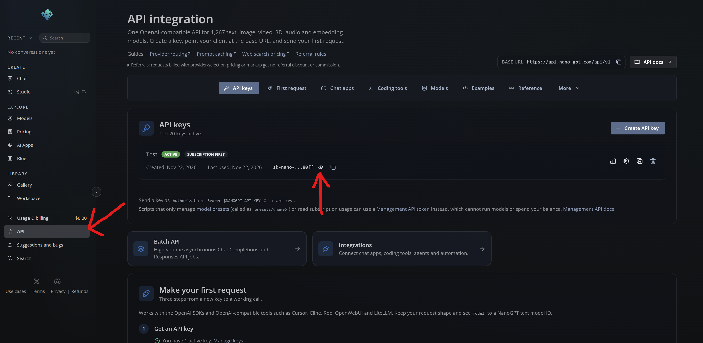

**NanoGPT 이미지 생성을 사용하면 종량제 API 키 하나로 HiDream, FLUX, Seedream, Qwen Image, Stable Diffusion XL, GPT Image 등 200개가 넘는 이미지 모델을 구독 없이 쓸 수 있습니다.** 이 가이드에서는 NanoGPT 이미지 생성 API를 Android용 AI 채팅 앱인 Layla에 연결해, AI 캐릭터가 채팅에서 이미지를 보낼 수 있게 합니다. 캐릭터가 응답에서 그림을 묘사하면 Layla Agent가 그 묘사를 NanoGPT에 보내고, 돌려받은 이미지를 저장해 대화에 표시합니다.

이 글은 두 부분으로 되어 있습니다. 첫 번째 부분에서는 _Agent_ 미니 앱에서 AI 이미지 Agent를 단계별로 만들며 각 요소가 어디에 들어가는지 보여 드립니다. 두 번째 부분에서는 Agent의 JavaScript 코드가 어떻게 작동하는지 한 줄씩 설명하므로, 코드를 수정하거나 다른 이미지 생성 API용 Agent를 직접 작성할 수 있습니다.

이 Agent는 Layla에 내장된 JavaScript 런타임에서 실행되므로 Python 인터프리터 미니 앱은 필요하지 않습니다. 직접 만들고 싶지 않다면 완성된 Agent 파일을 다운로드해 가져와도 됩니다.

Layla의 [오프라인 AI 모델](/ko/how-to-enable-image-generation-in-layla/)과 달리, 이 Agent는 인터넷 연결이 필요합니다. 이미지 묘사는 NanoGPT와 모델을 운영하는 회사로 전송되며, 이미지마다 NanoGPT 잔액에서 요금이 차감됩니다. 로컬 모델로 채팅하는 경우 나머지 대화는 기기에 남습니다.

<div class="file-download">
  <div class="file-download-info">
    <span class="file-download-label">Agent 파일</span>
    <span class="file-download-name">nanogpt-generate-image.json</span>
    <span class="file-download-hint">작동하려면 NanoGPT API 키가 필요하며, 키를 받는 방법은 아래에서 설명합니다.</span>
  </div>
  <a class="file-download-button" href="/assets/articles/how-to-create-a-nanogpt-image-generation-agent-in-layla/nanogpt-generate-image.json" download="nanogpt-generate-image.json"><svg viewBox="0 0 24 24" fill="none" stroke="currentColor" stroke-width="2" stroke-linecap="round" stroke-linejoin="round" aria-hidden="true"><path d="M12 4v11"/><path d="m7 10 5 5 5-5"/><path d="M5 20h14"/></svg>다운로드</a>
</div>

## Layla에서 NanoGPT 이미지 생성을 쓰는 이유

이미지를 전적으로 휴대폰에서 생성하고 싶다면 Layla의 Stable Diffusion 모델이 알맞은 선택입니다. NanoGPT는 다른 필요를 충족합니다.

- **이미지당 과금, 구독 없음.** 잔액을 충전해 두면 이미지마다 그 잔액에서 차감됩니다. 이 글을 쓰는 시점에서 가장 저렴한 NanoGPT 이미지 모델은 이미지당 0.5센트 미만이며, 이 Agent가 사용하는 HiDream I1 Full은 $0.0153입니다.
- **소액 충전과 암호화폐 결제.** NanoGPT는 카드는 $1부터, 암호화폐는 $0.10부터 받습니다. 큰 금액을 입금하거나 카드를 쓰지 않고 모델을 시험해 보고 싶은 사람에게 알맞습니다.
- **키 하나로 여러 이미지 모델.** HiDream, FLUX, Seedream, Qwen Image, GPT Image, Stable Diffusion XL, 그리고 Animagine XL과 Illustrious 같은 애니메이션 SDXL 모델이 모두 같은 요청 형식을 씁니다. 모델을 바꾸려면 Agent 코드에서 한 줄만 고치면 됩니다.
- **OpenAI 호환 이미지 API.** NanoGPT의 이미지 엔드포인트는 OpenAI `images/generations` API의 형식을 따르므로, 이 가이드의 코드는 다른 OpenAI 호환 이미지 생성 API용 템플릿으로도 쓸 수 있습니다.
- **채팅과 이미지를 하나의 NanoGPT 계정으로.** NanoGPT는 `https://api.nano-gpt.com/api/v1`에서 OpenAI 호환 API로 언어 모델도 제공하며, Layla는 [OpenAI 호환 API 연결](/ko/how-to-connect-layla-to-any-openai-compatible-api/)을 통해 이를 대화 자체에 사용할 수 있습니다. 이 Agent를 쓰면 같은 키로 캐릭터의 응답과 이미지를 모두 처리합니다.
- **또는 로컬 채팅 모델과 클라우드 이미지의 조합.** Agent는 캐릭터의 응답에만 반응하므로, 어떤 모델로 채팅하든 동작합니다. 대화에는 비공개 오프라인 LLM을 계속 쓰고, 휴대폰 밖으로 나가는 것은 이미지 프롬프트뿐입니다.
- **휴대폰 성능에 좌우되지 않는 이미지 품질.** 이미지는 서버에서 생성되므로, 기기 속도가 모델 크기나 대기 시간을 제한하지 않습니다.

## AI 이미지 Agent 작동 방식 한눈에 보기

이 Agent는 [OpenRouter Agent](/ko/how-to-use-the-openrouter-image-generation-agent/)나 [Nano Banana Agent](/ko/how-to-use-the-google-nano-banana-image-generation-agent/) 같은 Layla의 다른 이미지 생성 Agent와 같은 흐름을 따릅니다.

```text
이미지를 요청한다
  -> 캐릭터가 태그로 감싼 이미지 프롬프트로 응답한다
  -> Agent의 트리거가 태그를 감지한다
  -> Eval 도구가 NanoGPT API를 호출하고 이미지를 저장한다
  -> Display Image 도구가 채팅에 이미지를 표시한다
```

Agent는 세 부분으로 이루어지며, 이 Agent는 각 부분을 한 번씩 사용합니다.

1. **시스템 프롬프트**는 캐릭터의 언어 모델에게 이미지를 만들 수 있다는 것과, `<stable_diffusion_prompt></stable_diffusion_prompt>` 태그 안에 이미지 프롬프트를 써서 만든다는 것을 알려 줍니다.
2. **트리거**는 모델의 응답을 지켜봅니다. 응답에 태그가 있으면 트리거가 그 안의 텍스트를 가져와 Agent를 시작합니다.
3. **두 도구**가 차례로 실행됩니다. *Eval*은 프롬프트를 NanoGPT에 보내고 이미지를 파일로 저장하는 짧은 JavaScript 프로그램을 실행합니다. *Display Image*는 그 파일을 가져와 채팅에 표시합니다.

언어 모델은 NanoGPT와 직접 통신하지 않습니다. 텍스트만 쓰고, 그 이후는 모두 Agent가 처리합니다. 그래서 휴대폰에서 실행되는 작은 로컬 모델을 포함해 어떤 채팅 모델과도 Agent가 동작합니다.

태그 이름이 `<stable_diffusion_prompt>`인 이유는 Layla 자체의 이미지 생성도 이 태그를 감지하기 때문입니다. 이는 설정 단계에서 중요하며, [1단계](#1단계-layla의-기본-이미지-생성-끄기)에서 설명합니다.

## 준비물

- _Agent_ 미니 앱. Agent를 사용해 본 적이 없다면 먼저 [Layla에서 Agent, Function 및 Tool Calling을 활성화하는 방법](/ko/how-to-enable-agents-functions-and-tool-calling-in-layla/)을 읽어 보세요.
- 잔액이 있는 NanoGPT 계정과 NanoGPT API 키. 다음 섹션에서 방법을 설명합니다.
- 인터넷 연결.

## NanoGPT API 키를 받는 방법

API 키는 Agent가 요청을 보낼 때 NanoGPT 계정을 식별하는 긴 문자열입니다. NanoGPT 키는 `sk-nano-`로 시작합니다.

1. [nano-gpt.com](https://nano-gpt.com)에 접속해 로그인하거나 계정을 만듭니다.
2. [Balance 페이지](https://nano-gpt.com/balance)를 열고 잔액을 충전합니다. NanoGPT는 선불 방식입니다. 잔액을 충전해 두면 이미지마다 그 잔액에서 차감됩니다. 현재 잔액은 사이드바의 _Usage & billing_ 옆에 표시됩니다. 이 글을 쓰는 시점에서 NanoGPT는 카드, Apple Pay, Google Pay를 받으며, 첫 카드 입금은 최소 $1, 그 이후는 최소 $5입니다. 여러 암호화폐는 $0.10부터 받습니다. 입금 수수료는 없습니다. 현재 조건은 [가격 페이지](https://nano-gpt.com/pricing)에 나와 있습니다.
3. 사이드바에서 **API**를 선택해 _API integration_ 페이지를 열거나, [nano-gpt.com/api](https://nano-gpt.com/api)로 바로 이동합니다. _API keys_ 탭이 선택되어 있고 이미 가지고 있는 키 목록이 표시됩니다.
4. _API keys_ 섹션 오른쪽 위의 **Create API key**를 선택합니다. 새 키가 목록에 나타나며, 대부분이 가려져 있습니다.
5. 키 옆의 눈 아이콘을 선택하면 키 전체가 표시되고, 그 옆의 복사 아이콘을 선택하면 키가 복사됩니다.



목록 아래의 텍스트는 키를 보내는 방식을 보여 줍니다. `Authorization: Bearer $NANOGPT_API_KEY`입니다. Agent의 코드가 사용하는 헤더가 바로 이것이며, [요청 보내기](#요청-보내기)에서 설명합니다.

키는 비밀번호처럼 다루세요. 키를 가진 사람은 내 잔액으로 이미지를 생성할 수 있습니다. Agent를 시험해 보는 중이라면 계정에 소액만 충전해 두세요.

## NanoGPT 이미지 모델과 가격

Agent는 모델 하나와 이미지 크기 하나를 사용하며, 둘 다 코드 맨 위에서 설정합니다. NanoGPT는 [이미지 모델 페이지](https://nano-gpt.com/models/image)에 이미지 모델 목록을 제공합니다. Agent에 필요한 정확한 정보를 확인하려면 브라우저에서 모델 카탈로그를 여세요.

```text
https://api.nano-gpt.com/api/v1/images/models
```

모델마다 항목이 하나씩 있는 긴 JSON 목록이 반환됩니다. 각 항목에서 중요한 필드는 세 가지입니다.

- `id`는 `MODEL`에 넣는 값입니다.
- `supported_parameters.resolutions`는 모델이 받아들이는 크기 목록입니다. 그중 하나를 `SIZE`에 넣습니다.
- `pricing.per_image`는 크기별 이미지 한 장의 가격을 미국 달러로 보여 줍니다.

크기 이름은 모델마다 다릅니다. `1024x1024`를 쓰는 모델도 있고, `1024*1024`를 쓰는 모델도 있으며, `1k`나 `2k` 같은 이름을 쓰는 모델도 있습니다. 카탈로그에 적힌 그대로 크기를 복사하세요. 모델을 바꾼 뒤 요청이 실패하는 가장 흔한 이유는 모델이 지원하지 않는 크기입니다.

다음은 이 글을 쓰는 시점에 NanoGPT가 제공하는 텍스트-이미지 모델 중 일부와, 표시된 크기에서 이미지 한 장의 가격입니다.

| 모델                 | 모델 ID                                      | 크기 예시   | 이미지당 가격 | 비고                                                                 |
| -------------------- | -------------------------------------------- | ----------- | ------------- | -------------------------------------------------------------------- |
| HiDream-I1 Fast      | `hidream-i1-fast`                            | `1024x1024` | $0.0034       | HiDream I1의 빠른 버전. 이미지를 자주 저렴하게 생성할 때 알맞습니다. |
| Stable Diffusion XL  | `fast-sdxl`                                  | `1024x1024` | $0.0051       | Layla의 로컬 이미지 모델 다수가 기반으로 하는 SDXL 모델.             |
| WAI Illustrious SDXL | `wai-illustrious-sdxl`                       | `1024x1024` | $0.0051       | 애니메이션 SDXL 모델. 애니메이션 캐릭터와 AI 롤플레이에 알맞습니다.  |
| FLUX.3 Image Klein   | `blackforestlabs/flux-3/klein/text-to-image` | `1024x1024` | $0.009        | Black Forest Labs의 빠른 FLUX 모델. 최대 `4096x4096`까지 지원합니다. |
| FLUX.2 [klein] 9B    | `flux-2-klein-9b`                            | `1024*1024` | $0.01         | 크기 이름에 `*`를 쓰는 점에 주의하세요.                              |
| HiDream I1 Full      | `hidream`                                    | `1024x1024` | $0.0153       | 이 Agent가 기본으로 사용하는 모델. 모든 크기에서 가격이 같습니다.    |
| Seedream 5.5         | `bytedance/seedream-v5.5`                    | `1k`        | $0.02         | ByteDance의 모델. `2k`는 $0.035입니다.                               |
| Qwen Image 3         | `qwen-image-3`                               | `1k`        | $0.03         | `1k`와 `2k`를 지원합니다.                                            |
| GPT Image 2.6 Flare  | `gpt-image-2.6-flare`                        | `1k`        | 약 $0.09      | OpenAI의 모델. 사용량에 따라 과금되므로 요청마다 가격이 달라집니다.  |

가격과 모델은 자주 바뀌므로 선택하기 전에 카탈로그를 확인하세요. [맨 위의 설정](#맨-위의-설정)에서 설명하듯, 코드의 두 줄만 바꾸면 언제든 모델을 바꿀 수 있습니다.

휴대폰 화면을 채우는 세로로 긴 이미지를 원한다면, HiDream의 `768x1360`이나 `832x1248`처럼 모델의 목록에서 세로 크기를 고르세요.

## 1단계: Layla의 기본 이미지 생성 끄기

*추론 설정*을 열고 _이미지 생성_ 섹션까지 스크롤한 다음 이미지 생성 모델을 선택합니다. _Select Model_ 목록에서 **No Image Generation**(이미지 생성 안 함)을 선택하세요.


Layla에 내장된 이미지 생성도 캐릭터의 응답에서 같은 `<stable_diffusion_prompt>` 태그를 읽습니다. 모델이 여전히 선택되어 있으면 Layla가 그 태그로 자체 이미지를 생성해서 이미지가 두 장 나옵니다. *No Image Generation*을 선택하면 태그는 Agent에게 남겨집니다. [Layla에서 이미지 생성을 활성화하는 방법](/ko/how-to-enable-image-generation-in-layla/)에서 이 설정의 위치를 확인할 수 있습니다.

이미 [OpenRouter Agent](/ko/how-to-use-the-openrouter-image-generation-agent/), [Nano Banana Agent](/ko/how-to-use-the-google-nano-banana-image-generation-agent/) 또는 `<stable_diffusion_prompt>`에 반응하는 다른 Agent를 사용 중이라면, 같은 이유로 그 Agent를 끄세요.

## 2단계: 새 Agent 만들기

_Agent_ 미니 앱을 엽니다. 새 Agent를 가장 빠르게 시작하는 방법은 기존 Agent를 복제한 뒤 내용을 바꾸는 것입니다.

1. 아무 Agent 카드에서 **More**를 선택한 다음 **Duplicate**를 선택합니다.
2. 복사본에서 **Edit**를 선택합니다. Agent의 세부 정보, 트리거, 도구 흐름이 있는 _Edit Agent_ 화면이 열립니다.
3. 복사본의 기존 트리거는 각 트리거의 휴지통 아이콘으로, 각 도구는 **Remove tool**로 삭제해 빈 Agent에서 시작합니다.

만드는 단계를 건너뛰고 싶다면 이 글의 Agent 파일을 다운로드하고 _Agent_ 미니 앱 위쪽의 **Import** 버튼으로 가져오세요. 그런 다음 [7단계](#7단계-api-키-추가하기)부터 진행합니다. 가져온 Agent는 꺼진 상태로 시작하므로 카드의 스위치를 켜세요.

## 3단계: Agent 이름 정하고 시스템 프롬프트 추가하기

_Edit Agent_ 화면 맨 위의 세 필드를 채웁니다.

- **Name**: `NanoGPT Image Generation (JS)` 또는 알아보기 쉬운 이름.
- **Description**: 직접 참고할 한 문장. 예를 들어 "AI가 stable_diffusion_prompt 태그에 쓴 프롬프트로 NanoGPT 이미지 API를 사용해 이미지를 생성합니다."
- **System Prompt**: 아래 텍스트를 붙여 넣습니다.

```text
{{char}} can create images. Whenever {{user}} asks to see, draw, paint, picture or imagine something, or a visual would help the conversation, {{char}} writes an image prompt inside <stable_diffusion_prompt></stable_diffusion_prompt> tags. The image is then generated and shown in the chat automatically, so {{char}} never says it cannot create images and never describes the image as already visible before it is generated.

Rules for the tag:
- Use at most one <stable_diffusion_prompt> tag per reply, and place it at the end of the reply.
- Write the prompt in English as a comma-separated list of descriptive phrases: subject first, then appearance, clothing, pose and action, setting and background, lighting, camera angle and framing, art style or medium, and quality words.
- Be concrete and visual. Name colours, materials, time of day and mood. Do not use names the image model would not know; describe the person or thing instead.
- When the image shows {{char}} or {{user}}, describe their appearance in full inside the prompt every time.
- Keep the prompt on a single line, under 75 words, with no quotation marks, backticks or other tags inside it.

Example:
Here is the lighthouse I told you about.
<stable_diffusion_prompt>old stone lighthouse on a rocky cliff, stormy sea crashing below, dramatic overcast sky, warm light glowing from the lantern room, seagulls, wide angle, cinematic lighting, highly detailed digital painting</stable_diffusion_prompt>
```

아래의 [시스템 프롬프트 작동 방식](#1-시스템-프롬프트)에서 각 부분을 설명합니다.

## 4단계: 트리거 추가하기

_Triggers_ 아래에서 트리거를 추가하고 트리거 종류 목록에서 **Regex**를 선택합니다. 다음과 같이 설정합니다.

- **Regex**: 이 패턴을 붙여 넣습니다.

  ```text
  /<stable_diffusion_prompt>(.*?)</stable_diffusion_prompt>/s
  ```

- **Match on agent output**: 켭니다. 그러면 트리거가 내 메시지 대신 캐릭터의 응답을 확인합니다.
- **Group**: _ANY OF THESE_ (OR)로 둡니다. 트리거가 하나뿐이면 그룹은 아무 차이가 없습니다.

## 5단계: Eval 도구 추가하기

_Tools flow_ 아래에서 **Add tool**을 선택하고 **Eval**을 고릅니다. *Input mode*는 **Fixed inputs**로 두고, `code` 필드에 이 코드를 붙여 넣습니다.

```js
(async () => {
  // ---- configure these ----
  const API_KEY = "YOUR_NANOGPT_API_KEY"; // https://nano-gpt.com/api
  const MODEL = "hidream"; // any id from GET https://api.nano-gpt.com/api/v1/images/models
  const SIZE = "1024x1024";
  // --------------------------

  const PROMPT = String.raw`{{match$1}}`.trim();
  const ENDPOINT = "https://api.nano-gpt.com/v1/images/generations";

  if (!PROMPT) throw new Error("The <stable_diffusion_prompt> tag was empty.");
  if (!API_KEY || API_KEY.startsWith("YOUR_"))
    throw new Error("Set API_KEY in the NanoGPT Image Generation (JS) agent.");

  const response = await fetch(ENDPOINT, {
    method: "POST",
    headers: {
      Authorization: `Bearer ${API_KEY}`,
      "Content-Type": "application/json",
    },
    body: JSON.stringify({
      model: MODEL,
      prompt: PROMPT,
      n: 1,
      size: SIZE,
      response_format: "b64_json",
    }),
  });
  const text = await response.text();
  if (!response.ok)
    throw new Error(
      `nano-gpt returned HTTP ${response.status}: ${text.slice(0, 500)}`,
    );

  const item = (JSON.parse(text).data || [])[0];
  if (!item)
    throw new Error(`nano-gpt returned no image: ${text.slice(0, 500)}`);

  let base64;
  if (item.b64_json) {
    base64 = item.b64_json.replace(/^data:[^,]*,/, "");
  } else if (item.url) {
    // nano-gpt may answer with a link instead of base64; download it and encode it ourselves.
    const download = await fetch(item.url);
    if (!download.ok)
      throw new Error(`Image download failed: HTTP ${download.status}`);
    base64 = (await download.bytes()).toBase64();
  } else {
    throw new Error(
      `nano-gpt response had no b64_json or url: ${text.slice(0, 500)}`,
    );
  }

  const ext = base64.startsWith("/9j/")
    ? "jpg"
    : base64.startsWith("UklGR")
      ? "webp"
      : "png";
  const filename = `nanogpt_${Date.now()}.${ext}`;

  // Saved in the character workspace, the folder display-image resolves relative paths against.
  await layla.utils.saveFile(filename, base64);

  // The result is the next tool's input: display-image reads it as the image path.
  return filename;
})();
```

*Fixed inputs*는 코드가 적힌 그대로 실행된다는 뜻입니다. 다른 모드인 *AI decides*는 언어 모델에게 도구의 입력을 직접 쓰게 하는데, 이 Agent에는 필요하지 않습니다.

## 6단계: Display Image 도구 추가하기

**Add tool**을 다시 선택하고 **Display Image**를 고릅니다. 도구 흐름에서 _Eval_ 아래에 나타나므로 두 번째로 실행됩니다. `imagePath` 필드를 다음과 같이 설정합니다.

```text
{{input}}
```

**Save changes**를 선택합니다. Agent 목록으로 돌아가 Agent 카드의 스위치가 켜져 있는지 확인하세요.

## 7단계: API 키 추가하기

**Edit**로 Agent를 열고 _Eval_ 코드 앞부분에서 이 줄을 찾습니다.

```js
const API_KEY = "YOUR_NANOGPT_API_KEY";
```

`YOUR_NANOGPT_API_KEY`를 내 키로 바꾸고 따옴표는 그대로 둡니다. 다른 모델이나 크기를 골랐다면 다음 두 줄의 `MODEL`과 `SIZE`도 바꾸세요. Agent를 저장합니다.

이제 키가 Agent 안에 저장되었습니다. Agent를 공유하거나 **Share**로 내보내기 전에 키를 원래의 자리표시자로 되돌리세요.

## 8단계: Agent 테스트하기

Agent 카드에서 **Test**를 선택합니다. 테스트 화면에서 다음을 진행합니다.

1. **Test as output**을 켭니다. Agent의 트리거는 캐릭터의 응답만 보므로, 테스트 입력도 응답으로 취급되어야 합니다.
2. 태그가 들어 있는 응답을 입력합니다. 예를 들면 다음과 같습니다.

   ```text
   <stable_diffusion_prompt>red fox curled up in fresh snow, soft morning light, shallow depth of field, wildlife photograph</stable_diffusion_prompt>
   ```

3. 테스트를 실행합니다.

_Activity_ 목록에 각 도구가 실행되는 동안의 상태가 표시됩니다. 테스트가 성공하면 NanoGPT에 실제 요청이 한 번 전송되어 이미지 한 장의 요금이 들며, 두 도구 모두 오류 없이 끝납니다. 스크립트가 오류로 멈추면 오류 메시지가 _Eval_ 단계에 표시됩니다. 흔한 오류는 [문제 해결](#문제-해결)에 정리되어 있습니다. 테스트 화면에 대한 자세한 설명은 [Layla Agents 심층 분석](/ko/deep-dive-into-layla-agents/)을 참고하세요.

테스트는 이미지를 채팅에 넣지 않습니다. 테스트가 통과하면 실제 대화에서 Agent를 사용해 보세요.

## 9단계: 채팅에서 이미지 요청하기

채팅을 시작하고 이미지를 요청합니다. 예를 들어 "해 질 녘 절벽 위의 등대를 보여 줘"라고 보내 보세요. 캐릭터가 메시지 끝에 이미지 프롬프트를 넣어 응답하고 Agent가 실행되며, 몇 초 후 이미지가 채팅에 나타납니다.

## NanoGPT 이미지 Agent 코드 작동 방식

이 섹션에서는 직접 만든 각 부분을 따라가며 왜 그렇게 작성되었는지 설명합니다. [Layla Agents 심층 분석](/ko/deep-dive-into-layla-agents/)에서 같은 구성 요소를 전반적으로 다룹니다.

### 1. 시스템 프롬프트

Agent의 시스템 프롬프트는 Agent가 활성화되어 있는 동안 Agent의 실행 여부와 관계없이 매 턴 캐릭터의 시스템 프롬프트에 추가됩니다. 프롬프트가 모델에 전달되기 전에 Layla는 `{{char}}`를 캐릭터 이름으로, `{{user}}`를 내 이름으로 바꿉니다.

프롬프트의 각 부분에는 역할이 있습니다.

- **"{{char}} can create images."**({{char}}는 이미지를 만들 수 있다): 많은 언어 모델은 이미지를 만들 수 없다고 말하도록 학습되어 있습니다. 이 능력을 명시하고 "never says it cannot create images"(이미지를 만들 수 없다고 절대 말하지 않는다)를 덧붙이면 캐릭터가 거절하지 않습니다.
- **"Whenever {{user}} asks to see, draw, paint, picture or imagine something, or a visual would help the conversation"**({{user}}가 무언가를 보여 달라거나 그려 달라거나 상상해 달라고 할 때, 또는 시각 자료가 대화에 도움이 될 때)는 이미지가 나타나는 시점을 정합니다. 마지막 부분 덕분에 캐릭터는 요청받지 않아도 이미지를 보낼 수 있습니다. 이미지마다 요금이 들므로, 요청할 때만 이미지를 받고 싶다면 "or a visual would help the conversation"을 삭제하세요.
- **"Never describes the image as already visible before it is generated"**(이미지가 생성되기 전에 이미 보이는 것처럼 묘사하지 않는다)는 "사진에서 보이듯이…" 같은 응답을 막습니다. 이미지가 아직 만들어지는 중이라 그런 응답은 어색하게 읽힙니다.
- **"At most one tag per reply, at the end"**(응답당 태그는 최대 하나, 끝에 둔다)가 중요한 이유는 트리거가 응답의 첫 번째 태그만 읽기 때문입니다. 두 번째 태그는 무시되며, 태그를 끝에 두면 이미지를 소개하는 텍스트 바로 옆에 이미지가 놓입니다.
- **"A comma-separated list of descriptive phrases"**(쉼표로 구분한 묘사 구문 목록)와 그 순서(피사체, 외모, 자세, 배경, 조명, 구도, 화풍)는 HiDream이나 Stable Diffusion 같은 이미지 모델이 가장 잘 반응하는 프롬프트 스타일입니다.
- **"Do not use names the image model would not know"**(이미지 모델이 모르는 이름을 쓰지 않는다)가 있는 이유는 이미지 모델이 내 캐릭터에 대해 들어 본 적이 없기 때문입니다. "짧은 붉은 머리와 초록색 눈의 여성"은 일관된 결과를 내지만, 이름은 그렇지 않습니다.
- **"Describe their appearance in full inside the prompt every time"**(매번 프롬프트 안에 외모를 빠짐없이 묘사한다)도 같은 이유에서 나옵니다. 이미지 모델은 대화가 아니라 이 프롬프트 하나만 보므로, 모든 프롬프트에 전체 묘사가 담겨 있어야 합니다.
- **"Single line, under 75 words, with no quotation marks, backticks or other tags"**(한 줄, 75단어 미만, 따옴표·백틱·다른 태그 없음)는 스크립트를 보호합니다. [맨 위의 설정](#맨-위의-설정)에서 설명하듯, 프롬프트 안에 백틱이 있으면 코드가 깨집니다. 단어 수 제한은 프롬프트를 짧고 핵심적으로 유지하며, 이는 오래된 이미지 모델에 잘 맞습니다. Stable Diffusion의 텍스트 인코더는 한 번에 75토큰만 읽는데, 이는 75단어보다 적습니다.
- **예시**는 정확한 형식을 보여 줍니다. 언어 모델은 형식에 대한 설명보다 예시를 더 안정적으로 따릅니다.

### 2. 트리거

트리거는 *Match on agent output*이 켜진 _Regex_ 트리거이므로, 캐릭터의 완성된 응답을 하나하나 확인합니다. 패턴은 다음과 같습니다.

```text
/<stable_diffusion_prompt>(.*?)</stable_diffusion_prompt>/s
```

- Layla는 첫 번째 `/`와 마지막 `/` 사이의 텍스트를 패턴으로, 마지막 `/` 뒤의 글자를 플래그로 읽습니다. 닫는 태그 안의 `/`는 패턴의 일부이므로 이스케이프할 필요가 없습니다.
- 여는 태그와 닫는 태그는 응답 속 태그 문자열 그대로와 일치합니다.
- `(.*?)`는 캡처 그룹입니다. 태그 사이의 모든 내용을 모읍니다. `?` 때문에 마지막 닫는 태그가 아니라 첫 번째 닫는 태그에서 멈춥니다.
- `s` 플래그는 `.`이 줄바꿈과도 일치하게 하므로, 모델이 프롬프트를 여러 줄로 나눠 써도 트리거가 작동합니다.

패턴이 일치하면 일치한 전체가 `{{match$0}}`이 되고, 그룹이 캡처한 텍스트가 `{{match$1}}`이 됩니다. _Eval_ 코드는 태그를 뺀 프롬프트만 담긴 `{{match$1}}`을 사용합니다.

트리거는 생각(thinking) 블록을 제거한 응답을 읽습니다. 따라서 추론 모델이 아직 생각하는 도중에 태그를 써도 Agent가 시작되지 않습니다. 보이는 응답 안의 태그만 해당됩니다.

### 3. Eval 도구: NanoGPT 이미지 API 호출하기

*Eval*은 Layla 내부의 샌드박스 QuickJS 런타임에서 JavaScript를 실행합니다. 실행할 때마다 새 런타임이 만들어지고 실행 후 제거됩니다. 웹 페이지나 Node.js 모듈은 없지만, 이 Agent에 필요한 것은 제공합니다.

- 웹 요청용 `fetch`. 응답은 `.text()`, `.json()`, `.bytes()`, `.arrayBuffer()`를 지원합니다.
- base64 텍스트를 다루는 `atob`, `btoa`, 그리고 바이트 배열의 `toBase64()`.
- `setTimeout`과 `AbortController`.
- 파일 저장 같은 Layla 기능에 스크립트가 접근하게 해 주는 `layla`라는 전역 객체.

*Eval*은 스크립트의 마지막 식의 값을 반환합니다. 그 값이 Promise라면 *Eval*은 먼저 완료될 때까지 기다립니다. 반환된 값은 다음 도구의 입력이 됩니다.

#### async 래퍼

```js
(async () => {
  // ...
})();
```

스크립트 전체가 바로 자기 자신을 호출하는 async 화살표 함수 안에 들어 있습니다. 이 패턴은 두 가지 일을 합니다. 코드가 `await`로 네트워크 응답을 기다릴 수 있게 하고, `return`으로 결과를 돌려줄 수 있게 합니다. 이 함수 호출이 스크립트의 마지막 식이므로, *Eval*은 함수가 반환하는 Promise를 기다린 뒤 그 결과인 파일 이름을 도구의 출력으로 사용합니다.

#### 맨 위의 설정

```js
const API_KEY = "YOUR_NANOGPT_API_KEY"; // https://nano-gpt.com/api
const MODEL = "hidream"; // any id from GET https://api.nano-gpt.com/api/v1/images/models
const SIZE = "1024x1024";

const PROMPT = String.raw`{{match$1}}`.trim();
const ENDPOINT = "https://api.nano-gpt.com/v1/images/generations";
```

바꾸고 싶을 만한 것들이 모두 한곳에 있습니다.

- `API_KEY`는 내 NanoGPT 키입니다.
- `MODEL`은 NanoGPT 카탈로그에 있는 모델의 `id`입니다.
- `SIZE`는 모델의 `supported_parameters.resolutions` 목록에 있는 크기 중 하나이며, 카탈로그에 적힌 그대로 씁니다.
- `ENDPOINT`는 NanoGPT의 OpenAI 호환 이미지 생성 주소입니다. 모든 모델에서 같습니다. OpenAI 이미지 API의 형식을 따르므로, 주소와 키만 바꾸면 OpenAI 호환 `images/generations` 엔드포인트를 제공하는 다른 서비스에서도 같은 코드가 작동합니다.

`PROMPT`는 좀 더 자세히 볼 필요가 있습니다. 코드가 실행되기 전에 Layla가 `{{match$1}}`을 트리거가 캡처한 텍스트로 바꾸므로, 이미지 프롬프트가 프로그램의 일부가 됩니다. Layla는 어떤 문자도 이스케이프하지 않고 텍스트를 그대로 붙여 넣습니다. 그래서 프롬프트를 백틱 사이의 텍스트인 템플릿 리터럴 안에 둡니다.

- 템플릿 리터럴에는 따옴표와 줄바꿈이 들어갈 수 있습니다. 일반 `"…"` 문자열이라면 이런 문자 때문에 문자열이 일찍 끝나 스크립트가 깨집니다.
- `String.raw`는 백슬래시를 `\n` 같은 이스케이프 코드로 읽지 않고 입력한 그대로 유지합니다.
- `.trim()`은 프롬프트 앞뒤의 공백과 줄바꿈을 제거합니다.

템플릿 리터럴도 백틱에서는 끝나며, 안에 `${`가 있으면 코드 조각이 시작됩니다. 프롬프트에 둘 중 하나가 있으면 스크립트가 깨지므로, 시스템 프롬프트가 백틱을 금지합니다.

#### 입력 확인하기

```js
if (!PROMPT) throw new Error("The <stable_diffusion_prompt> tag was empty.");
if (!API_KEY || API_KEY.startsWith("YOUR_"))
  throw new Error("Set API_KEY in the NanoGPT Image Generation (JS) agent.");
```

태그가 비어 있거나 키가 설정되지 않은 경우, 스크립트는 읽기 쉬운 메시지와 함께 일찍 멈춥니다. 성공할 수 없는 요청에 돈을 쓸 이유는 없습니다.

_Eval_ 스크립트가 오류를 던지면 Agent가 멈추고 *Display Image*는 실행되지 않습니다. Layla는 오류 메시지를 언어 모델에 다시 전달하므로, 채팅에서는 캐릭터가 문제가 생겼다고 알려 줄 수 있습니다. 테스트 화면에서는 메시지가 _Eval_ 단계에 표시됩니다.

#### 요청 보내기

```js
const response = await fetch(ENDPOINT, {
  method: "POST",
  headers: {
    Authorization: `Bearer ${API_KEY}`,
    "Content-Type": "application/json",
  },
  body: JSON.stringify({
    model: MODEL,
    prompt: PROMPT,
    n: 1,
    size: SIZE,
    response_format: "b64_json",
  }),
});
const text = await response.text();
```

NanoGPT와 통신하는 부분입니다.

- `fetch`는 엔드포인트에 `POST` 요청을 보내고, `await`는 응답을 기다립니다.
- `Authorization` 헤더는 API 키를 NanoGPT가 기대하는 형식인 bearer 토큰으로 전달합니다. 키는 웹 주소에 포함되지 않습니다.
- `Content-Type` 헤더는 본문이 JSON이라고 NanoGPT에 알려 줍니다.
- `JSON.stringify`는 요청 데이터를 JSON 텍스트로 바꿉니다. `model`, `prompt`, `size`는 설정에서 가져옵니다. `n: 1`은 이미지 한 장을 요청합니다. `response_format: "b64_json"`은 이미지 링크 대신 이미지 자체를 base64 텍스트로 보내 달라고 NanoGPT에 요청합니다.
- `response.text()`는 응답 전체를 텍스트로 읽습니다. 스크립트가 바로 `response.json()`을 호출하지 않고 텍스트로 읽는 이유는, 문제가 생겼을 때 원래 응답을 오류 메시지에 포함하기 위해서입니다.

NanoGPT의 [이미지 생성 문서](https://docs.nano-gpt.com/api-reference/endpoint/image-generation-openai)에는 본문에 추가할 수 있는 다른 필드가 나와 있습니다. `seed`, `guidance_scale`, `num_inference_steps` 같은 일부 필드는 특정 모델에서만 작동합니다.

#### 응답 상태 확인하기

```js
if (!response.ok)
  throw new Error(
    `nano-gpt returned HTTP ${response.status}: ${text.slice(0, 500)}`,
  );
```

`response.ok`는 HTTP 상태가 200번대일 때, 즉 요청이 성공했을 때 true입니다. 그렇지 않으면 스크립트가 멈추고 상태 코드와 NanoGPT 응답의 처음 500자를 오류에 포함합니다. NanoGPT는 그 응답에서 문제를 설명하므로, 잘못된 키, 부족한 잔액, 모델이 받아들이지 않는 크기가 테스트 화면에 명확한 메시지로 표시됩니다.

#### 응답에서 이미지 찾기

```js
const item = (JSON.parse(text).data || [])[0];
if (!item) throw new Error(`nano-gpt returned no image: ${text.slice(0, 500)}`);
```

NanoGPT의 성공 응답은 다음과 같습니다.

```json
{
  "created": 1795351940,
  "data": [{ "b64_json": "iVBORw0KGgo..." }],
  "cost": 0.0153,
  "remainingBalance": 4.9847
}
```

`JSON.parse`는 텍스트를 객체로 바꿉니다. `data`는 이미지 목록이며, `[0]`은 첫 번째 이미지를 가져옵니다. `|| []` 부분은 `data`가 없을 때 빈 목록을 사용하므로, 스크립트가 중단되지 않고 "no image"를 보고합니다. 응답에는 이미지 비용과 남은 잔액도 들어 있습니다.

#### base64로 이미지 받기

```js
let base64;
if (item.b64_json) {
  base64 = item.b64_json.replace(/^data:[^,]*,/, "");
} else if (item.url) {
  const download = await fetch(item.url);
  if (!download.ok)
    throw new Error(`Image download failed: HTTP ${download.status}`);
  base64 = (await download.bytes()).toBase64();
} else {
  throw new Error(
    `nano-gpt response had no b64_json or url: ${text.slice(0, 500)}`,
  );
}
```

base64는 이미지 같은 이진 데이터를 일반 문자와 숫자로 표현하는 방식입니다. Layla의 파일 저장 함수는 base64를 받으므로, 이 블록은 NanoGPT가 어떤 형식을 쓰든 스크립트가 base64 텍스트를 얻도록 합니다.

- **`b64_json`**: 요청에서 이 형식을 요구했으므로 일반적인 경우입니다. `replace` 호출은 `data:image/png;base64,` 접두사가 있으면 제거합니다. 파일에는 base64 데이터만 들어가야 하기 때문입니다. 접두사가 없으면 `replace`는 아무것도 바꾸지 않습니다.
- **`url`**: 일부 모델이나 base64를 보낼 수 없는 경우, NanoGPT가 대신 링크로 응답할 수 있습니다. 스크립트는 두 번째 `fetch`로 이미지를 다운로드하고, `.bytes()`로 원시 바이트를 읽은 뒤, `.toBase64()`로 바이트를 base64로 변환합니다. NanoGPT의 링크는 약 하루 뒤에 만료되므로, 스크립트는 링크를 저장하지 않고 사본을 저장합니다.
- **둘 다 없음**: 스크립트가 NanoGPT가 보낸 내용을 보여 주는 오류와 함께 멈춥니다.

#### 파일 이름 정하기

```js
const ext = base64.startsWith("/9j/")
  ? "jpg"
  : base64.startsWith("UklGR")
    ? "webp"
    : "png";
const filename = `nanogpt_${Date.now()}.${ext}`;
```

모델마다 반환하는 이미지 형식이 다르고, NanoGPT의 응답이 항상 형식을 알려 주지는 않습니다. 스크립트는 base64 텍스트의 첫 글자들로 형식을 알아냅니다. 모든 이미지 형식은 고정된 시그니처로 시작하며, 그 시그니처는 항상 같은 base64 문자로 인코딩됩니다.

- `/9j/`는 JPEG 파일의 시작입니다.
- `UklGR`은 WebP 파일의 시작입니다.
- 그 밖의 경우는 가장 흔한 형식인 PNG로 저장됩니다. PNG 파일은 `iVBOR`로 인코딩됩니다.

`Date.now()`는 현재 시각을 밀리초 단위로 붙이므로, 이미지마다 고유한 파일 이름이 생기고 새 이미지가 채팅 기록의 이전 이미지를 덮어쓰지 않습니다.

#### 파일 저장하고 이름 반환하기

```js
await layla.utils.saveFile(filename, base64);
return filename;
```

`layla.utils.saveFile`은 base64 텍스트를 디코딩해 캐릭터의 워크스페이스에 파일을 씁니다. 워크스페이스는 채팅 중인 캐릭터에 속한 비공개 폴더입니다. 경로는 그 폴더를 기준으로 한 상대 경로입니다.

그다음 스크립트는 파일 이름을 반환합니다. 이 이름이 _Eval_ 도구의 출력이 됩니다.

### 4. Display Image 도구

두 번째 도구는 *Display Image*이며, 유일한 설정은 다음과 같습니다.

```text
{{input}}
```

`{{input}}`은 이전 도구의 출력, 즉 스크립트가 반환한 파일 이름으로 대체됩니다. *Display Image*는 스크립트가 파일을 저장한 캐릭터의 워크스페이스에서 먼저 그 이름을 찾습니다. 파일을 Layla의 채팅 이미지 저장소로 복사해 캐릭터의 응답에 첨부하며, 이미지가 채팅에 나타납니다.

*Display Image*는 텍스트를 반환하지 않으므로, 이미지가 표시되면 Agent는 조용히 끝납니다. 언어 모델에게 다시 응답하라고 요청하지 않습니다.

## Agent 사용자 지정: 다른 모델, 휴대폰 크기 이미지, AI 롤플레이

다음 변경은 모두 같은 Agent에서 시작합니다.

- **다른 모델 사용하기.** `MODEL`을 다른 모델의 `id`로, `SIZE`를 그 모델의 크기 중 하나로 바꾼 다음 Agent를 다시 테스트하세요. 애니메이션 캐릭터에는 보통 사진 스타일 모델보다 `wai-illustrious-sdxl` 같은 애니메이션 SDXL 모델이 더 잘 맞습니다.
- **휴대폰 화면에 맞는 세로로 긴 이미지 만들기.** `SIZE`를 모델 목록의 세로 크기로 설정하세요. 예를 들어 HiDream은 `768x1360`, HiDream-I1 Fast는 `1088x1920`입니다.
- **메시지마다 이미지 생성하기.** [이미지 생성 Agent 만들기](/ko/creating-an-image-generation-agent/)처럼, 시스템 프롬프트의 첫 문단을 모든 응답을 현재 장면의 이미지 프롬프트로 끝내라는 지시문으로 바꾸세요. AI 롤플레이와 스토리텔링에 잘 맞지만, 그러면 응답마다 이미지 한 장의 요금이 듭니다. `hidream-i1-fast` 같은 저렴한 모델을 쓰면 비용을 줄일 수 있습니다.
- **AI 캐릭터의 이미지를 일관되게 유지하기.** 캐릭터의 *시나리오*에 다음과 같은 지시문을 추가하세요. "`<stable_diffusion_prompt>`를 쓸 때는 자신을 짧은 붉은 머리, 초록색 눈, 주근깨가 있는 20대 후반의 여성으로 묘사할 것." 그러면 모델이 모든 프롬프트에서 같은 외모를 반복합니다. 같은 지시문에 "수채화 일러스트" 같은 고정된 화풍을 추가하는 것도 도움이 됩니다.
- **생성 설정 추가하기.** 지원하는 모델이라면 `JSON.stringify` 안의 객체에 `seed: 42` 같은 필드를 추가하세요. 시드를 고정하면 같은 프롬프트에서 비슷한 이미지가 나옵니다.
- **다른 서비스용 Agent 작성하기.** 시스템 프롬프트, 트리거, *Display Image*는 어떤 이미지 서비스에서도 그대로입니다. 바뀌는 것은 요청과, 스크립트가 응답에서 이미지를 찾는 방식뿐입니다. [OpenRouter Agent](/ko/how-to-use-the-openrouter-image-generation-agent/)와 [Nano Banana Agent](/ko/how-to-use-the-google-nano-banana-image-generation-agent/)는 같은 패턴의 또 다른 예시입니다.

이미지 Agent는 한 번에 하나만 켜 두세요. 모두 같은 태그에 반응하기 때문입니다.

## 문제 해결

### 이미지가 두 장 나온 이유는 무엇인가요?

Layla에 내장된 이미지 생성이 아직 켜져 있거나, `<stable_diffusion_prompt>`에 반응하는 다른 Agent가 켜져 있습니다. 추론 설정에서 *No Image Generation*을 선택하고 다른 이미지 Agent를 끄세요.

### Agent가 "Set API_KEY in the NanoGPT Image Generation (JS) agent."라고 표시합니다

키 자리표시자가 코드에 그대로 남아 있습니다. Agent를 열고 _Eval_ 코드를 편집해 `YOUR_NANOGPT_API_KEY`를 내 키로 바꾸세요.

### NanoGPT API 키가 작동하지 않는 이유는 무엇인가요?

NanoGPT가 요청을 거부하면 Agent는 "nano-gpt returned HTTP"로 시작하고 상태 코드와 NanoGPT가 직접 쓴 설명이 이어지는 오류와 함께 멈춥니다. 흔한 원인은 다음과 같습니다.

- **잘못되었거나 삭제된 키.** [API 페이지](https://nano-gpt.com/api)에서 키를 다시 복사하거나 새 키를 만드세요.
- **잔액 부족.** [Balance 페이지](https://nano-gpt.com/balance)에서 잔액을 충전하세요.
- **모델이 받아들이지 않는 크기나 모델 ID.** 카탈로그에서 모델 항목을 확인하고, `id`와 `supported_parameters.resolutions`의 크기를 `x`, `*`, `1k` 같은 이름 중 무엇을 쓰는지까지 그대로 복사하세요.

### 테스트에서 Agent가 트리거되지 않았다고 나옵니다

**Test as output**을 켜고, 테스트 입력에 여는 태그와 닫는 태그가 모두 들어 있는지 확인하세요.

### 캐릭터가 이미지를 보내지 않습니다

Agent의 스위치가 켜져 있어 시스템 프롬프트가 채팅에 추가되는지 확인하세요. 작은 로컬 모델은 가끔 태그를 잊습니다. "…그림을 그려 줘"처럼 직접 요청하면 대개 효과가 있습니다. 캐릭터가 태그를 썼는데 이미지가 나타나지 않는다면, 캐릭터의 응답을 그대로 넣어 Agent의 **Test**를 실행해 어느 단계에서 실패하는지 확인하세요.

### 이미지가 거부되었거나 빈 결과가 왔습니다

각 회사는 자사 모델에 자체 콘텐츠 정책을 적용합니다. 한 모델이 거부한 프롬프트가 다른 모델에서는 작동할 수 있습니다. 스크립트는 NanoGPT가 보낸 응답을 보고하므로, 테스트 화면에 이유가 표시됩니다.

## 자주 묻는 질문

### NanoGPT API 키는 어떻게 받나요?

[nano-gpt.com](https://nano-gpt.com)에 로그인하고 Balance 페이지에서 잔액을 충전한 다음, 사이드바에서 **API**를 선택하고 **Create API key**를 선택하세요. 눈 아이콘으로 키를 표시하거나 복사 아이콘으로 복사할 수 있습니다. NanoGPT 키는 `sk-nano-`로 시작합니다.

### NanoGPT 이미지 생성 비용은 얼마인가요?

모델마다 가격이 다르며, NanoGPT 카탈로그에 나와 있습니다. 이 글을 쓰는 시점에서 이 Agent가 기본으로 사용하는 HiDream I1 Full은 이미지당 $0.0153이며, 가장 저렴한 모델은 0.5센트 미만입니다. NanoGPT 잔액에서 지출한 금액을 확인할 수 있으며, API의 모든 응답에 해당 이미지의 비용이 포함됩니다.

### NanoGPT 이미지 생성에 구독이 필요한가요?

아니요. NanoGPT는 선불 잔액 방식으로 작동하며, 이미지마다 잔액에서 요금이 차감됩니다. NanoGPT는 선택 사항인 월 구독도 제공하며, 포함 내용은 [가격 페이지](https://nano-gpt.com/pricing)에 나와 있습니다.

### NanoGPT 이미지 생성 API 엔드포인트는 무엇인가요?

OpenAI 호환 엔드포인트는 `https://api.nano-gpt.com/v1/images/generations`이며, `POST`로 호출하고 `Authorization: Bearer` 헤더에 키를 넣습니다. 같은 엔드포인트가 모든 이미지 모델을 제공하며, `model` 필드로 실행할 모델을 고릅니다. 모델 카탈로그는 `https://api.nano-gpt.com/api/v1/images/models`에 있습니다.

### 이 Agent를 다른 OpenAI 호환 이미지 생성 API에 쓸 수 있나요?

대개 가능합니다. `ENDPOINT`를 다른 서비스의 `images/generations` 주소로, `API_KEY`를 그 서비스의 키로, `MODEL`과 `SIZE`를 그 서비스가 받아들이는 값으로 바꾸세요. 스크립트는 이미 OpenAI 호환 이미지 API가 쓰는 두 가지 응답 형식인 `b64_json`과 `url`을 모두 처리합니다.

### 성인용 콘텐츠를 허용하는 NanoGPT 이미지 모델은 무엇인가요?

NanoGPT 카탈로그는 각 모델에 `capabilities.nsfw` 필드를 표시합니다. 이 글을 쓰는 시점에서 텍스트-이미지 모델 중 37개가 `true`로 표시되어 있으며, HiDream O1 Image, Qwen Image 3 Uncensored, 그리고 WAI Illustrious SDXL 같은 여러 애니메이션 및 사실적 SDXL 모델이 포함됩니다. 선택한 모델에 의존하기 전에 이 필드를 확인하세요. 모든 요청에는 여전히 NanoGPT의 서비스 약관이 적용됩니다. 외부 서비스를 전혀 거치지 않는 이미지 생성에는 Layla의 [로컬 Stable Diffusion 모델](/ko/how-to-enable-image-generation-in-layla/)을 사용하세요.

### NanoGPT를 이미지뿐 아니라 채팅에도 쓸 수 있나요?

네. NanoGPT는 `https://api.nano-gpt.com/api/v1`에서 OpenAI 호환 API로 언어 모델을 제공합니다. [Layla를 모든 OpenAI 호환 API에 연결하는 방법](/ko/how-to-connect-layla-to-any-openai-compatible-api/)에 설명된 대로 같은 키로 Layla에 추가하면, 이 Agent가 이미지를 더해 줍니다.

### Android용 NanoGPT 앱이 있나요?

NanoGPT는 웹사이트이자 API입니다. Layla는 NanoGPT와 함께 작동하는 Android 앱입니다. OpenAI 호환 API 연결을 통해 NanoGPT의 언어 모델과 채팅할 수 있고, 이 Agent를 통해 NanoGPT의 이미지 모델로 이미지를 생성할 수 있습니다.

### SillyTavern 캐릭터로 NanoGPT 이미지 생성을 쓸 수 있나요?

네. SillyTavern에는 NanoGPT 이미지 소스가 내장되어 있으며, 이 Agent를 쓰면 휴대폰의 채팅 앱에서 비슷한 구성을 쓸 수 있습니다. Layla는 SillyTavern이 쓰는 형식인 [TavernPNG 캐릭터 카드](/ko/how-to-import-tavernpng-characters-in-layla/)와 [SillyTavern 프리셋](/ko/how-to-use-sillytavern-presets-in-layla/)을 가져올 수 있으며, 이 Agent는 어떤 캐릭터와도 작동합니다.

### Android에서 AI 챗봇이 사진을 보낼 수 있나요?

네. 이 Agent를 쓰면 Layla 캐릭터가 요청할 때마다, 또는 그렇게 설정하면 메시지마다 이미지를 보냅니다. [Layla에서 이미지 생성을 활성화하는 방법](/ko/how-to-enable-image-generation-in-layla/)에 설명된 대로, Layla는 휴대폰에서 실행되는 Stable Diffusion 모델을 사용해 클라우드 서비스 없이도 이미지를 보낼 수 있습니다.

### Python 인터프리터 미니 앱이 필요한가요?

아니요. Agent는 Layla 자체에서 JavaScript를 실행하는 _Eval_ 도구를 사용합니다.

### 내 프롬프트는 비공개인가요?

이미지 프롬프트는 NanoGPT와, 선택한 모델을 운영하는 회사로 전송됩니다. NanoGPT의 [개인정보처리방침](https://nano-gpt.com/legal/privacy-policy)에는 기본적으로 프롬프트 내용을 서버에 저장하지 않는다고 나와 있지만, 문서에는 이미지 모델을 운영하는 회사가 자체 정책에 따라 프롬프트와 이미지를 보관할 수 있다는 설명도 있습니다. 로컬 모델로 채팅한다면 나머지 대화는 기기에 남습니다.

### 인터넷 연결 없이 이 Agent를 사용할 수 있나요?

아니요. Agent는 NanoGPT 서버를 호출합니다. 전적으로 휴대폰에서 실행되는 이미지 생성에는 [Layla에서 이미지 생성을 활성화하는 방법](/ko/how-to-enable-image-generation-in-layla/)에 설명된 로컬 모델 중 하나를 사용하세요.

### 생성된 이미지는 어디에 저장되나요?

스크립트는 각 이미지를 캐릭터의 워크스페이스 폴더에 저장하고, *Display Image*가 이를 Layla의 채팅 이미지 저장소로 복사하므로 이미지가 채팅 기록에 남습니다.

## 마치며

NanoGPT Agent는 Layla의 다른 이미지 생성 Agent와 같은 네 가지 요소를 사용합니다. 태그로 감싼 이미지 프롬프트를 요청하는 시스템 프롬프트, 그것을 잡아내는 정규식 트리거, 프롬프트를 이미지로 바꾸는 짧은 스크립트, 그리고 결과를 채팅에 표시하는 *Display Image*입니다. NanoGPT는 엔드포인트 하나로 200개가 넘는 이미지 모델을 제공하므로, 같은 스크립트에서 두 줄만 바꾸면 AI 캐릭터가 HiDream, FLUX, SDXL, GPT Image 이미지를 보낼 수 있습니다.

Layla는 Android용 오프라인 AI 어시스턴트로 만들어졌으며, 완전히 비공개인 오프라인 채팅과 이미지 생성에는 여전히 로컬 모델이 알맞은 선택입니다. NanoGPT 이미지 생성은 특정 온라인 모델을 채팅에 쓰고 싶고 연결과 이미지당 비용을 감수할 수 있을 때의 선택지입니다.

## Agent 다운로드

<div class="file-download">
  <div class="file-download-info">
    <span class="file-download-label">Agent 파일</span>
    <span class="file-download-name">nanogpt-generate-image.json</span>
    <span class="file-download-hint">Agent 미니 앱의 <em>Import</em> 버튼으로 가져온 다음 API 키를 추가하세요.</span>
  </div>
  <a class="file-download-button" href="/assets/articles/how-to-create-a-nanogpt-image-generation-agent-in-layla/nanogpt-generate-image.json" download="nanogpt-generate-image.json"><svg viewBox="0 0 24 24" fill="none" stroke="currentColor" stroke-width="2" stroke-linecap="round" stroke-linejoin="round" aria-hidden="true"><path d="M12 4v11"/><path d="m7 10 5 5 5-5"/><path d="M5 20h14"/></svg>다운로드</a>
</div>
