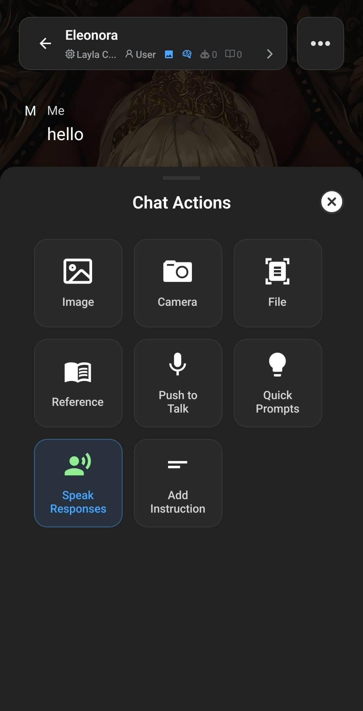

Layla는 캐릭터의 답변을 소리 내어 읽어줄 수 있습니다. 방법은 세 가지이며 각각 어울리는 상황이 다릅니다. 손을 쓰지 않는 음성 대화, 계속 입력하면서 모든 답변을 자동으로 읽어주는 방식, 그리고 특정 메시지 하나만 원할 때 읽어주는 방식입니다.

어떤 방법이든 소리가 나오려면 캐릭터에 목소리가 설정되어 있어야 합니다. 아직 설정하지 않았다면 [Layla에서 PocketTTS를 사용하는 방법](/how-to-use-pockettts-in-layla/) 또는 [Layla에서 캐릭터에 다국어 음성 합성을 추가하는 방법](/how-to-add-multilingual-text-to-speech-for-your-characters-in-layla/)을 참고하세요.

## 음성 채팅 시작하기

음성 채팅은 손을 쓰지 않고 주고받는 음성 대화입니다. Layla가 여러분의 말을 듣고 음성을 텍스트로 변환한 뒤 답변을 생성하고 그 답변을 소리 내어 읽어줍니다. 애니메이션 캐릭터를 사용하면 캐릭터의 입술이 목소리에 맞춰 움직입니다.

시작하려면 채팅을 열고 메시지 입력창 옆 메시지 바에서 **파형 아이콘**을 누르세요. Layla가 음성 채팅 모드로 전환되며 시작하는 동안 _음성 채팅을 초기화하는 중..._ 이 표시됩니다.

마이크 버튼이 초록색으로 바뀌면 말을 시작하세요. 말을 멈추면 Layla가 내용을 처리할 시간을 잠시 준 뒤 소리로 답변합니다. 음성 채팅 모드에서는 다음 기능을 사용할 수 있습니다.

- **일시정지 및 재개** — 대화를 잠시 멈췄다가 준비되면 다시 이어갑니다.
- **길게 눌러 계속 말하기** — Layla가 응답하기 전에 생각을 마무리할 시간이 더 필요하면 길게 누르세요.
- **음성 채팅 중지** — 빨간색 버튼을 누르면 음성 채팅 모드가 끝나고 일반 텍스트 화면으로 돌아갑니다.

인식률을 높이려면 또렷하게 말하고 조용한 공간을 사용하세요. 주변 소음은 음성 인식 단계를 방해할 수 있습니다.

## 응답을 자동으로 읽어주기

입력은 계속하면서 답변이 도착할 때마다 읽어주기를 원한다면 응답 자동 읽어주기를 켜세요. 이는 음성 채팅과 별개입니다. 메시지는 직접 입력하고 Layla가 각 답변만 읽어줍니다.

1. 채팅에서 메시지 바 왼쪽의 **더하기 버튼**을 눌러 **채팅 작업** 메뉴를 엽니다.
2. **응답 읽어주기**를 누릅니다.

켜져 있으면 해당 항목이 강조 표시됩니다. 그 시점부터 캐릭터의 새 답변이 자동으로 읽어집니다. 끄려면 채팅 작업을 다시 열고 **응답 읽어주기**를 한 번 더 누르세요. 강조 표시가 사라지고 Layla는 새 답변을 읽지 않습니다.

## 메시지 하나만 읽어주기

전체 읽어주기를 켜지 않고 특정 메시지만 듣고 싶을 때가 있습니다. 대화 속 어떤 메시지든, 오래된 것이든 최근 것이든 가능합니다.

1. 듣고 싶은 메시지를 길게 누릅니다. 가장 최근 답변이라면 메시지의 **더보기(...)** 버튼을 눌러도 됩니다.
2. 나타나는 메뉴에서 **읽어주기**를 누릅니다.

Layla가 그 메시지 하나만 읽어줍니다. 다른 것은 바뀌지 않습니다. 응답 자동 읽어주기는 꺼진 상태로 남아 있고, 원하는 만큼 여러 개별 메시지에 이 기능을 사용할 수 있습니다.

## 어떤 것을 사용해야 할까요?

- 입력 없이 완전한 음성 대화를 원한다면 **음성 채팅**을 사용하세요.
- 입력은 하되 모든 답변을 듣고 싶다면 **응답 읽어주기**를 사용하세요.
- 특정 답변 하나만 듣고 싶다면 해당 메시지에서 **읽어주기**를 사용하세요.

세 가지 모두 캐릭터에 설정한 동일한 음성 합성 목소리를 사용합니다. 따라서 좋은 목소리를 먼저 설정해 두면 어떤 방법을 쓰든 더 자연스럽게 들립니다.
