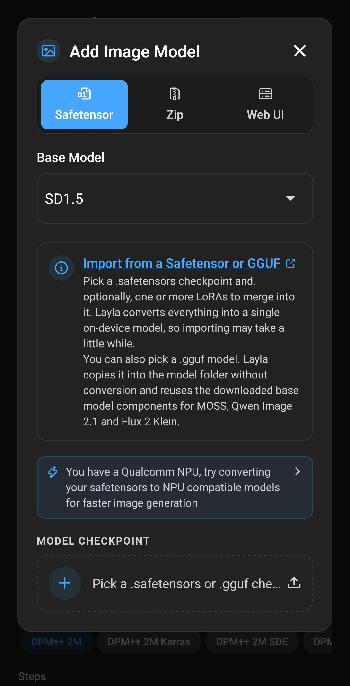
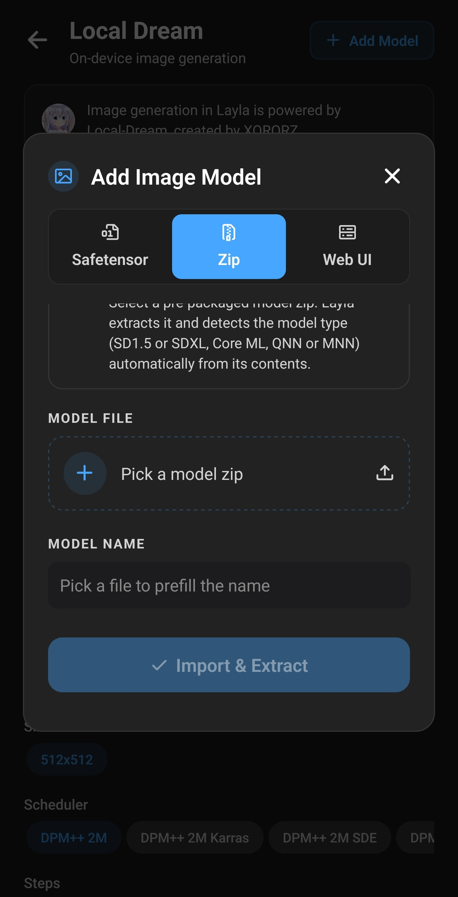
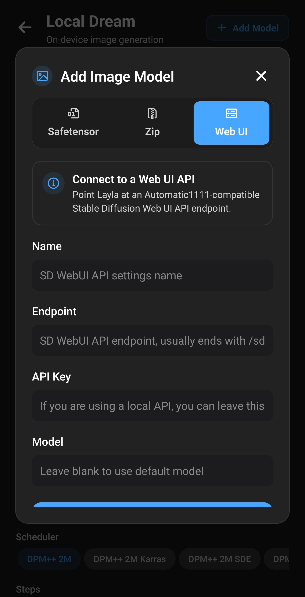

**Layla는 Civitai의 Stable Diffusion 체크포인트 등 사용자 지정 이미지 모델을 세 방식으로 가져옵니다. 기기에서 변환하는 safetensors·GGUF 파일, 준비된 zip, PC의 Stable Diffusion Web UI 연결입니다.** 파일로 가져온 모델은 Android나 iPhone에서 오프라인 생성합니다. 방법은 모델 계열과 기기 칩에 따라 다릅니다.

이 글은 가져오기 화면, 각 방식, 지원 모델 및 선택 사항인 NPU Forge를 설명합니다. 가져오기는 모두 기기에서 이루어지므로 선택한 파일은 업로드되지 않습니다.

기본 제공 모델만 쓰려면 [이미지 생성 활성화하기](/ko/how-to-enable-image-generation-in-layla/)를 참고하세요.

## 사용자 지정 모델을 가져오는 이유

기본 목록 외에도 [Civitai](https://civitai.com/)와 [Hugging Face](https://huggingface.co/)에는 사실적·애니메이션·일러스트 스타일 체크포인트와 특정 인물, 의상, 외형을 추가하는 LoRA가 있습니다. 가져오면 기본 목록에 제한되지 않고 쓸 수 있습니다.

가져온 모델은 Local Dream에서 실행하며 모든 과정이 로컬입니다.

- **오프라인.** 가져온 뒤에는 인터넷, 계정, 구독이 필요 없습니다.
- **개인정보 보호.** 프롬프트와 이미지는 기기에 남고 온라인 검토가 없습니다.
- **유연성.** 텍스트-이미지와 대부분의 종류에서 이미지-이미지를 지원합니다. 캐릭터도 채팅에서 쓸 수 있습니다.

## Layla에 사용자 지정 모델 가져오기

같은 **Add Image Model** 화면을 여는 경로는 두 가지입니다.

- **Settings** → **Inference Settings** → **Image Generation** → **Add Custom Model**.
- **Local Dream** 상단의 **Add Model**.

Local Dream은 기기 내 생성을 담당하며 Web UI 외의 모든 방식에 필요합니다. [미니 앱 활성화 및 비활성화](/ko/how-to-enable-disable-mini-apps-within-layla/)에 따라 먼저 설치하세요. 구버전이면 가져오기 전 업데이트가 필요하다고 표시됩니다.

최대 **Safetensor**, **Zip**, **Web UI** 세 탭이 있습니다. 완료되면 저장 후 자동 선택됩니다. 큰 파일은 수 분 걸리므로 Layla를 열어 두세요.

## 세 가지 가져오기 방식

|              | Safetensor                                    | Zip                    | Web UI          |
| ------------ | --------------------------------------------- | ---------------------- | --------------- |
| 제공할 항목  | `.safetensors`, Android는 `.gguf`도 지원      | Layla용 모델 zip       | Web UI API 주소 |
| Layla의 처리 | 기기용 모델로 변환                            | 압축 해제 및 종류 감지 | 연결 정보 저장  |
| 생성 위치    | 사용자 기기                                   | 사용자 기기            | Web UI 실행 PC  |
| 플랫폼       | Android 및 iOS(iOS는 SD 1.5만)                | Android 및 iOS         | Android 및 iOS  |
| 주 입수처    | [Civitai](https://civitai.com/), Hugging Face | 변환된 패키지          | 사용자 PC       |

## 지원하는 이미지 모델

Android Safetensor의 **Base Model**은 변환 방식을 지정합니다. 체크포인트가 학습된 기반 계열을 선택하세요.

| 기반 모델      | 결과                         | 하드웨어       | 플랫폼         |
| -------------- | ---------------------------- | -------------- | -------------- |
| SD 1.5         | LoRA가 병합된 단일 로컬 모델 | CPU            | Android 및 iOS |
| SDXL           | Q4_0 GGUF, 생성 중 LoRA 적용 | Snapdragon NPU | Android        |
| MOSS           | Q4_0 GGUF 확산 모델          | Snapdragon NPU | Android        |
| Qwen Image 2.1 | Q4_0 GGUF 확산 모델          | Snapdragon NPU | Android        |
| Flux 2 Klein   | Q4_0 GGUF 확산 모델          | Snapdragon NPU | Android        |

표에 대한 참고 사항:

- **SD 1.5**는 Civitai에 널리 쓰이고 iOS가 가져올 수 있는 유일한 계열입니다. CPU에서 실행해 최근 기기 대부분에 대응합니다.
- **SDXL, MOSS, Qwen Image 2.1, Flux 2 Klein**은 기본 모델과 같은 NPU 엔진을 쓰며 Snapdragon 8 Elite(SM8750) 이상이 필요합니다. 가져올 때 칩 경고가 없으므로 먼저 확인하세요.
- **MOSS, Qwen Image 2.1, Flux 2 Klein**은 해당 기본 모델의 토크나이저, 텍스트 인코더, VAE를 재사용합니다. 먼저 [필요한 기반 모델](#models-that-need-a-base-model-first)을 다운로드하세요.
- **Z-Image Turbo, Krea 2 Turbo 등 기본 NPU 모델**은 Base Model 목록에 없습니다. Local Dream에서 받을 수 있지만 자체 체크포인트는 가져올 수 없습니다.

Civitai 모델 페이지에서 기반 모델을 먼저 확인하세요. Layla는 파일에서 계열을 판별하지 않으므로 잘못 고르면 가져오기나 생성이 실패할 수 있습니다.

## safetensors 또는 GGUF 가져오기

1. 휴대전화에 체크포인트를 다운로드합니다. Civitai에서 **Model Type: Checkpoint**, **File format: SafeTensor**, 원하는 **Base Model**로 필터링합니다. [SD 1.5 스크린샷 예시](/ko/how-to-import-sd1-5-safetensor-models-from-civit-ai-into-layla/)도 참고하세요.
2. **Add Image Model** → **Safetensor**를 엽니다.
3. Android는 **Base Model**을 고릅니다. iOS는 SD 1.5뿐이라 목록이 없습니다.
4. **MODEL CHECKPOINT**에서 파일을 고릅니다. `.safetensors`, Android에서는 `.gguf`도 허용됩니다.
5. 파일명에서 채워진 **MODEL NAME**을 확인하고 필요하면 바꿉니다.
6. 아래 설명에 따라 LoRA를 추가할 수 있습니다.
7. **Import & Convert**를 누릅니다.

GGUF나 LoRA만 가져올 때는 변환이 없어 버튼이 **Import**입니다. 복사·변환 진행 상황을 표시하고 임시 복사본을 지웁니다. 원래 다운로드 파일은 그대로 둡니다.

### GGUF 파일

Android에서는 safetensors 대신 `.gguf` 확산 모델을 고를 수 있습니다. 변환 없이 폴더로 복사하므로 빠릅니다. 올바른 보조 파일을 사용하도록 일치하는 기반 모델을 선택하세요.

### LoRA

LoRA는 스타일이나 인물·개념을 더하는 작은 파일입니다. **LORA FILES (OPTIONAL)**의 **Add LoRA**에서 `.safetensors`를 고르고 강도를 정합니다. 초기값은 1.0이며 여러 개 추가할 수 있습니다.

적용 방법은 계열에 따라 다릅니다.

- **SD 1.5**: 변환 모델에 병합되어 나중에 바꾸거나 제거할 수 없습니다.
- **SDXL, MOSS, Qwen Image 2.1, Flux 2 Klein**: 모델 폴더에 복사하고 생성할 때 적용합니다.

### 먼저 기반 모델이 필요한 계열

MOSS, Qwen Image 2.1, Flux 2 Klein은 Local Dream에 다운로드한 모델의 보조 파일을 씁니다. 없으면 Safetensor가 경고하고 가져오기 버튼을 끕니다. 먼저 다음을 받으세요.

| Base Model     | Local Dream에서 받을 모델                |
| -------------- | ---------------------------------------- |
| MOSS           | MOSS-Image Turbo 또는 MOSS-Image Base    |
| Qwen Image 2.1 | Qwen Image 2.1 또는 Qwen Image 2.1 Turbo |
| Flux 2 Klein   | FLUX.2 Klein 4B                          |

이 세 계열은 **LoRA only**도 제공합니다. 체크포인트 없이 다운로드한 기반과 LoRA만으로 새 모델을 만들어 변환 시간과 공간을 절약합니다.

## zip 가져오기

**Zip**은 Layla용으로 변환하고 준비한 모델을 받습니다. zip을 선택하고 이름을 확인한 뒤 **Import & Extract**를 누릅니다.

압축을 풀고 내용에 따라 종류를 판단합니다.

- Core ML 번들: iOS용 SD 1.5 Core ML.
- MNN 파일이 있는 SDXL: SDXL CPU.
- QNN 파일이 있는 SDXL: SDXL NPU.
- ANIMA 패키지: ANIMA NPU.
- QNN 파일이 있는 패키지: SD 1.5 NPU.
- 그 외: SD 1.5 CPU.

마지막은 기본 처리이므로 부적합한 zip도 가져오기에 성공한 뒤 생성에 실패할 수 있습니다. Local Dream용이라고 명시한 신뢰할 수 있는 소스를 쓰세요. QNN 패키지는 특정 Snapdragon 칩용이므로 다운로드 전에 확인하세요.

## Web UI 연결

PC에서 [AUTOMATIC1111 Stable Diffusion Web UI](https://github.com/AUTOMATIC1111/stable-diffusion-webui)를 실행한다면 **Web UI**로 연결합니다. PC가 이미지를 생성하므로 네트워크 연결이 필요하며 오프라인 방식은 아닙니다.

다음을 입력합니다.

- **Name**: 알아보기 쉬운 이름.
- **Endpoint**: API 주소. 보통 `/sdapi/v1/text2img`로 끝납니다.
- **API Key**: 로컬 API면 비웁니다.
- **Model**: Web UI 기본 모델을 쓰려면 비웁니다.

**Save & Select**를 누릅니다. Web UI 설정은 [이미지 생성 활성화](/ko/how-to-enable-image-generation-in-layla/)를 참고하세요.

## NPU Forge로 Snapdragon NPU에서 가속하기

일반 SD 1.5 safetensors 가져오기는 CPU를 씁니다. 지원 Qualcomm Snapdragon이라면 **NPU Forge**로 같은 체크포인트를 QNN으로 변환해 더 빠른 AI 가속기 NPU에서 실행합니다.

NPU Forge는 별도 Android 미니 앱입니다. SD 1.5와 SDXL, LoRA 병합을 지원하며 결과를 Local Dream에 바로 넣습니다. 지원 칩이면 Safetensor에 안내가 나옵니다. [NPU Forge 가이드](/ko/how-to-convert-safetensors-to-qnn-with-npu-forge-in-layla/)에서 단계와 메모리·저장 공간 요구 사항을 확인하세요.

## 가져온 뒤

Local Dream에 새 모델이 선택되어 있습니다. 상단 목록으로 바꿀 수 있습니다. 초기값은 20단계·CFG 5이며 Flux 2 Klein은 4단계·CFG 1입니다. 둘 다 변경 가능하고 적은 단계용 모델은 보통 더 낮은 값이 필요합니다.

선택한 모델에서 두 작업을 할 수 있습니다.

- **Model setup**: 새 엔진의 SDXL, MOSS, Qwen Image 2.1, Flux 2 Klein 가져오기에서 파일, 샘플러, LoRA를 보고 편집합니다.
- **Delete Model**: 모델을 제거하고 공간을 확보합니다.

가져온 모델은 캐릭터 목록에도 나타납니다. 캐릭터별 선택은 [이미지 생성 활성화](/ko/how-to-enable-image-generation-in-layla/)를 참고하세요.

## 자주 묻는 질문

### Android에서 Stable Diffusion을 오프라인으로 쓸 수 있나요?

네. Local Dream에서 대부분의 기기는 CPU, 지원 Snapdragon은 NPU를 씁니다. 모델 다운로드 후에는 인터넷이 필요 없습니다.

### 휴대전화에서 SDXL을 실행할 수 있나요?

Android Snapdragon 8 Elite(SM8750) 이상이면 가능합니다. Safetensor에서 **SDXL**을 선택하면 NPU용으로 변환합니다. 변환된 **Zip** 패키지나 지원 칩의 NPU Forge도 가능합니다.

### iPhone에서 Stable Diffusion을 쓸 수 있나요?

SD 1.5로 가능합니다. **Safetensor**에서 safetensors, **Zip**에서 Core ML을 가져옵니다. 다른 계열은 Android 전용입니다.

### 휴대전화에서 Civitai 모델을 쓸 수 있나요?

지원 계열의 safetensors라면 됩니다. **Checkpoint**, **SafeTensor**, **SD 1.5** 또는 **SDXL**로 필터링해 받고 **Safetensor**로 가져오세요.

### safetensors 파일이란?

기계 학습 모델의 가중치를 저장하는 형식으로 Civitai의 대부분 체크포인트와 LoRA가 씁니다. 옛 `.ckpt`를 대체하며, 이와 달리 실행 코드를 담을 수 없다는 점도 널리 쓰이는 이유입니다.

### 체크포인트와 LoRA는 어떻게 다른가요?

체크포인트는 전체 모델입니다. LoRA는 스타일이나 주제를 더하는 작은 보조 파일로 같은 기반 계열에서만 동작합니다. 먼저 체크포인트를 고르고 LoRA를 더합니다.

### Layla에서 LoRA를 쓸 수 있나요?

네. **Safetensor**에서 여러 개와 개별 강도를 정할 수 있습니다. SD 1.5는 병합하고 SDXL, MOSS, Qwen Image 2.1, Flux 2 Klein은 생성 중 적용합니다.

### 사용자 모델에 Snapdragon이 필요한가요?

아니요. SD 1.5는 최근 Android와 iPhone의 CPU에서 실행됩니다. NPU Forge 변환과 Android SDXL, MOSS, Qwen Image 2.1, Flux 2 Klein 등 NPU 모델에만 Snapdragon이 필요합니다.

### 모든 Stable Diffusion 모델을 가져올 수 있나요?

아니요. SD 1.5와 SDXL, Android에서는 MOSS, Qwen Image 2.1, Flux 2 Klein이 대상입니다. SD 2.x 등은 Base Model에 없습니다.

### 가져오기에 인터넷이 필요한가요?

미니 앱 설치와 필요한 기반 모델 다운로드 때만 필요합니다. 변환은 로컬입니다. Web UI는 예외로 생성 중 PC 접근이 필요합니다.

### iPhone에 Base Model이 없는 이유는?

iOS는 SD 1.5 safetensors만 받으므로 고를 필요가 없습니다. Zip에서는 Core ML도 받습니다.

### 가져온 모델이 NPU에서 실행되나요?

SD 1.5 safetensors는 CPU입니다. SD 1.5나 SDXL을 NPU로 쓰려면 NPU Forge를 이용하세요. Android의 SDXL, MOSS, Qwen Image 2.1, Flux 2 Klein 가져오기는 이미 NPU용이며 Snapdragon 8 Elite 이상이 필요합니다.

### SD 1.5를 가져온 뒤 LoRA를 바꿀 수 있나요?

병합되므로 안 됩니다. 원본 체크포인트를 원하는 LoRA와 강도로 새 이름으로 다시 가져오세요.

### 왜 Local Dream 업데이트가 필요한가요?

미니 앱에 포함된 변환 파일이 필요하기 때문입니다. 미니 앱 화면에서 업데이트 후 재시도하세요.

### 가져온 모델을 제거하려면?

Local Dream에서 모델을 선택하고 **Delete Model**을 누릅니다.

### 가져올 모델은 어디서 구하나요?

주로 [Civitai](https://civitai.com/)와 [Hugging Face](https://huggingface.co/)입니다. 기반 모델에 따라 가져오기 방식이 달라지므로 먼저 페이지에서 확인하세요.

## 제작 기여

이미지 생성은 XORORZ의 [Local Dream](https://github.com/xororz/local-dream)을 사용합니다. NPU Forge는 AbrahamPaulJ가 만들었습니다.
