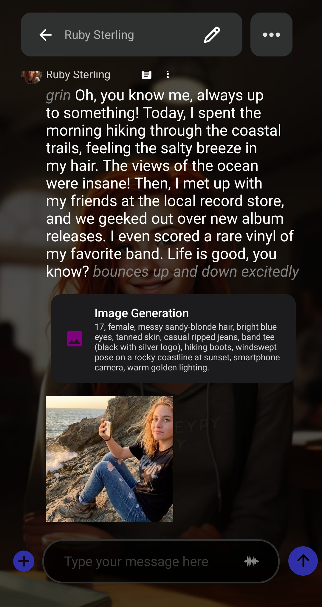
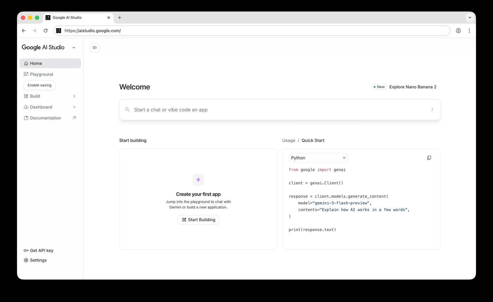
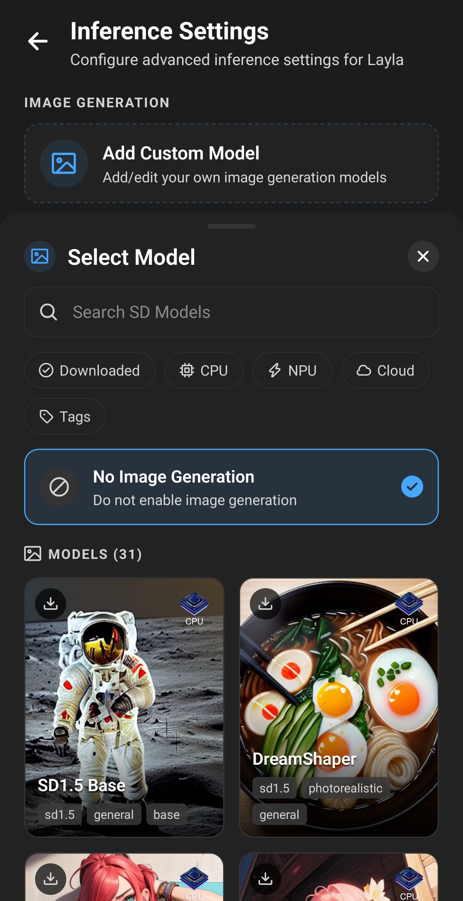

**커스텀 이미지 생성 Agent를 사용하면 Layla를 앱에 내장된 모델에 국한하지 않고, API를 제공하는 모든 서비스로 이미지를 생성하는 AI 챗봇으로 만들 수 있습니다.** AI 캐릭터가 응답에서 그림을 묘사하면, Agent가 그 묘사를 서비스에 보내고 완성된 이미지를 받아 채팅에 표시합니다.

Layla는 이미 기기에서 직접 또는 Layla Cloud를 통해 Stable Diffusion 모델로 이미지를 생성합니다. Agent를 쓰면 또 다른 선택지가 생깁니다. 서비스, 모델, 설정을 직접 고르고 자신의 API 키를 사용합니다. 이런 방식은 흔히 "bring your own key"라고 부릅니다. 이 글에서는 Nano Banana API를 중심으로 Agent를 만듭니다. Nano Banana는 Google이 Gemini 이미지 생성 모델에 붙인 이름이며, 이 글의 Agent는 API 이름이 `gemini-3-pro-image`인 Nano Banana Pro를 사용합니다.

이 글에는 세 가지 목표가 있습니다. Nano Banana API 키를 받는 방법과 Agent를 설정하는 방법을 보여 드립니다. 그다음 Agent 코드를 한 단계씩 설명하고, 마지막으로 같은 패턴을 다른 이미지 서비스용 Agent에 재사용하는 방법을 설명합니다.

Layla의 로컬 모델과 달리, 이 Agent는 인터넷 연결이 필요합니다. 이미지 묘사는 Google로 전송되며, Google은 이미지마다 요금을 부과합니다. 로컬 모델로 채팅하는 경우 나머지 대화는 기기에 남습니다.

Agent가 동작하는 모습입니다. 캐릭터가 응답하고, 캐릭터가 쓴 이미지 묘사 뒤에 완성된 이미지가 이어집니다.



바로 사용해 보고 싶다면 여기에서 Agent 파일을 다운로드하세요: [google-nano-banana-generate-image.json](/assets/articles/how-to-use-the-google-nano-banana-image-generation-agent/google-nano-banana-generate-image.json). 작동하려면 Google API 키가 필요하며, 키를 받는 방법은 아래에서 설명합니다.

## Layla에서 Nano Banana를 쓰는 이유

이미지를 전적으로 기기에서 생성하고 싶다면 Layla의 Stable Diffusion 모델이 알맞은 선택입니다. Nano Banana API는 다른 필요를 충족합니다.

- **휴대폰 성능에 좌우되지 않는 이미지 품질.** 이미지는 Google 서버에서 생성되므로, 기기의 CPU나 NPU 속도가 결과나 대기 시간을 제한하지 않습니다.
- **대화를 따라가는 이미지.** 캐릭터가 채팅 내용을 바탕으로 이미지 묘사를 쓰기 때문에, 이야기 중인 장면, 의상, 장소와 맞는 이미지가 나옵니다. AI 롤플레이와 AI 컴패니언 채팅 모두에서 쓸 수 있습니다.
- **로컬 채팅 모델과 클라우드 이미지의 조합.** Agent는 캐릭터의 응답에만 반응하므로, 어떤 모델로 채팅하든 동작합니다. 대화에는 로컬 LLM을 계속 쓰고, Google로 전송되는 것은 이미지 묘사뿐입니다.
- **이미지당 과금, 구독 없음.** Google은 생성한 이미지에 대해서만 요금을 부과하며, 사용량과 지출은 Google AI Studio에서 확인할 수 있습니다.
- **나만의 키.** API 키는 언제든 폐기할 수 있으며, 다른 키를 만들어도 Agent는 그대로 동작합니다.

Google의 Gemini 앱도 Android에서 Nano Banana를 제공합니다. 차이점은, 여기서는 내 Layla 채팅 안에서 내 캐릭터와 내 API 키로 이미지를 만든다는 것입니다.

## Agent 작동 방식 한눈에 보기

채팅에서 동작하는 모든 이미지 생성 Agent는 같은 네 단계 흐름을 따릅니다.

```text
이미지를 요청한다
  -> 캐릭터가 태그로 감싼 이미지 묘사로 응답한다
  -> Agent의 트리거가 태그를 감지한다
  -> Eval 도구가 Google API를 호출하고 이미지를 저장한다
  -> Display Image 도구가 채팅에 이미지를 표시한다
```

1. **시스템 프롬프트가 모델에게 태그를 요청합니다.** Agent는 이미지를 요청할 때마다 캐릭터의 언어 모델이 자세한 이미지 묘사를 `<stable_diffusion_prompt></stable_diffusion_prompt>` 태그 안에 쓰도록 지시하는 내용을 추가합니다.
2. **트리거가 태그를 감지합니다.** Agent에는 모델의 응답을 지켜보는 정규식 트리거가 있습니다. 태그를 발견하면 안의 텍스트를 가져와 Agent를 시작합니다.
3. **스크립트가 API를 호출합니다.** Agent의 첫 번째 도구는 짧은 JavaScript 프로그램을 실행합니다. 묘사를 Google에 보내고, 이미지를 받아 파일로 저장합니다.
4. **이미지가 채팅에 나타납니다.** 두 번째 도구인 _Display Image_가 저장된 파일을 가져와 대화에 표시합니다.

언어 모델은 Google과 직접 통신하지 않습니다. 텍스트만 씁니다. 그 이후는 모두 Agent가 처리하며, 그래서 같은 패턴이 API가 있는 어떤 서비스에서도 동작합니다.

태그 이름이 `<stable_diffusion_prompt>`인 이유는 Layla 자체의 이미지 생성도 이 태그를 감지하기 때문입니다. 이는 설정 단계에서 중요하며, 아래 설정 섹션에서 다룹니다.

## 준비물

- 설치된 _Agent_ 미니 앱. Agent를 사용해 본 적이 없다면 먼저 [Layla에서 Agent, Function 및 Tool Calling을 활성화하는 방법](/how-to-enable-agents-functions-and-tool-calling-in-layla/)을 읽어 보세요.
- Google 계정.
- 결제가 활성화된 Gemini API 키(Nano Banana API 키). 다음 섹션에서 방법을 설명합니다.
- 인터넷 연결.
- 이 글의 끝에 링크된 Agent 파일.

이 Agent는 Layla에 내장된 _Eval_ 도구를 사용합니다. Python 인터프리터 미니 앱은 필요하지 않습니다.

## Google AI Studio에서 Nano Banana API 키를 받는 방법

별도의 Nano Banana 키는 없습니다. 필요한 키는 Gemini API 키이며, Google AI Studio에서 발급되고 결제를 활성화하면 이미지 모델에서도 작동합니다. API 키는 Agent가 요청을 보낼 때 Google 계정을 식별하는 긴 문자열입니다. 과정은 몇 분이면 끝납니다.

### 1단계: Google AI Studio 열기

[aistudio.google.com](https://aistudio.google.com)에 접속해 Google 계정으로 로그인합니다. 처음 방문하는 경우 서비스 약관에 동의하세요. 그러면 Google이 기본 프로젝트와 API 키를 만들어 줍니다.

왼쪽 사이드바 하단의 **Get API key**를 선택합니다.



### 2단계: 키 만들기

_API Keys_ 페이지에는 프로젝트의 키 목록이 표시됩니다. **Create API key**를 선택합니다.


### 3단계: 키 이름 정하고 프로젝트 선택하기

알아보기 쉬운 이름(예: "Layla")을 입력하고 프로젝트를 선택합니다. 새 계정에는 _Default Gemini Project_라는 프로젝트가 있습니다. **Create key**를 선택합니다.


모든 API 키는 Google Cloud 프로젝트에 속하며, 프로젝트가 결제와 사용 한도를 관리합니다. 이미 Google Cloud를 사용 중이라면 AI Studio는 기존 프로젝트를 자동으로 표시하지 않습니다. _Import projects_ 버튼으로 원하는 프로젝트를 추가하세요. Google은 이 내용을 [Using Gemini API keys](https://ai.google.dev/gemini-api/docs/api-key)에서 설명합니다.

### 4단계: 키 복사하기

새 키가 목록에 나타납니다. 해당 행의 복사 아이콘을 선택하면 키가 클립보드에 복사됩니다. 나중에 이 페이지로 돌아와 다시 복사할 수도 있습니다.


키는 비밀번호처럼 다루세요. 키를 가진 사람은 Google이 내 계정에 청구하는 요청을 보낼 수 있습니다. 키가 노출되었다고 생각되면 이 페이지에서 삭제하고 새 키를 만드세요.

### 5단계: 결제 설정하기

이전 스크린샷의 Quota Tier 열에는 _Free tier_가 표시되고 옆에 **Set up billing** 링크가 있습니다. 이 단계는 필수입니다. Google이 API의 Nano Banana 이미지 모델에는 무료 등급을 제공하지 않기 때문입니다. 키가 속한 프로젝트에는 결제 계정이 있어야 합니다.

**Set up billing**을 선택하고 Google의 안내를 따릅니다. 국가를 선택하고, 약관에 동의하고, 결제 수단을 추가하세요. 계정에 따라 Google이 최소 금액(현재 $5)의 크레딧 선결제를 요구할 수 있습니다. Google의 [결제 가이드](https://ai.google.dev/gemini-api/docs/billing)에 현재 단계와 요금제가 나와 있습니다.

Google은 이미지마다 요금을 부과합니다. 이 글을 쓰는 시점에서 Nano Banana Pro의 1K 또는 2K 이미지는 $0.134, 4K 이미지는 $0.24입니다. 이 글의 Agent는 1K 이미지를 요청합니다. 가격은 바뀔 수 있으므로 시작하기 전에 Google의 [가격 페이지](https://ai.google.dev/gemini-api/docs/pricing)를 확인하세요. 사용량은 AI Studio의 _Dashboard_, 그다음 _Usage_에서 볼 수 있습니다.

Google의 가격 페이지에는 유료 등급에서 전송된 콘텐츠가 Google 제품 개선에 사용되지 않는다는 설명도 있습니다.

## 어떤 Nano Banana 모델을 써야 할까요?

Google은 같은 API로 여러 Nano Banana 모델을 제공합니다. Agent는 Nano Banana Pro를 사용하지만, 스크립트의 한 줄만 바꾸면 다른 모델을 쓸 수 있습니다. 다음은 이 글을 쓰는 시점에 Google이 나열한 모델과, 1K 이미지에 대해 Google이 제시한 가격입니다.

| 모델               | API 이름                      | 1K 이미지당 가격 | 비고                                                                                  |
| ------------------ | ----------------------------- | ---------------- | ------------------------------------------------------------------------------------- |
| Nano Banana 2.1    | `gemini-nano-banana-2.1`      | $0.0336          | Google이 새 프로젝트에 권장하는 모델. 1K, 2K, 4K 이미지를 지원합니다.                 |
| Nano Banana 2 Lite | `gemini-3.1-flash-lite-image` | $0.0336          | 가장 빠르고 저렴한 모델. 1K 이미지만 지원합니다.                                      |
| Nano Banana 2      | `gemini-3.1-flash-image`      | $0.067           | 같은 계열의 이전 세대 모델.                                                           |
| Nano Banana Pro    | `gemini-3-pro-image`          | $0.134           | 가장 복잡한 시각 작업을 위한 Google의 프리미엄 모델. 이 Agent가 사용하는 모델입니다.  |
| Nano Banana        | `gemini-2.5-flash-image`      | $0.039           | 최초의 모델. Google은 레거시로 분류하며 종료일을 2027년 3월 15일로 안내하고 있습니다. |

Nano Banana Pro와 Nano Banana 2를 비교하면, Pro는 1K 이미지당 가격이 약 두 배이며 복잡한 장면을 대상으로 합니다. Nano Banana 2와 2.1은 더 빠르고 저렴한 모델입니다. 어떤 모델이든 큰 이미지일수록 비용이 늘어납니다. 4K 이미지는 Nano Banana Pro가 $0.24, Nano Banana 2가 $0.151, Nano Banana 2.1이 $0.113입니다.

모델을 바꾸려면 스크립트의 `MODEL_ID`를 변경하고 **Test** 버튼을 실행하세요. 각 모델이 지원하는 내용은 Google의 [이미지 생성 문서](https://ai.google.dev/gemini-api/docs/image-generation)에 나와 있습니다. 모델이 오류를 반환한다면 Agent 요청의 설정(예: 2K 크기) 중 하나를 받아들이지 않거나, Google의 새로운 API 형식을 기대하는 것일 수 있습니다. 가격과 모델 이름은 자주 바뀌므로 선택하기 전에 Google의 [가격 페이지](https://ai.google.dev/gemini-api/docs/pricing)와 [지원 종료 페이지](https://ai.google.dev/gemini-api/docs/deprecations)를 확인하세요.

## Layla에서 Agent 설정하기

### 1단계: Layla의 기본 이미지 생성 끄기

_추론 설정_을 열고 _이미지 생성_ 섹션까지 스크롤한 다음 이미지 생성 모델을 선택합니다. _Select Model_ 목록에서 **No Image Generation**(이미지 생성 안 함)을 선택하세요.



Layla에 내장된 이미지 생성도 캐릭터의 응답에서 같은 `<stable_diffusion_prompt>` 태그를 읽습니다. 모델이 여전히 선택되어 있으면 Layla가 그 태그로 자체 이미지를 생성해서 이미지가 두 장 나옵니다. _No Image Generation_을 선택하면 태그는 Agent에게 남겨집니다. [Layla에서 이미지 생성을 활성화하는 방법](/how-to-enable-image-generation-in-layla/)에서 이 설정의 위치를 확인할 수 있습니다.

### 2단계: Agent 가져오기

이 글의 끝에 있는 Agent 파일을 다운로드합니다. _Agent_ 미니 앱을 열고 오른쪽 위의 **Import** 버튼으로 가져옵니다. Agent 이름은 _Google Nano Banana: generate image_이며, 카드에는 사용하는 두 도구인 _Eval_과 _Display Image_가 표시됩니다.


Agent 카드 오른쪽 위의 스위치가 켜져 있는지 확인하세요. 스크린샷에서는 아직 꺼져 있습니다.

### 3단계: API 키 추가하기

**Edit** 버튼으로 Agent를 열고 _Eval_ 도구를 찾습니다. 코드 앞부분에 다음 줄이 있습니다.

```js
const API_KEY = "PUT YOUR API KEY HERE";
```

`PUT YOUR API KEY HERE`를 내 키로 바꾸고 따옴표는 그대로 둡니다. Agent를 저장하세요.

이제 키가 Agent 안에 저장되었습니다. Agent 파일을 공유하거나 어딘가에 업로드하기 전에 키를 원래의 자리표시자로 되돌리세요.

### 4단계: 이미지 요청하기

채팅을 시작하고 이미지를 요청합니다. 예를 들어 "해 질 녘 절벽 위의 등대를 보여 줘"라고 보내 보세요. 캐릭터가 이미지 묘사로 응답하고 Agent가 실행되며, 몇 초 후 이 글 맨 위의 스크린샷처럼 이미지가 채팅에 나타납니다.

문제가 생기면 Agent 미니 앱의 **Test** 버튼을 사용하세요. [Layla Agents 심층 분석](/deep-dive-into-layla-agents/)에서 설명하듯, 각 단계의 입력과 출력을 보여 줍니다.

## Agent 작동 방식, 단계별 설명

Agent는 세 부분으로 이루어집니다. 시스템 프롬프트, 트리거, 그리고 차례로 실행되는 도구 목록입니다. 각 도구의 출력은 다음 도구의 입력이 됩니다. 이러한 구성 요소는 [Layla Agents 심층 분석](/deep-dive-into-layla-agents/)에서 전반적으로 다룹니다. 이 섹션에서는 Nano Banana Agent를 각 부분별로 따라가 봅니다.

### 1. 시스템 프롬프트

시스템 프롬프트는 Agent가 활성화되어 있는 동안 Layla가 대화에 추가하는 지시문입니다. 이 Agent의 프롬프트는 영어로 작성되어 있으며, 파일에도 그대로 들어 있습니다.

```text
When the user asks you to generate, draw or create an image, write a detailed
description of the image (subject, setting, style, lighting, composition) inside
<stable_diffusion_prompt></stable_diffusion_prompt> tags, e.g.
<stable_diffusion_prompt>a lighthouse on a cliff at dusk, oil painting, warm
light</stable_diffusion_prompt>. The image is generated from the text inside the
tags and shown in the chat. Use the tags only when an image is requested, and
never put backticks inside them.
```

지시문의 각 부분에는 목적이 있습니다.

- **"When the user asks you to generate, draw or create an image"**(사용자가 이미지를 생성, 그리기 또는 만들어 달라고 요청할 때)는 동작을 이미지 요청으로 한정하여 일반 대화에는 영향이 없도록 합니다.
- **"A detailed description (subject, setting, style, lighting, composition)"**(피사체, 배경, 스타일, 조명, 구도를 포함한 자세한 묘사)은 모델에게 체크리스트를 줍니다. Nano Banana는 묘사를 읽는 언어 모델이므로, 이런 요소를 담은 완전한 문장이 키워드 목록보다 대체로 더 좋은 이미지를 만듭니다.
- **예시**는 정확한 태그 형식을 보여 줍니다. 언어 모델은 형식에 대한 설명보다 예시를 더 안정적으로 따릅니다.
- **"Use the tags only when an image is requested"**(이미지가 요청될 때만 태그를 사용)는 모델이 모든 응답에 태그를 붙이는 것을 막습니다. 그렇게 되면 매번 Agent가 시작되고 요금이 부과됩니다.
- **"Never put backticks inside them"**(태그 안에 백틱을 넣지 말 것)은 스크립트를 보호합니다. 이유는 아래 코드 설명에서 다룹니다.

직접 Agent를 만들 때도 시스템 프롬프트의 역할은 같습니다. 모델에게 새 동작 하나를 가르치고, 출력 형식을 보여 주고, 사용하지 말아야 할 경우를 알려 줍니다.

### 2. 트리거

이 Agent에는 트리거가 하나 있습니다. 입력이 아니라 모델의 **출력**에 작동하는 _정규식 트리거_입니다. 패턴은 다음과 같습니다.

```text
/<stable_diffusion_prompt>(.*?)<\/stable_diffusion_prompt>/s
```

- 여는 태그와 닫는 태그는 태그 문자열 그대로와 일치합니다.
- `(.*?)`는 캡처 그룹입니다. 태그 사이의 모든 내용을 모으며, `?` 때문에 첫 번째 닫는 태그에서 멈춥니다.
- `s` 플래그는 묘사가 여러 줄에 걸쳐 있어도 되게 합니다.

그룹이 캡처한 텍스트는 Agent에서 `{{match$1}}`로 사용할 수 있게 됩니다. 이것이 언어 모델과 코드를 잇는 연결 고리입니다. 모델이 태그 사이에 쓴 내용이 첫 번째 도구로 전달됩니다.

### 3. Eval 도구: API 호출하기

첫 번째 도구는 _Eval_입니다. Layla 내부의 샌드박스 런타임에서 JavaScript를 실행합니다. 이 런타임에는 웹 요청용 `fetch`와, 파일 저장 같은 Layla 기능에 스크립트가 접근하게 해 주는 `layla`라는 전역 객체가 있습니다. 브라우저 페이지나 Node.js 모듈은 없습니다.

Eval은 스크립트의 마지막 식의 값을 반환하며, 그것이 Promise라면 완료될 때까지 기다립니다. 그래서 스크립트의 마지막 줄이 작업을 시작하는 `generateImage(PROMPT);`입니다.

스크립트는 여덟 부분으로 이루어져 있습니다.

#### 맨 위의 설정

```js
const API_KEY = "PUT YOUR API KEY HERE";
const PROMPT = String.raw`{{match$1}}`.trim();

const MODEL_ID = "gemini-3-pro-image";
const API_METHOD = "streamGenerateContent";
const API_URL = `https://generativelanguage.googleapis.com/v1beta/models/${MODEL_ID}:${API_METHOD}`;
const TIMEOUT_MS = 60000;
```

바꾸고 싶을 만한 것들이 모두 한곳에 있습니다.

- `API_KEY`는 내 키입니다.
- `PROMPT`는 모델이 쓴 묘사입니다. 스크립트가 실행되기 전에 Layla가 `{{match$1}}`을 캡처한 텍스트로 바꾸므로, 묘사가 프로그램의 일부가 됩니다. 백슬래시가 입력한 그대로 유지되도록 `String.raw`와 함께 템플릿 리터럴로 감싸고, `.trim()`이 불필요한 공백과 줄바꿈을 제거합니다. 묘사 안에 백틱이나 `${` 문자가 있으면 리터럴이 일찍 끝나서 스크립트가 깨집니다. 시스템 프롬프트가 백틱을 금지하는 이유입니다.
- `MODEL_ID`는 사용할 모델입니다. Google은 때때로 모델 이름을 바꾸거나 종료하므로, 나중에 가장 많이 수정하게 될 줄입니다.
- `API_URL`은 모델과 메서드로 만들어집니다. `streamGenerateContent`는 응답을 청크의 목록으로 반환합니다.
- `TIMEOUT_MS`는 포기하기 전까지 기다리는 시간으로, 60초입니다.

스크립트의 나머지는 `generateImage`라는 함수 안에 있습니다. 이 함수는 묘사를 `prompt`라는 매개변수로 받으며, 스크립트의 마지막 줄이 `PROMPT`로 이 함수를 호출합니다.

#### 입력 확인하기

```js
if (!prompt) throw new Error("The stable diffusion prompt was empty.");
if (!API_KEY || API_KEY === "PUT YOUR API KEY HERE")
  throw new Error("Set API_KEY in this agent first.");
```

보낼 내용이 없거나 키가 설정되지 않은 경우, 스크립트는 읽기 쉬운 메시지와 함께 일찍 실패합니다. 스크립트가 오류를 던지면 Agent가 멈추고 이미지가 나타나지 않습니다. **Test** 버튼에서 그 메시지를 볼 수 있습니다.

#### 요청 만들기

```js
const imageConfig = { imageSize: "1K" };

const payload = {
  contents: [{ role: "user", parts: [{ text: prompt }] }],
  generationConfig: {
    responseModalities: ["IMAGE", "TEXT"],
    imageConfig,
  },
  tools: [{ googleSearch: {} }],
};
```

페이로드는 Google로 보내는 데이터입니다.

- `contents`는 모델에게 보내는 대화입니다. 여기서는 텍스트 한 조각(묘사)이 담긴 사용자의 메시지 하나입니다.
- `responseModalities`는 모델이 반환할 수 있는 출력 종류를 나열합니다. `IMAGE`를 요청해야 모델이 그림을 그리며, `TEXT`는 모델이 설명을 덧붙일 수 있게 합니다.
- `imageConfig`는 이미지 설정을 담습니다. `imageSize`는 대문자 K를 사용해 `'1K'`, `'2K'`, `'4K'` 중 하나로 지정할 수 있으며, 크기가 클수록 비용이 늘어납니다. `'16:9'`나 `'9:16'` 같은 `aspectRatio`를 추가할 수도 있습니다. Google은 빈 값을 받으면 오류로 응답하므로, 스크립트는 값이 있는 설정만 보냅니다.
- `tools: [{ googleSearch: {} }]`는 모델이 작업하는 동안 Google 검색으로 정보를 찾아볼 수 있게 하며, 실제 장소와 사물에 도움이 됩니다. 원하지 않으면 이 줄을 삭제하세요. Google은 Gemini 3 모델에 매월 일정량의 검색 요청을 포함해 제공하며, 그 이상은 가격 페이지에 나온 대로 요금을 부과합니다.

#### 시간 제한을 두고 요청 보내기

```js
const controller = new AbortController();
const timer = setTimeout(() => controller.abort(), TIMEOUT_MS);
let response;
let body;
try {
  response = await fetch(API_URL, {
    method: "POST",
    headers: { "Content-Type": "application/json", "x-goog-api-key": API_KEY },
    body: JSON.stringify(payload),
    signal: controller.signal,
  });
  body = await response.text();
} catch (error) {
  if (controller.signal.aborted)
    throw new Error(`Image generation timed out after ${TIMEOUT_MS / 1000} s.`);
  throw new Error(`Image generation request failed: ${error.message}`);
} finally {
  clearTimeout(timer);
}
```

Google과 통신하는 부분입니다.

- `fetch`는 JSON 텍스트로 변환한 페이로드와 함께 `POST` 요청을 보냅니다.
- API 키는 `x-goog-api-key` 헤더로 전달되므로 웹 주소에 포함되지 않습니다.
- `AbortController`와 타이머가 60초 후에 요청을 취소합니다. 이것들이 없으면 연결이 멈췄을 때 Agent가 계속 기다리게 됩니다.
- `catch` 블록은 시간 초과와 다른 네트워크 실패를 구분하므로, 오류 메시지가 어떤 일이 일어났는지 알려 줍니다. `finally` 블록은 두 경우 모두 타이머를 해제합니다.

#### 응답 상태 확인하기

```js
if (!response.ok) {
  throw new Error(
    `HTTP error ${response.status} ${response.statusText}. Response body: ${body.slice(0, 500)}`,
  );
}
```

Google이 요청을 거부하면 응답 본문에 이유를 설명합니다. 스크립트는 그 설명의 처음 500자를 오류에 포함하므로, 잘못된 키, 설정되지 않은 결제, 초과된 한도가 **Test** 버튼을 사용할 때 명확한 메시지로 표시됩니다.

#### 응답에서 이미지 찾기

```js
const data = JSON.parse(body);
const chunks = Array.isArray(data) ? data : [data];

for (const chunk of chunks) {
  for (const candidate of chunk.candidates || []) {
    for (const part of (candidate.content && candidate.content.parts) || []) {
      const inline = part.inlineData;
      if (
        !inline ||
        !inline.data ||
        !String(inline.mimeType || "").startsWith("image/")
      )
        continue;
      // ...save the image
    }
  }
}
```

스트리밍 메서드는 청크의 JSON 목록으로 응답합니다. 각 청크에는 `candidates`(모델의 답변)가 있고, 각 후보에는 `content`가 있으며, content는 `parts`의 목록입니다. 파트는 텍스트이거나 인라인 데이터입니다. 인라인 데이터에는 `image/png` 같은 `mimeType`과, 이미지 자체가 base64 텍스트(이진 데이터를 일반 문자로 표현하는 방식)로 들어 있습니다.

루프는 모든 청크, 후보, 파트를 차례로 살펴보며 텍스트는 건너뛰고 이미지인 첫 번째 파트에서 멈춥니다. `|| []` 가드는 청크에 후보가 없을 때 스크립트가 중단되는 것을 막아 줍니다.

#### 이미지 저장하기

```js
const extension =
  inline.mimeType
    .split("/")
    .pop()
    .replace(/[^a-z0-9]/gi, "") || "png";
const id = Math.random().toString(16).slice(2, 10).padEnd(8, "0");
const path = `generated-images/output_image_${id}.${extension}`;

await layla.utils.saveFile(path, inline.data);
return path;
```

- 파일 확장자는 Google이 알려 주는 이미지 형식에서 가져오며, 없으면 `png`를 사용합니다.
- 무작위 8자리 ID가 이미지마다 고유한 파일 이름을 주므로, 새 이미지가 채팅 기록의 이전 이미지를 덮어쓰지 않습니다.
- `layla.utils.saveFile`은 캐릭터의 비공개 워크스페이스 폴더에 파일을 씁니다. 경로는 그 폴더를 기준으로 한 상대 경로이며, 없는 폴더는 자동으로 만들어집니다. 이 함수는 base64 텍스트를 받는데, Google이 보내는 형식이 바로 그것이므로 변환 없이 그대로 저장됩니다.
- 함수는 경로를 반환합니다. 이 경로가 도구의 출력이 됩니다.

#### 실패를 명확하게 보고하기

```js
const keys =
  chunks.length && typeof chunks[0] === "object"
    ? Object.keys(chunks[0]).join(", ")
    : "Unknown error";
throw new Error(
  `No image was found in the response. Full API Response Keys: ${keys}`,
);
```

루프가 이미지를 찾지 못하고 끝나면(예를 들어 모델이 요청을 거부하고 텍스트로만 응답한 경우), 스크립트가 응답에 무엇이 들어 있었는지 보고합니다. 덕분에 특이한 실패의 원인을 훨씬 쉽게 진단할 수 있습니다.

### 4. Display Image 도구

두 번째 도구는 _Display Image_이며, 유일한 설정은 다음과 같습니다.

```text
{{input}}
```

`{{input}}`은 이전 도구의 출력, 즉 스크립트가 반환한 파일 경로로 대체됩니다. _Display Image_는 캐릭터의 워크스페이스에서 그 파일을 열어 응답에 첨부하며, 이미지가 채팅에 나타납니다.

## AI 캐릭터의 이미지를 일관되게 유지하기

언어 모델은 이미지 묘사를 매번 처음부터 씁니다. 그래서 별다른 안내가 없으면 캐릭터가 이미지마다 다르게 보일 수 있습니다. 다음 방법으로 AI 캐릭터 이미지를 일관되게 유지하고, 이미지가 나타나는 빈도도 정할 수 있습니다.

- **캐릭터를 한 번만 묘사하기.** 캐릭터의 _시나리오_에 다음과 같은 지시문을 추가하세요. "`<stable_diffusion_prompt>`를 쓸 때는 자신에 대한 다음 묘사로 시작할 것: 20대 후반의 여성, 짧은 붉은 머리, 초록색 눈, 주근깨. 그다음 장면을 묘사할 것." 모델이 모든 프롬프트에서 외모를 반복하므로, 이미지 모델이 매번 같은 캐릭터를 그리는 데 도움이 됩니다.
- **화풍 고정하기.** 같은 지시문에 화풍을 추가하세요. 예를 들어 "35mm 필름 사진, 자연광"이나 "수채화 일러스트" 등입니다. [Perchance Agent로 Layla에서 AI 이미지를 생성하는 방법](/how-to-use-the-perchance-image-generation-agent/)에서도 같은 방식을 설명하며, 이 태그를 사용하는 모든 Agent에서 작동합니다.
- **메시지마다 이미지 생성하기.** [이미지 생성 Agent 만들기](/creating-an-image-generation-agent/)처럼, _시나리오_에 모든 응답을 태그로 끝내라는 지시문을 추가합니다. 그러면 모든 응답에 이미지가 붙으며, AI 롤플레이와 스토리텔링에 잘 맞습니다. 이미지마다 요금이 부과되므로, 요청할 때만 이미지를 받는 것보다 비용이 더 듭니다.
- **참조 이미지 사용하기.** Nano Banana 모델은 이미지를 입력으로 받을 수도 있어서, 캐릭터가 같은 얼굴을 유지하는 데 도움이 됩니다. 이 Agent는 텍스트만 보내므로, 요청에 참조 이미지를 추가하는 것이 다음에 해 볼 만한 좋은 프로젝트입니다.

## 같은 패턴으로 다른 Agent 만들기

Nano Banana Agent는 템플릿입니다. 시스템 프롬프트, 정규식 트리거, Display Image 단계는 어떤 이미지 서비스에서도 그대로입니다. 바뀌는 것은 스크립트뿐입니다. 다음 아이디어는 이를 바탕으로 합니다.

- **모델이나 설정 바꾸기.** 스크립트에서 `MODEL_ID`나 `imageSize`를 수정하거나 `aspectRatio`를 추가하세요. Google은 가격이 다른 여러 Nano Banana 모델을 제공하며, [가격 페이지](https://ai.google.dev/gemini-api/docs/pricing)에 나와 있습니다.
- **다른 이미지 서비스 사용하기.** 요청과 응답 처리를 교체하세요. 서비스가 base64 텍스트를 반환한다면 저장 단계는 그대로입니다. 웹 주소를 반환한다면 그 주소를 가져와 `layla.utils.saveFile`을 호출하기 전에 `toBase64()`로 바이트를 변환하세요.
- **묘사 외의 정보도 모델에게 요청하기.** 시스템 프롬프트에서 자유 텍스트 대신 `prompt`와 `aspect_ratio`가 담긴 짧은 JSON 객체처럼 몇 가지 필드를 요청할 수 있습니다. 그러면 스크립트가 캡처한 텍스트에서 필드를 읽습니다. Agent가 `PROMPT`로 하는 것처럼 자리표시자는 문자열 리터럴 안에 두고, 텍스트 분석은 자신의 코드에서 하세요.
- **이미지가 아닌 다른 일 하기.** `<weather_request>` 같은 다른 태그를 고르고, _Eval_이 다른 API를 호출하게 한 뒤, _Provide Context_ 도구로 마무리하면 캐릭터가 결과에 대해 이야기할 수 있습니다. [Brave Search Agent를 만드는 방법](/how-to-create-a-brave-search-agent/)이 이 흐름의 예시입니다.

직접 Agent를 만들 때 이 Agent에서 가져가면 좋은 습관이 몇 가지 있습니다.

- **모든 설정을 맨 위의 한 블록에 모으기.** 키, 모델, 크기, 타임아웃을 쉽게 찾고 바꿀 수 있습니다.
- **돈을 쓰기 전에 입력 확인하기.** 빈 요청을 막는 가드에는 비용이 들지 않습니다.
- **항상 타임아웃 설정하기.** 끝나지 않는 요청은 메시지와 함께 실패하는 요청보다 나쁩니다.
- **실패했을 때 읽을 수 있는 내용 반환하기.** 오류 텍스트는 **Test** 버튼이 보여 주는 내용이므로, 무엇이 잘못되었는지 알려 주도록 만드세요.
- **데이터가 아니라 경로 넘기기.** 스크립트가 이미지를 저장하고 짧은 경로를 다음 도구에 전달하므로, 큰 데이터가 체인을 오가지 않습니다.
- **태그마다 Agent 하나만 사용하기.** `<stable_diffusion_prompt>`에 반응하는 다른 Agent를 만든다면 이 Agent를 비활성화하세요. 또는 새 Agent의 시스템 프롬프트와 트리거 모두에서 고유한 태그를 사용하세요.
- **`{{match$1}}`을 코드로 취급하기.** 캡처한 텍스트는 실행 전에 스크립트에 붙여 넣어집니다. 따라서 문자열 리터럴로 감싸고, 모델에게 피해야 할 문자를 알려 주세요.

## 자주 묻는 질문

### Nano Banana API 키는 어떻게 받나요?

별도의 Nano Banana 키는 없습니다. [Google AI Studio](https://aistudio.google.com)에 로그인하고 _API Keys_ 페이지를 열어 **Create API key**를 선택하세요. 그런 다음 키가 속한 프로젝트에서 결제를 활성화하세요. API의 Nano Banana 모델에는 무료 등급이 없기 때문입니다.

### Nano Banana API는 무료인가요?

키를 만드는 것은 무료이지만, Google은 API의 Nano Banana 이미지 모델에 무료 등급을 제공하지 않으므로 이미지마다 요금이 부과됩니다. 현재 가격은 Google의 [가격 페이지](https://ai.google.dev/gemini-api/docs/pricing)를 참고하세요.

### Nano Banana API는 이미지당 비용이 얼마인가요?

이 글을 쓰는 시점에서 Nano Banana Pro는 1K 또는 2K 이미지가 $0.134, 4K 이미지가 $0.24입니다. Nano Banana 2.1은 1K 이미지가 $0.0336입니다. 위 모델 섹션의 표에 모든 모델이 나와 있습니다.

### Nano Banana Pro와 Nano Banana 2의 차이는 무엇인가요?

Nano Banana Pro는 복잡한 장면을 위한 Google의 프리미엄 이미지 모델로 이미지당 비용이 더 높습니다. Nano Banana 2는 같은 계열의 더 빠르고 저렴한 모델이며, Google은 현재 새 프로젝트에 Nano Banana 2.1을 권장합니다. 이름과 가격은 위의 모델 표를 참고하세요.

### Android에서 Nano Banana를 사용할 수 있나요?

네. Google의 Gemini 앱에 Nano Banana가 포함되어 있습니다. 이 Agent는 내 Layla 채팅 안에서 내 캐릭터와 내 API 키로 이미지를 만들고 싶을 때를 위한 것입니다.

### AI 캐릭터가 채팅이나 롤플레이 중에 이미지를 보낼 수 있나요?

네. 채팅에서 이미지를 요청하거나, 캐릭터의 _시나리오_에 모든 응답이 이미지 묘사로 끝나도록 지시문을 추가하세요. 이미지 일관성 섹션에서 두 방법을 모두 설명합니다.

### Nano Banana는 이미지를 필터링하나요?

네. Google은 Gemini API에 자체 안전 정책을 적용하며, 거부된 요청은 이미지를 반환하지 않을 수 있습니다. 그러면 Agent는 응답에서 이미지를 찾지 못했다고 보고합니다. 이미지 생성을 전적으로 기기에서 처리하고 싶다면 [Layla에서 이미지 생성을 활성화하는 방법](/how-to-enable-image-generation-in-layla/)에 설명된 로컬 Stable Diffusion 모델을 사용하세요.

### 이미지가 두 장 나온 이유는 무엇인가요?

Layla에 내장된 이미지 생성이 아직 켜져 있을 가능성이 큽니다. 추론 설정에서 _No Image Generation_을 선택해 Agent만 태그를 처리하도록 하세요.

### Agent가 "Set API_KEY in this agent first."라고 표시합니다

키 자리표시자가 스크립트에 그대로 남아 있습니다. Agent를 열고 _Eval_ 도구를 편집해 `PUT YOUR API KEY HERE`를 내 키로 바꾸세요.

### Agent가 HTTP 오류를 표시합니다. 무슨 뜻인가요?

메시지에는 Google이 직접 쓴 설명이 포함되어 있습니다. 흔한 원인은 키를 잘못 입력한 경우, 키가 속한 프로젝트에 결제가 설정되지 않은 경우, 사용 한도에 도달한 경우입니다. Google이 종료한 모델 이름도 오류의 원인이 될 수 있습니다.

### 오래된 가이드에서는 `gemini-3-pro-image-preview`를 사용합니다. 아직 작동하나요?

Google은 그 프리뷰 이름을 2026년 6월 25일에 종료했으며 대신 `gemini-3-pro-image`를 권장합니다. 이 Agent도 이것을 사용합니다. Google의 [지원 종료 페이지](https://ai.google.dev/gemini-api/docs/deprecations)에 현재 모델 이름과 종료일이 나와 있습니다.

### 이 Agent는 Google의 최신 API를 사용하나요?

이 Agent는 Google의 `generateContent` API를 사용합니다. 웹 요청 하나로 끝나서 스크립트에서 따라가기 쉽기 때문입니다. Google은 문서에서 이 API를 레거시로 분류하고 새 프로젝트에는 더 새로운 Interactions API를 권장하지만, `generateContent`는 계속 지원된다고 밝히고 있습니다. Google이 이를 변경하더라도 스크립트에서 요청과 응답 부분만 다시 작성하면 되며, Agent의 나머지는 그대로입니다.

### 내 프롬프트는 비공개인가요?

이미지 묘사는 이미지를 생성하기 위해 Google로 전송됩니다. 로컬 모델로 채팅한다면 나머지 대화는 기기에 남습니다. Google의 가격 페이지에 따르면 유료 등급에서는 콘텐츠가 제품 개선에 사용되지 않습니다.

### 이미지에 워터마크가 들어가나요?

Google은 Nano Banana 모델로 생성한 모든 이미지에 SynthID 워터마크가 포함된다고 밝히고 있습니다.

### 인터넷 연결 없이 이 Agent를 사용할 수 있나요?

아니요. Agent는 Google 서버를 호출합니다. 오프라인 이미지 생성에는 [Layla에서 이미지 생성을 활성화하는 방법](/how-to-enable-image-generation-in-layla/)에 설명된 로컬 모델 중 하나를 사용하세요.

## 마치며

Nano Banana Agent는 AI 채팅용 이미지 생성 Agent가 얼마나 작을 수 있는지 보여 줍니다. 시스템 프롬프트가 모델이 태그로 감싼 묘사를 쓰게 하고, 정규식 트리거가 이를 잡아내고, 짧은 스크립트가 묘사를 이미지로 바꾸며, _Display Image_가 결과를 채팅에 표시합니다. 이 네 가지 요소를 이해하면 서비스, 모델, 설정을 바꿔 가며 Layla가 기본으로 지원하지 않는 이미지 서비스용 Agent도 만들 수 있습니다.

완전한 오프라인 이미지 생성에는 여전히 Layla의 로컬 모델이 알맞은 선택입니다. 이와 같은 Agent는 특정 온라인 모델을 선호하고 연결과 비용을 감수할 수 있을 때의 선택지입니다.

## Agent 다운로드

[google-nano-banana-generate-image.json 다운로드](/assets/articles/how-to-use-the-google-nano-banana-image-generation-agent/google-nano-banana-generate-image.json)

Agent 미니 앱의 _Import_ 버튼으로 가져온 다음 API 키를 추가하세요.
