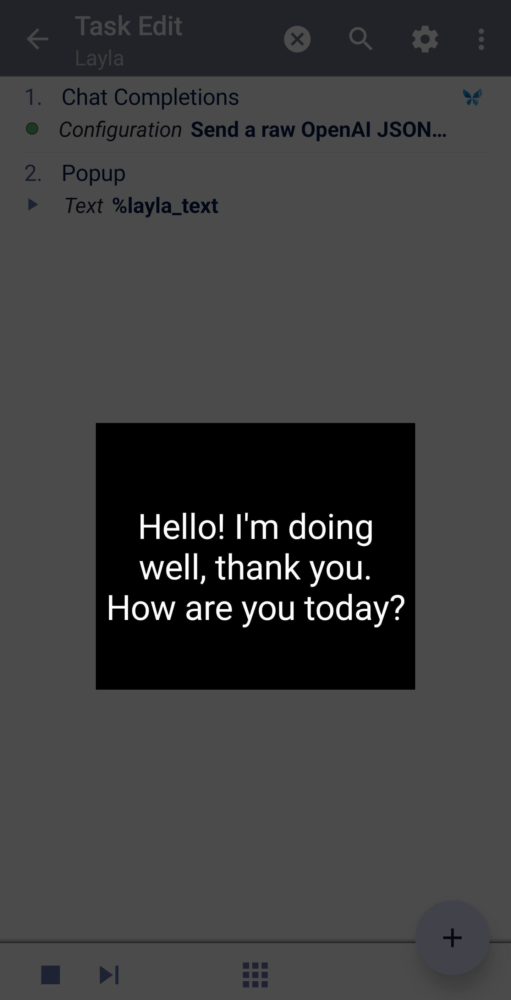

Layla에는 Android 자동화에 기기 내 AI를 추가해 주는 Tasker 플러그인이 포함되어 있습니다. Tasker 작업에서 로컬 LLM에 프롬프트를 보내고, 이미지·음성·음악을 생성하고, 채팅 기록을 읽고 쓰고, 기억을 저장하고, 캐릭터의 메시지를 예약할 수 있습니다. 기기에 있는 모델을 사용하면 이 모든 과정에서 온라인 서비스로 데이터가 전송되지 않습니다.

## Tasker란?

Tasker는 Android용으로 널리 쓰이는 자동화 앱입니다. 기기에서 특정 조건이 충족되면 실행되는 작업을 만들 수 있습니다. 예를 들어 새 이메일이 도착하면 Layla에게 요약을 요청하거나, 한 시간 뒤에 캐릭터가 알림 메시지를 보내도록 할 수 있습니다.

Layla는 모델을 로컬에서 실행하므로 이러한 자동화는 인터넷 연결 없이, 요청당 비용 없이 동작할 수 있습니다. Layla는 기본값으로 설정한 추론 엔진을 사용하므로, 작업은 채팅과 같은 설정을 따릅니다.

*참고: Tasker는 별도의 앱이며 [Google Play](https://play.google.com/store/apps/details?id=net.dinglisch.android.taskerm&hl=ko)에서 구매해야 합니다. Layla는 Tasker와 제휴 관계가 아닙니다.*

Tasker 연동은 Android에서만 사용할 수 있습니다.

## Layla와 Tasker로 무엇을 자동화할 수 있나요?

어떤 Tasker 트리거로든 Layla 액션을 시작할 수 있고, 그 결과를 작업의 다음 액션으로 넘길 수 있습니다. 몇 가지 예시입니다.

- **알림이나 이메일 요약.** 새 알림의 텍스트를 **Ask Layla**에 전달해 로컬 LLM이 한 문장으로 요약하게 합니다.
- **메시지 읽어 주기.** 수신한 텍스트를 **Speak Text**로 보내 Layla가 선택한 음성으로 읽어 주게 합니다.
- **메시지의 어조 확인.** **Analyze Sentiment**로 텍스트를 분석하고, 가장 강한 감정에 따라 작업을 분기합니다.
- **트리거로 이미지나 음악 생성.** 시간대나 캘린더 일정 같은 Tasker 변수로 만든 설명을 사용해 **Generate Image** 또는 **Generate Music**을 실행합니다.
- **캐릭터가 보내는 알림 예약.** **Schedule Character Message**로 캐릭터가 정해진 시간에 메시지를 보내게 합니다.
- **메모를 기억으로 저장.** **Remember Text**로 캐릭터의 장기 기억에 텍스트를 저장합니다.

## 단계별 안내: 첫 Layla 작업 만들기

이 안내에서는 Layla에 메시지를 보내고 답변을 화면에 표시하는 Tasker 작업을 만듭니다. 한 번 만들어 보면 다른 Layla 액션도 같은 방식으로 추가할 수 있습니다.

### 1단계: 작업을 만들고 액션 추가하기

Tasker를 열고 새 작업을 만든 다음 **+**를 눌러 액션을 추가합니다. Tasker가 액션 카테고리를 선택하라고 안내합니다. **Plugin**을 선택합니다.


### 2단계: Layla 선택하기

Tasker에 플러그인 액션을 제공하는 앱 목록이 표시됩니다. **Layla**를 누릅니다.


Layla가 목록에 없다면, 같은 기기에 Layla가 설치되어 있고 최신 버전인지 확인하세요.

### 3단계: 액션 선택하기

Layla의 모든 Tasker 액션이 표시됩니다. 이 안내에서는 **Chat Completions**를 선택합니다. 각 액션이 하는 일은 아래의 [사용 가능한 액션](#사용-가능한-액션)을 참고하세요.


이 목록에서 Tasker가 액션 이름에서 'Layla'를 생략할 수 있어, **Ask Layla**가 **Ask**로 표시될 수 있습니다.

### 4단계: 설정 열기

액션 페이지에서 **Configuration** 옆의 연필 아이콘을 누릅니다. 액션을 설정하는 Layla 자체 화면이 열립니다.


### 5단계: 요청을 입력하고 저장하기

Layla에 보낼 메시지를 입력합니다. 예를 들면 다음과 같습니다.

```
{"messages":[{"role":"user","content":"Hello, how are you?"}]}
```

텍스트 대신 `%prompt` 같은 Tasker 변수를 사용할 수도 있습니다. 변수에 들어 있는 따옴표나 줄바꿈이 문제를 일으키지 않도록 **JSON-escape variable values**는 켜 둔 상태로 두세요. 그런 다음 **Save**를 눌러 Tasker로 돌아갑니다.


타임아웃은 기본값이 **None**으로 설정되어 있습니다. 덕분에 Layla가 응답에 필요한 만큼 시간을 쓸 수 있습니다.

### 6단계: 결과 표시하기

Layla는 답변을 `%layla_text` 변수로 돌려줍니다. 이를 표시하려면 Chat Completions 뒤에 다른 액션을 추가합니다. **Alert** 카테고리에서 **Popup**을 선택하고 **Text**에 `%layla_text`를 입력합니다.


### 7단계: 작업 실행하기

작업 화면 하단의 재생 버튼을 누릅니다. Layla가 답변을 생성하고 Tasker가 팝업으로 표시합니다.



Layla가 모델을 불러와야 하므로 처음 실행할 때는 시간이 더 걸릴 수 있습니다.

## 변수와 출력 사용하기

Layla 액션의 모든 텍스트 입력란은 Tasker 변수를 지원하므로, 한 액션의 출력을 다음 액션에 전달할 수 있습니다. 예를 들어 알림의 텍스트를 변수에 담아 **Ask Layla**의 프롬프트로 사용할 수 있습니다.

각 액션은 결과를 Tasker 변수로 반환하며, 위 안내의 팝업처럼 뒤따르는 모든 액션에서 사용할 수 있습니다. Layla 액션은 Layla가 실행 중이 아니면 백그라운드에서 시작하므로, 먼저 앱을 열 필요가 없습니다.

## 사용 가능한 액션

### 채팅과 텍스트

| 액션 | 기능 |
| --- | --- |
| **Ask Layla** | Layla에 프롬프트(선택 사항으로 시스템 지침 포함)를 보내고 답변을 반환합니다. 각 요청은 독립적이며 채팅 기록을 읽거나 변경하지 않습니다. |
| **Analyze Sentiment** | 텍스트에 담긴 감정을 분석합니다. |
| **Chat Completions** | 여러 메시지로 이루어진 전체 채팅 요청을 받는 고급 액션으로, 대화 전체를 직접 지정하고 싶을 때 사용합니다. |

Tasker에서 LLM 프롬프트를 실행하려면 Ask Layla와 Chat Completions를 사용하세요. 이 액션들은 Layla에서 기본값으로 설정한 추론 엔진을 사용하므로, 기기의 로컬 모델을 Tasker에서 별도 설정 없이 사용할 수 있습니다.

**Ask Layla**가 반환하는 값:

- `%layla_text`: Layla의 답변.

**Analyze Sentiment**가 반환하는 값:

- `%layla_emotion`: 텍스트에서 발견된 가장 강한 감정.
- `%layla_emotion_score`: 해당 감정의 점수(0~1).
- `%layla_sentiment_joy`, `%layla_sentiment_sadness`처럼 각 감정별 점수.

### 음성, 이미지, 음악

이 액션들은 AI 음성 합성, 이미지 생성, 음악 생성을 Tasker로 가져옵니다. 이 액션이 사용하는 모델을 설정하는 방법은 [Layla에서 이미지 생성을 활성화하는 방법](/ko/how-to-enable-image-generation-in-layla/), [Layla에서 캐릭터의 목소리를 듣는 방법](/ko/how-to-hear-your-characters-speak-in-layla/), [Layla에서 ACE-Step으로 오프라인 음악을 생성하는 방법](/ko/how-to-generate-music-offline-in-layla-with-ace-step/)을 참고하세요.

| 액션 | 기능 |
| --- | --- |
| **Speak Text** | Layla의 음성으로 텍스트를 소리 내어 읽고, 읽기가 끝날 때까지 기다립니다. 음성을 비워 두면 기본 음성을 사용합니다. |
| **Generate Speech File** | 텍스트를 재생하지 않고 오디오 파일로 변환합니다. 음성은 선택 사항입니다. |
| **Generate Image** | 프롬프트로 이미지를 생성합니다. 이미지 모델은 선택 사항이며, 비워 두면 기본 모델을 사용합니다. |
| **Generate Music** | 스타일 설명으로 노래를 생성합니다. 가사, 초 단위 길이, 음악 모델은 선택 사항입니다. |

생성된 이미지와 오디오는 Tasker가 읽을 수 있는 파일로 반환됩니다.

- 이미지: `%layla_image_uri`, `%layla_image_mime`, `%layla_image_name`.
- 음성과 음악: `%layla_audio_uri`, `%layla_audio_mime`, `%layla_audio_name`.

이 파일들은 Layla의 캐시에 보관됩니다. Layla의 캐시를 지우거나 Android가 삭제할 때까지 남아 있으므로, 영구적으로 저장하려면 Tasker의 **Copy File** 액션을 사용하세요. 자동으로 재생되는 것은 없습니다.

음성 파일을 생성하려면 오디오 파일을 만들 수 있는 음성 합성 목소리가 필요합니다. 음악을 생성하려면 Layla에서 음악 생성 모델이 설정되어 있어야 합니다.

### 캐릭터, 채팅, 기억

| 액션 | 기능 |
| --- | --- |
| **List Characters** | 캐릭터의 이름과 ID를 반환합니다. |
| **List Chat Sessions** | 캐릭터의 채팅을 각 채팅의 최신 메시지와 함께 반환합니다. |
| **Get Chat History** | 채팅의 메시지를 반환합니다. 반환할 개수와 건너뛸 개수를 지정할 수 있습니다. |
| **Save Chat Message** | 사용자 또는 캐릭터의 메시지를 채팅에 추가합니다. 답변은 생성되지 않습니다. |
| **Remember Text** | 캐릭터에 새 기억을 추가합니다. 장기 기억 모델이 다운로드되어 있어야 합니다. |
| **Get Memories** | 캐릭터의 최근 기억 또는 상위 기억을 반환합니다. |
| **List Voices** | 사용 가능한 음성의 이름과 ID를 반환합니다. |

목록 액션은 결과를 서로 대응하는 배열로 반환합니다. 이름 배열의 1번째 항목은 ID 배열의 1번째 항목에 해당하며, 나머지도 마찬가지입니다.

- List Characters: `%layla_character_ids()`와 `%layla_character_names()`.
- List Chat Sessions: `%layla_session_ids()`와 `%layla_last_messages()`.
- List Voices: `%layla_voice_ids()`와 `%layla_voice_names()`.

이 액션들이 반환한 ID를 다른 액션에서 사용하세요. 예를 들어 **List Characters**로 캐릭터의 ID를 찾은 다음 **Remember Text**나 **Get Memories**에 전달합니다.

그 밖의 출력:

- Get Chat History: `%layla_text`는 오래된 순서부터 최신 순서로 정리된, 읽기 쉬운 대화 기록입니다.
- Get Memories: `%layla_memory_ids()`와 `%layla_memory_texts()`.
- Remember Text: `%layla_memory_id`와 `%layla_session_id`.
- Save Chat Message: `%layla_message_id`와 `%layla_session_id`.

알아 두면 좋은 점:

- **Save Chat Message**로 사용자 메시지를 추가하려면 기존 채팅이 필요합니다. 새 채팅을 시작하려면 새 세션 ID를 지정하고 먼저 캐릭터의 메시지를 저장하세요.
- **Get Memories**는 최근 기억 또는 순위가 높은 기억을 반환합니다. 텍스트로 기억을 검색하지는 않습니다.
- **Remember Text**는 요약 입력란을 비워 두면 기억의 요약을 대신 작성해 줄 수 있습니다.
- **Get Memories**의 타임스탬프는 Unix 밀리초를 사용합니다. Tasker 변수 `%TIMEMS`는 이 형식의 현재 시각을 제공합니다.

### 예약된 캐릭터 메시지

| 액션 | 기능 |
| --- | --- |
| **Schedule Character Message** | 캐릭터의 메시지가 미래의 지정한 시각에 전달되도록 예약합니다. |
| **List Scheduled Character Messages** | Tasker로 만들지 않은 것을 포함해, 예약되었거나 읽지 않은 캐릭터 메시지를 모두 나열합니다. |
| **Cancel Scheduled Character Message** | ID로 예약된 메시지를 취소합니다. |

예약하면 입력한 텍스트가 지정한 시각에 그대로 전달됩니다. 전달 시점에 Layla가 새 답변을 작성하지는 않습니다. 예약된 메시지를 전달하려면 Layla에 알림 권한이 필요합니다.

전달 시각은 밀리초 단위의 Unix 타임스탬프입니다. Tasker에서는 **Variable Set**과 **Do Maths**로 계산할 수 있습니다. 예를 들어 `%TIMEMS + 60000`은 지금부터 1분 뒤입니다. 이 변수를 전달 시각으로 지정하세요.

**Schedule Character Message**는 `%layla_scheduled_id`를 반환하며, 이를 사용해 나중에 메시지를 취소할 수 있습니다. 취소하면 아직 전달되지 않은 메시지가 삭제됩니다. 이미 표시된 알림은 닫히지 않습니다.

### 고급

| 액션 | 기능 |
| --- | --- |
| **Get Execution Context** | 기기에 설치된 Layla의 버전을 `%layla_app_version`으로 반환합니다. Tasker가 Layla에 연결할 수 있는지 확인할 때 유용합니다. |
| **Raw Layla API Request** | 개발자를 위해 Layla에 요청을 직접 보냅니다. 사용 가능한 내용은 [Layla SDK](https://github.com/l3utterfly/layla-sdk)를 참고하세요. |

## 오류와 타임아웃 처리

액션이 실패하면 Tasker가 `%err`와 `%errmsg`를 설정합니다. 작업을 계속 진행하면서 메시지를 읽으려면 해당 액션에서 **Continue Task After Error**를 켜세요.

Layla 액션은 작업이 끝날 때까지 기다리며, 이미지와 음악 생성은 시간이 꽤 걸릴 수 있습니다. 새 액션은 기본적으로 Tasker 타임아웃이 **None**, 즉 시간 제한이 없습니다. 대신 시간 제한을 설정하면 Layla가 이를 따릅니다.

## 예시: 알림에 응답하기

1. AutoNotification 같은 Tasker 플러그인으로 수신한 알림의 텍스트를 변수(예: `%ntext`)에 담습니다.
2. 프롬프트를 `Summarise this notification in one sentence: %ntext`로 지정해 **Ask Layla**를 추가합니다.
3. 요약을 화면에 표시하려면 `%layla_text`를 지정한 Tasker의 **Flash** 액션을, Layla가 소리 내어 읽게 하려면 **Speak Text**를 추가합니다.

## 팁

- Android의 백그라운드 제한은 계속 적용됩니다. 휴대폰이 유휴 상태일 때 액션이 실패한다면 배터리 최적화가 Layla를 제한하고 있지 않은지 확인하세요.
- 액션에 필요한 모델(이미지 모델, 음악 모델, 장기 기억 모델 등)을 먼저 Layla에서 다운로드해 두세요.
- 변수에는 따옴표, 줄바꿈 및 기타 특수 문자가 들어갈 수 있습니다. 표준 입력란에서는 Layla가 자동으로 처리합니다.

## 자주 묻는 질문

### 인터넷 연결 없이 Tasker에서 LLM을 사용할 수 있나요?

네. Layla의 기본 추론 엔진이 기기에 다운로드한 모델이라면 **Ask Layla** 같은 Tasker 액션은 전부 휴대폰에서 실행됩니다. 클라우드 또는 원격 엔진을 기본값으로 설정했다면 요청은 해당 엔진을 거칩니다.

### Layla를 Tasker와 함께 쓰려면 API 키가 필요한가요?

아니요. Layla의 Tasker 액션은 API 키를 요구하지 않습니다. Layla에 이미 설정된 추론 엔진을 사용합니다.

### Tasker 액션을 실행하려면 Layla를 열어 두어야 하나요?

아니요. 액션이 실행되면 Layla가 백그라운드에서 시작됩니다. Android의 백그라운드 제한은 계속 적용되므로, 휴대폰이 유휴 상태일 때 액션이 실패한다면 Layla의 배터리 설정을 확인하세요.

### Tasker에서 Layla로 이미지를 생성할 수 있나요?

네. 프롬프트와 필요하면 이미지 모델을 지정해 **Generate Image** 액션을 사용하세요. Tasker는 이미지를 파일로 받으며, 이를 복사하거나 공유하거나 이후 액션에서 사용할 수 있습니다. 먼저 모델을 설정하려면 [Layla에서 이미지 생성을 활성화하는 방법](/ko/how-to-enable-image-generation-in-layla/)을 참고하세요.

### Tasker에서 Layla가 말하게 하거나 음악을 만들게 할 수 있나요?

네. **Speak Text**는 Layla의 음성으로 읽어 주고, **Generate Speech File**은 음성을 오디오 파일로 저장하며, **Generate Music**은 설명과 선택 사항인 가사로 노래를 만듭니다.

### 생성된 이미지와 오디오 파일은 어디에 저장되나요?

Layla의 캐시에 저장되며, 캐시를 지우거나 Android가 삭제할 때까지 남아 있습니다. 영구적으로 보관하려면 Tasker의 **Copy File** 액션을 사용하세요.
