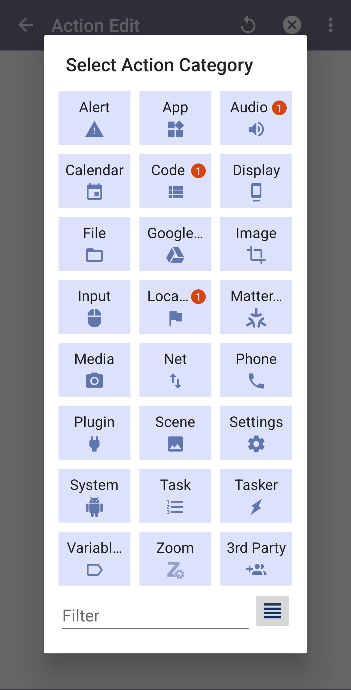

Layla is integrated with Tasker. Your automations can ask Layla a question, generate images, speech and music, read and write chat history, store memories, and schedule messages from your characters, all running on your device.

## What is Tasker?

Tasker is a popular Android app for automation. It lets you create tasks that run when a condition on your device is met. For example, you can ask Layla to summarise a new email when it arrives, or have a character send you a reminder in an hour.

*Note: Tasker is a separate app and requires a purchase from [Google Play](https://play.google.com/store/apps/details?id=net.dinglisch.android.taskerm&hl=en). Layla is not affiliated with Tasker.*

The Tasker integration is available on Android only.

## Step by step: create your first Layla task

This walkthrough creates a Tasker task that sends a message to Layla and shows the reply on screen. Once you have done this, adding any other Layla action works the same way.

### Step 1: Create a task and add an action

Open Tasker, create a new task, and tap **+** to add an action. Tasker asks you to select an action category. Choose **Plugin**.



### Step 2: Choose Layla

Tasker lists the apps that provide plugin actions. Tap **Layla**.


If Layla is not listed, make sure Layla is installed on the same device and is up to date.

### Step 3: Choose an action

Layla shows all of its Tasker actions. For this walkthrough, choose **Chat Completions**. See [Available actions](#available-actions) below for what each action does.


Tasker may drop "Layla" from an action's name in this list, so **Ask Layla** can appear as **Ask**.

### Step 4: Open the configuration

On the action's page, tap the pencil icon next to **Configuration**. This opens Layla's own screen for setting up the action.


### Step 5: Enter your request and save

Enter the message you want to send to Layla. For example:

```
{"messages":[{"role":"user","content":"Hello, how are you?"}]}
```

You can also use a Tasker variable in place of the text, such as `%prompt`. Keep **JSON-escape variable values** turned on so that quotes and line breaks in your variables do not cause problems. Then tap **Save** to return to Tasker.


The timeout is set to **None** by default. This lets Layla take as long as it needs to respond.

### Step 6: Show the result

Layla returns its reply in the variable `%layla_text`. To see it, add another action after Chat Completions: choose the **Alert** category, then **Popup**, and enter `%layla_text` as the **Text**.


### Step 7: Run the task

Tap the play button at the bottom of the task screen. Layla generates a reply and Tasker shows it in the popup.


The first run can take longer, because Layla needs to load its model.

## Using variables and outputs

Every text field in a Layla action accepts Tasker variables, so you can pass the output of one action into the next. For example, you can set a variable to the text of a notification, then use it as the prompt for **Ask Layla**.

Each action returns its results as Tasker variables, which you can use in any action that follows, as the popup did in the walkthrough above. Layla actions start Layla in the background if it is not already running, so you do not need to open the app first.

## Available actions

### Chat and text

| Action | What it does |
| --- | --- |
| **Ask Layla** | Sends a prompt, with optional system instructions, to Layla and returns the reply. Each request is standalone and does not read or change any chat history. |
| **Analyze Sentiment** | Analyses the emotions in a piece of text. |
| **Chat Completions** | An advanced action that accepts a full chat request with several messages, for when you want to supply the whole conversation yourself. |

Ask Layla and Chat Completions use the inference engine you have set as your default in Layla.

**Ask Layla** returns:

- `%layla_text`: the reply from Layla.

**Analyze Sentiment** returns:

- `%layla_emotion`: the strongest emotion found in the text.
- `%layla_emotion_score`: the score of that emotion, from 0 to 1.
- A score for each individual emotion, such as `%layla_sentiment_joy` or `%layla_sentiment_sadness`.

### Voice, images and music

| Action | What it does |
| --- | --- |
| **Speak Text** | Reads text aloud in Layla's voice and waits until speaking has finished. Leave the voice empty to use your default voice. |
| **Generate Speech File** | Turns text into an audio file without playing it. The voice is optional. |
| **Generate Image** | Generates an image from a prompt. The image model is optional; leave it empty to use your default. |
| **Generate Music** | Generates a song from a style description. Lyrics, duration in seconds and music model are optional. |

Generated images and audio are returned as files that Tasker can read:

- Images: `%layla_image_uri`, `%layla_image_mime` and `%layla_image_name`.
- Speech and music: `%layla_audio_uri`, `%layla_audio_mime` and `%layla_audio_name`.

These files are kept in Layla's cache. They stay there until you clear Layla's caches or Android removes them, so use Tasker's **Copy File** action to save them somewhere permanent. Nothing is played automatically.

Generating speech files requires a text-to-speech voice that can create audio files. Generating music requires the music generation model to be set up in Layla.

### Characters, chats and memories

| Action | What it does |
| --- | --- |
| **List Characters** | Returns the names and IDs of your characters. |
| **List Chat Sessions** | Returns the chats for a character, with the latest message in each. |
| **Get Chat History** | Returns the messages from a chat. You can choose how many to return and how many to skip. |
| **Save Chat Message** | Adds a message to a chat, either from you or from a character. This does not generate a reply. |
| **Remember Text** | Adds a new memory to a character. This requires the long-term memory model to be downloaded. |
| **Get Memories** | Returns a character's most recent memories, or its top memories. |
| **List Voices** | Returns the names and IDs of the available voices. |

The list actions return their results as matching arrays. The entry at position 1 of the names belongs to the entry at position 1 of the IDs, and so on:

- List Characters: `%layla_character_ids()` and `%layla_character_names()`.
- List Chat Sessions: `%layla_session_ids()` and `%layla_last_messages()`.
- List Voices: `%layla_voice_ids()` and `%layla_voice_names()`.

Use the IDs returned by these actions in the other actions. For example, run **List Characters** to find a character's ID, then pass it to **Remember Text** or **Get Memories**.

Other outputs:

- Get Chat History: `%layla_text` is a readable transcript from oldest to newest.
- Get Memories: `%layla_memory_ids()` and `%layla_memory_texts()`.
- Remember Text: `%layla_memory_id` and `%layla_session_id`.
- Save Chat Message: `%layla_message_id` and `%layla_session_id`.

A few things to know:

- **Save Chat Message** needs an existing chat to add a message from you. To start a new chat, supply a new session ID and save a message from a character first.
- **Get Memories** returns recent or top-ranked memories. It does not search memories by text.
- **Remember Text** can write the memory's summary for you if you leave the summary field empty.
- Timestamps in **Get Memories** use Unix milliseconds. The Tasker variable `%TIMEMS` gives the current time in this format.

### Scheduled character messages

| Action | What it does |
| --- | --- |
| **Schedule Character Message** | Schedules a message from a character to be delivered at a future time. |
| **List Scheduled Character Messages** | Lists all scheduled and unread character messages, including ones not created through Tasker. |
| **Cancel Scheduled Character Message** | Cancels a scheduled message using its ID. |

Scheduling delivers the exact text you provide at the time you choose. Layla does not write a new reply at delivery time. Layla needs notification permission to deliver scheduled messages.

The delivery time is a Unix timestamp in milliseconds. In Tasker, you can calculate it with **Variable Set** and **Do Maths**. For example, `%TIMEMS + 60000` is one minute from now. Pass that variable as the delivery time.

**Schedule Character Message** returns `%layla_scheduled_id`, which you can use to cancel the message later. Cancelling removes a message that has not been delivered yet. It does not dismiss a notification that has already appeared.

### Advanced

| Action | What it does |
| --- | --- |
| **Get Execution Context** | Returns the version of Layla installed on your device in `%layla_app_version`. This is useful for checking that Tasker can reach Layla. |
| **Raw Layla API Request** | Sends a request directly to Layla for developers. See the [Layla SDK](https://github.com/l3utterfly/layla-sdk) for what is available. |

## Handling errors and timeouts

If an action fails, Tasker sets `%err` and `%errmsg`. Turn on **Continue Task After Error** for the action if you want your task to carry on and read the message.

Layla actions wait for as long as the work takes, which can be a while for image and music generation. New actions use a Tasker timeout of **None** by default, which means no time limit. If you set a time limit instead, Layla honours it.

## Example: reply to a notification

1. Use a Tasker plugin such as AutoNotification to capture the text of an incoming notification into a variable, for example `%ntext`.
2. Add **Ask Layla** with the prompt `Summarise this notification in one sentence: %ntext`.
3. Add Tasker's **Flash** action with `%layla_text` to show the summary on screen, or **Speak Text** to have Layla read it out loud.

## Tips

- Android's background restrictions still apply. If actions fail when your phone is idle, check that battery optimisation is not restricting Layla.
- Make sure the models an action needs are downloaded in Layla first, such as an image model, a music model or the long-term memory model.
- Variables can contain quotes, line breaks and other special characters. Layla handles them for you in the standard fields.
